# 1차 인프라 구축

관리 VM `infra-son01`의 Test03 저장소 루트에서 작업합니다. Sandbox 프로젝트팀은 플랫폼 프로젝트를 관리합니다. Shared VPC 운영팀은 기존 호스트의 네트워크와 IAM 변경 요청을 처리하고, 필요한 경우 Private Pool 최초 생성을 담당합니다. 각 터미널에서 로그인 계정과 대상 프로젝트를 확인하고 필요한 명령을 한 줄씩 실행합니다.

**Private Pool** · 과제 자동화가 Private Pool 에서 GKE 로 접속하므로 3-17절에서 Pool 을 준비하고 접속을 확인합니다.

| 범위 | 명령서의 기본값 |
|---|---|
| 실행 위치 | 관리 VM `infra-son01`의 Test03 저장소 루트 |
| 플랫폼 프로젝트 | `SBX_GKE_PROJECT=gcp-sbx-gke01` · GKE, ALB, Cloud Build, Cloud Run, Workflows, GCS |
| 이미지 저장소 | `AR_PROJECT=gcp-prod-edp-edge-509423` 의 Artifact Registry (기존 자원 사용, 저장소 `AR_REPOSITORY`) |
| Shared VPC 호스트 | `VPC_HOST_PROJECT=gcp-prod-edp-hub-vpchost` · VPC, 서브넷, 방화벽, PSA |
| 로그인 계정 | `ADMIN_ACCOUNT=user01@sonmap.net`, `VPC_ADMIN_ACCOUNT=admin@sonmap.net`, `AR_ACCOUNT=user01@sonmap.net` |
| 작업 그룹 | `OPERATOR_MEMBER=group:pgrp-gcp-sbx01@sonmap.net` · 작업자 `user01@sonmap.net` 은 이 그룹 구성원 |
| 서비스 계정 | `TF_MANAGER=tf-manager@gcp-sbx-gke01.iam.gserviceaccount.com`, `SBX_MANAGER=sbx-manager@gcp-sbx-gke01.iam.gserviceaccount.com` |

**Cloud Shell 은 admin 으로 열립니다.** 실행 계정이 `user01` 인 블록은 `infra-son01` 에서, `admin` 인 블록은 Cloud Shell 또는 `infra-son01` 에서 실행합니다. 프로젝트 번호(`402269387486`)는 바뀌지 않으므로 블록에 값으로 적었습니다.

**모든 명령 블록은 혼자서 실행됩니다.** 첫 줄에 `# 실행 위치 | 대상 | 실행 계정 | 가장` 이 있고, 바로 아래에 그 블록이 쓰는 변수를 `export` 로 선언합니다. 앞 절의 변수가 남아 있지 않아도, 새 터미널이나 Cloud Shell 에서도 블록 하나만 붙여 넣으면 됩니다. 값을 바꿔야 하면 그 블록의 `export` 줄을 고칩니다.

 실행 위치는 터미널(`infra-son01` · Cloud Shell), 대상은 명령이 바꾸는 프로젝트나 자원, 실행 계정은 `gcloud` 가 쓰는 로그인 계정입니다. `가장`은 `--impersonate-service-account`로 API를 호출하는 계정이고, `워크로드 실행`은 `--service-account`로 지정하는 Build·Cloud Run·Workflows 실행 계정입니다. `--member`에 적힌 계정은 IAM 권한을 받는 주체입니다.

각 대제목 아래의 **내용 펼치기 / 접기**를 눌러 명령과 설명을 볼 수 있습니다.

**위에서부터 순서대로 실행합니다.** 뒤 절이 앞 절의 결과를 씁니다.

| 순서 | 절 | 내용 | 실행 위치 | 계정 |
|---|---|---|---|---|
| 1 | 0-0 | 프로젝트 확인, 작업 그룹 권한 | `infra-son01` | admin |
| 2 | 0-1 · 0-2 | 전체 변수 목록, 조회 확인 | `infra-son01` | user01 |
| 3 | 1-1 | API 활성화 | `infra-son01` | user01 |
| 4 | 1-2 | 서비스 에이전트 생성 | **Cloud Shell** | **admin** |
| 5 | 1-3 | `sbx-manager` · `tf-manager` 생성 | `infra-son01` | user01 |
| 6 | 1-4-1 | `tf-manager` 프로젝트 권한 | `infra-son01` | user01 |
| 7 | 1-4-2 | `tf-manager` 에 Workspace 그룹스 관리자 역할 | **admin.google.com** | 최고 관리자 |
| 8 | 1-5 ~ 1-7 | `sbx-manager` · `tf-manager` 나머지 권한 | `infra-son01` | user01 (1-6 은 admin) |
| 9 | 1-8 | 가장 권한 + **확인 3가지** (가장 · 그룹 조회 · 고객 ID) | `infra-son01` | user01 |
| 10 | 1-9 ~ 1-12 | 폴더 권한, GKE 노드 계정, (선택) 결제 | `infra-son01` | admin · user01 |
| 11 | 2장 | **2-3-0 Shared VPC 연결** → 서브넷 · 방화벽 · 서브넷 IAM · PSA · Private Google Access | `infra-son01` | admin (호스트 프로젝트) |
| 12 | 3-1 ~ 3-9 | 버킷 3개와 권한 | `infra-son01` | user01 → `tf-manager` 가장 |
| 13 | 3-10 ~ 3-12 | edge AR 확인, AR 권한 | Cloud Shell | edge 프로젝트 관리자 |
| 14 | 3-13 ~ 3-16 | OAuth Secret — **테스트 중 건너뜀** | | |
| 15 | 3-17 ~ 3-18 | Private Pool, GKE 클러스터 | `infra-son01` | admin · user01 |
| 16 | 3-19 ~ 3-26 | 이미지 빌드, Cloud Run, Workflow | `infra-son01` | user01 → `tf-manager` 가장 |
| 17 | 3-27 ~ | 내부 ALB, 인증서 | `infra-son01` | user01 → `tf-manager` 가장 |
| 18 | 4장 | Infrastructure Manager 조건 점검, StorageClass, 헬스 체크 (4-5 건너뜀) | `infra-son01` | user01 |
| 19 | 다음 문서 | [2차 과제 자동화](../03.sandbox_deploy/README.md) · [기존 과제 이전](../05.migration/README.md) | | |

기존 환경에서는 자원 조회 결과를 확인한 뒤 필요한 생성·갱신 명령만 실행합니다.

### 자주 나는 오류

| 오류 | 원인 | 조치 |
|---|---|---|
| `does not have permission to access projects instance [gcp-sbx-gke01]` | `user01` 그룹에 역할이 없음 | 0-0 의 2) `--apply` |
| `RESTRICTED_VIP_REQUEST_NOT_ALLOWED` · `not available on Google's Restricted VIPs` | `infra-son01` 의 API 경로가 그 명령(주로 `beta`) 또는 그 API(Cloud Identity 등)를 막음 | 그 명령만 Cloud Shell 에서 실행 (절에 적힌 계정으로) |
| `does not have any valid credentials` (Cloud Shell) | Cloud Shell 에 그 계정 로그인이 없음 (Cloud Shell 은 admin 으로 열림) | 블록의 `--account` 를 admin 으로 실행하거나 `gcloud auth login user01@sonmap.net` |
| `service-@…` 또는 `service-…@… does not exist` | 프로젝트 번호 조회가 실패했거나 서비스 에이전트가 없음 | 블록 첫 부분의 번호 조회 줄이 숫자를 내는지 확인, 1-2 실행 여부 확인 |
| `describe` 의 `NOT_FOUND` | 아직 없는 자원 조회 | 정상. 바로 다음 `create` 를 실행 |
| `create` 의 `already exists` · `conflict` | 이미 만든 자원을 다시 만듦 | 정상. 무시하고 다음으로 |
| `iam.serviceAccounts.getAccessToken denied` | `user01` 이 아직 `tf-manager` 를 가장할 수 없음 (1-8 전) | 1-8 까지 진행한 뒤 실행 |
| 만든 직후 `does not exist` · `getAccessToken denied` | IAM 반영 지연 | 1 ~ 2분 뒤 다시 실행 |

<a name="0-공통-변수"></a>

<a name="-0-공통-변수"></a>

## 0. 공통 변수

<details>
<summary>내용 펼치기 / 접기</summary>

### 0-0. 시작 전 — 프로젝트와 작업 그룹 권한

0-1 의 프로젝트 번호 조회부터 `user01@sonmap.net` 권한이 필요합니다. 그래서 **0-1 보다 먼저** 관리자 계정 `admin@sonmap.net` 으로 아래를 끝냅니다. 처음 한 번만 합니다.

| 계정 | 쓰는 곳 |
|---|---|
| `admin@sonmap.net` | 0-0, 1-2(Cloud Shell), Shared VPC 호스트 작업(`VPC_ADMIN_ACCOUNT`) |
| `user01@sonmap.net` | 그 밖의 모든 절 (`ADMIN_ACCOUNT`). 그룹 `pgrp-gcp-sbx01@sonmap.net` 구성원으로서 권한을 받음 |

```bash
# 실행 위치: infra-son01 (저장소 루트 ~/GCP_SBX_Test03) | 대상: gcp-sbx-gke01 | 실행 계정: admin@sonmap.net
cd ~/GCP_SBX_Test03 && git pull
gcloud auth login admin@sonmap.net
gcloud config set account admin@sonmap.net

# 1) 프로젝트 확인 → "gcp-sbx-gke01  ACTIVE" 가 나와야 합니다.
gcloud projects describe gcp-sbx-gke01 --format='value(projectId,lifecycleState)'
#    오류가 나면(프로젝트 없음) 만들고 결제 계정을 연결합니다.
# gcloud projects create gcp-sbx-gke01 --folder=154455658682
# gcloud billing projects link gcp-sbx-gke01 --billing-account="<결제 계정 ID>"

# 2) 작업 그룹에 역할 부여. 그룹은 Workspace 관리 콘솔에서 미리 만들고 user01 을 넣어 둡니다.
export SBX_GKE_PROJECT=gcp-sbx-gke01
export OPERATOR_MEMBER=group:pgrp-gcp-sbx01@sonmap.net
export IAM_ADMIN_ACCOUNT=admin@sonmap.net
./02.infra-setup/grant-operator-group.sh            # 계획: 역할 이름 → ID, "찾지 못함" 건수 확인
./02.infra-setup/grant-operator-group.sh --apply    # 부여. 마지막에 그룹의 현재 역할 목록 출력

# 3) user01 로 전환해 확인. 숫자(프로젝트 번호)가 나오면 성공입니다. 반영까지 몇 분 걸릴 수 있습니다.
gcloud auth login user01@sonmap.net
gcloud config set account user01@sonmap.net
gcloud config set project gcp-sbx-gke01
gcloud projects describe gcp-sbx-gke01 --format='value(projectNumber)'
```

- 3) 에서 `does not have permission` 이 나오면 2) 의 `--apply` 결과에 역할 목록이 나왔는지 봅니다. 비어 있으면 `--apply` 를 다시 실행합니다.
- `gcloud identity groups memberships list` 로 그룹을 조회하면 "그룹이 없다"고 나올 수 있습니다. admin 계정에 Workspace 그룹 조회 권한이 없을 때도 이렇게 나오므로, 그룹 확인은 Workspace 관리 콘솔에서 합니다.

각 블록이 필요한 변수를 스스로 선언하므로 새 터미널에서 0-1 을 다시 실행하지 않아도 됩니다. 0-1 은 전체 값을 한눈에 보는 목록입니다.

<a name="프로젝트-기준과-변수명"></a>

### 0-1. 프로젝트 기준과 변수명

이 작업의 주 대상은 **SBX_GKE_PROJECT=gcp-sbx-gke01**입니다. 공통 GKE와 Sandbox의 JupyterHub·Notebook Pod가 이 프로젝트에서 실행됩니다. 자동화 실행·이미지 보관은 SBX_GKE_PROJECT, Shared VPC는 VPC_HOST_PROJECT, 과제의 데이터·Query Job 자원은 2차 배포 요청의 `project.project_id`에 지정한 프로젝트에 둡니다. 신규 과제는 2차 Sandbox 배포에서 프로젝트를 생성하고, `10-project` Terraform이 필요한 API와 후속 배포용 프로젝트 IAM을 설정합니다.

```bash
# 실행 위치: infra-son01 | 대상: 없음 (변수 선언) | 실행 계정: 불필요
export SBX_GKE_PROJECT="gcp-sbx-gke01"              # 주 대상: Sandbox GKE
export AR_PROJECT="gcp-prod-edp-edge-509423"         # 이미지 저장소 (기존 edge AR 사용)
export SBX_NAME="sbx01"                      # 과제·Namespace 이름
export VPC_HOST_PROJECT="gcp-prod-edp-hub-vpchost"   # Shared VPC
```

변수명은 대소문자를 구분합니다. SBX_GKE_PROJECT를 모든 자동화·GKE 자원의 공통 프로젝트 변수로 사용합니다. Cloud Run API와 Build 배포 코드 사이의 실행 환경변수도 SBX_GKE_PROJECT로 통일했습니다. Cloud Build 사용자 치환 변수는 형식 제약에 맞춰 _SBX_GKE_PROJECT를 사용합니다. Cloud Run 설정과 API·배포 도구 이미지는 함께 갱신해야 합니다. JSON의 project.project_id·gke.project_id와 Terraform 입력 필드명은 포털 요청 규격이므로 유지합니다.

저장소 루트에서 아래 값을 확인한 뒤 블록을 복사합니다. 변수 지정과 프로젝트 번호 조회만 수행하며 자원은 생성하지 않습니다. 새로운 터미널에서는 다시 설정합니다. 이 값은 기존 PoC 기준이며 프로젝트·GKE 변경은 런타임 Schema와 YAML 입력 파일도 함께 맞춰야 합니다.

```bash
unset CLOUDSDK_AUTH_IMPERSONATE_SERVICE_ACCOUNT
export ADMIN_ACCOUNT=user01@sonmap.net
# 실행 프로젝트 작업자는 user01(그룹 pgrp-gcp-sbx01), Shared VPC·초기 권한 관리자는 admin으로 구분합니다.
export VPC_ADMIN_ACCOUNT="${VPC_ADMIN_ACCOUNT:-admin@sonmap.net}"
export OPERATOR_MEMBER=group:pgrp-gcp-sbx01@sonmap.net
export SBX_GKE_PROJECT="gcp-sbx-gke01"
export AR_PROJECT="gcp-prod-edp-edge-509423"
export AR_REPOSITORY="ar-sbxtest01-platform"
export VPC_HOST_PROJECT="gcp-prod-edp-hub-vpchost"
export FOLDER_ID=154455658682
export REGION=asia-northeast3
export NETWORK=vpc-prod-edp-hub
# 내부 ALB 대역 후보: VPC Admin의 실제 중복 확인·승인 후 실행합니다.
export ILB_VIP_SUBNET=subnet-prod-edp-alb-frontend-an3
export ILB_VIP_CIDR=172.31.96.0/27
export ILB_VIP_ADDRESS="" # 예약 후 실제 할당 주소 조회
export ILB_PROXY_SUBNET=subnet-prod-sbx-ilb-proxy
export ILB_PROXY_CIDR=172.31.111.64/26
export MAIN_CLUSTER=gke-sbx-main-an3
export MAIN_SUBNET=subnet-prod-sbx-gke-01
export MAIN_NODE_CIDR=10.252.0.0/24
export MAIN_POD_RANGE=subnet-prod-sbx-pod-01
export MAIN_POD_CIDR=100.64.128.0/19
export MAIN_CP_CIDR=10.253.3.0/28
export PSA_NAME=psa-prod-edp-cloudbuild
export PSA_CIDR=10.250.0.0/24
export ADMIN_CIDR=172.31.10.0/24
export BILLING_ACCOUNT=""
export TF_MANAGER="tf-manager@${SBX_GKE_PROJECT}.iam.gserviceaccount.com"
export SBX_MANAGER="sbx-manager@${SBX_GKE_PROJECT}.iam.gserviceaccount.com"
export PSA_ADDRESS="10.250.0.0"
export PSA_PREFIX_LENGTH="24"
# 실행 위치: infra-son01 | 대상: gcp-sbx-gke01 | 실행 계정: user01@sonmap.net
export SBX_GKE_PROJECT_NUMBER="402269387486"   # gcp-sbx-gke01 프로젝트 번호 (바뀌지 않음. 확인: gcloud projects describe gcp-sbx-gke01 --format='value(projectNumber)')
```

<a name="조회-결과-확인"></a>

### 0-2. 조회 결과 확인

```bash
export SBX_GKE_PROJECT="gcp-sbx-gke01"
# 실행 위치: infra-son01 | 대상: 로컬 gcloud 설정 | 실행 계정: VM 로그인 사용자
export ADMIN_ACCOUNT="user01@sonmap.net"
gcloud auth list
# 실행 위치: infra-son01 | 대상: gcp-sbx-gke01 | 실행 계정: user01@sonmap.net
gcloud projects describe "${SBX_GKE_PROJECT}" --account="${ADMIN_ACCOUNT}" \
  --format='table(projectId,projectNumber)'
```

프로젝트 번호가 숫자가 아니거나 조회가 실패하면 1단계로 진행하지 않습니다. 서비스 계정 표시 이름은 sbx_manager/tf_manager, 실제 ID는 sbx-manager/tf-manager입니다. 관리자는 여러 프로젝트와 Folder/Billing 범위에 필요한 기존 권한을 보유해야 합니다. Google 서비스 에이전트·노드 기본 SA와 Kubernetes KSA는 두 사용자 관리 계정과 별개입니다.

실행 순서: [1 관리자](#1-api와-관리자-권한) → [2 네트워크](#2-shared-vpc와-네트워크) → [2-2 서브넷별 IAM](#2-2-서브넷별-iam) → [3 공통 기반](#3-공통-기반).

</details>

<a name="1-api와-관리자-권한"></a>

<a name="-1-api와-관리자-권한"></a>

## 1. API와 관리자 권한

<details>
<summary>내용 펼치기 / 접기</summary>

API 활성화 후 서비스 에이전트와 사용자 관리 서비스 계정을 준비합니다. 작업에 필요한 IAM을 프로젝트·폴더·Shared VPC 범위별로 적용합니다.

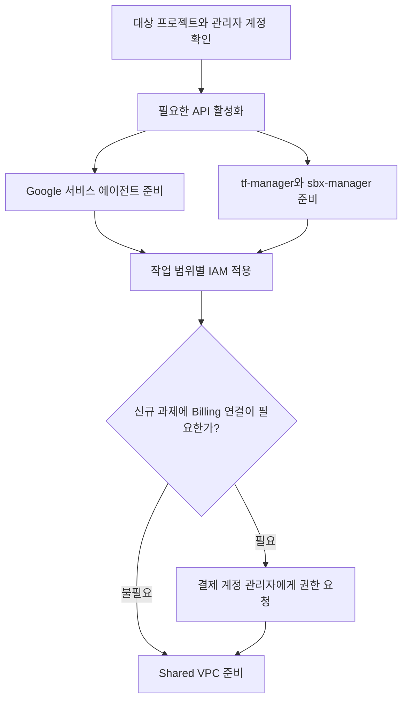

필요한 변수 선언을 아래 코드 블록 맨 앞에 포함했습니다. 별도 문서에서 변수를 설정할 필요 없이, 이 문서의 선언부터 같은 터미널에서 실행합니다. 변수 선언을 실행한 다음 각 단계의 `# 주석`을 보며 순서대로 실행합니다. **계정이 이미 있으면 해당 create 명령을 건너뜁니다.** Billing은 필요한 경우에만 주석을 해제합니다.

```bash
# ── 이 문서에서 사용하는 변수 선언 ──
# 아래 값을 확인하고 이 블록부터 같은 터미널에서 실행합니다.
unset CLOUDSDK_AUTH_IMPERSONATE_SERVICE_ACCOUNT
export ADMIN_ACCOUNT=user01@sonmap.net
# 실행 프로젝트 작업자는 user01(그룹 pgrp-gcp-sbx01), Shared VPC·초기 권한 관리자는 admin으로 구분합니다.
export VPC_ADMIN_ACCOUNT="${VPC_ADMIN_ACCOUNT:-admin@sonmap.net}"
export OPERATOR_MEMBER=group:pgrp-gcp-sbx01@sonmap.net
export SBX_GKE_PROJECT="gcp-sbx-gke01"
export AR_PROJECT="gcp-prod-edp-edge-509423"
export AR_REPOSITORY="ar-sbxtest01-platform"
export VPC_HOST_PROJECT="gcp-prod-edp-hub-vpchost"
export FOLDER_ID=154455658682
export BILLING_ACCOUNT=""
export TF_MANAGER="tf-manager@${SBX_GKE_PROJECT}.iam.gserviceaccount.com"
export SBX_MANAGER="sbx-manager@${SBX_GKE_PROJECT}.iam.gserviceaccount.com"
# 실행 위치: infra-son01 | 대상: gcp-sbx-gke01 | 실행 계정: user01@sonmap.net
export SBX_GKE_PROJECT_NUMBER="402269387486"   # gcp-sbx-gke01 프로젝트 번호 (바뀌지 않음. 확인: gcloud projects describe gcp-sbx-gke01 --format='value(projectNumber)')
# 프로젝트 번호는 자동 조회합니다. 조회 실패 또는 숫자가 아닌 결과이면 이후 명령을 중단합니다.

```

<a name="-1-필요한-api-활성화--cicd--shared-vpc-host--gke-프로젝트"></a>

<a name="1-필요한-api-활성화--cicd--shared-vpc-host--gke-프로젝트"></a>

### 1-1. 필요한 API 활성화 — CI/CD · Shared VPC Host · GKE 프로젝트

두 활성화 명령의 대상은 플랫폼 프로젝트 `gcp-sbx-gke01`입니다. 도식의 짧은 이름은 명령에 나오는 `*.googleapis.com` 서비스 ID의 앞부분입니다.

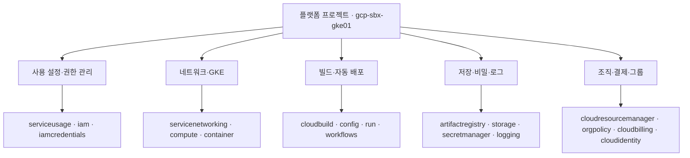

`config`는 Infrastructure Manager에 사용합니다. 과제의 모든 Terraform 단계(05 · 10 · 30 · 40 · 50)가 Infrastructure Manager 배포로 실행되고 State 도 그 배포 안에 있습니다. Shared VPC 호스트의 네트워크·DNS 준비는 [2절](#2-shared-vpc와-네트워크)에서 진행합니다. `certificatemanager.googleapis.com`은 [3-32절 인증서 준비](#3-32-regional-ssl-인증서-확인-및-등록)에서 별도로 활성화합니다.

```bash
# [infra-son01] 플랫폼 운영자 · 대상 ${SBX_GKE_PROJECT}
# 실행 위치: infra-son01 | 대상: gcp-sbx-gke01 | 실행 계정: user01@sonmap.net
export SBX_GKE_PROJECT="gcp-sbx-gke01"
export ADMIN_ACCOUNT="user01@sonmap.net"
gcloud services enable servicenetworking.googleapis.com serviceusage.googleapis.com iam.googleapis.com \
  iamcredentials.googleapis.com compute.googleapis.com container.googleapis.com \
  cloudbuild.googleapis.com config.googleapis.com run.googleapis.com workflows.googleapis.com \
  artifactregistry.googleapis.com secretmanager.googleapis.com storage.googleapis.com \
  logging.googleapis.com cloudresourcemanager.googleapis.com cloudbilling.googleapis.com \
  cloudidentity.googleapis.com --project="${SBX_GKE_PROJECT}" --account="${ADMIN_ACCOUNT}"
gcloud services enable container.googleapis.com compute.googleapis.com iam.googleapis.com \
  iamcredentials.googleapis.com cloudresourcemanager.googleapis.com orgpolicy.googleapis.com \
  --project="${SBX_GKE_PROJECT}" --account="${ADMIN_ACCOUNT}"

```

<a name="-2-google-서비스-에이전트-준비--api별로-필요한-시스템-계정"></a>

<a name="2-google-서비스-에이전트-준비--api별로-필요한-시스템-계정"></a>

### 1-2. Google 서비스 에이전트 준비 — API별로 필요한 시스템 계정

서비스 에이전트는 Google 서비스가 **프로젝트 안에서 대신 일할 때 쓰는 시스템 계정**입니다(`service-<프로젝트 번호>@<서비스 도메인>`). 대부분 처음 쓸 때 자동으로 생기지만, 뒤 절(1-4, 1-8, 2장, 3-12)에서 이 계정들에 권한을 먼저 줘야 하므로 여기서 미리 만듭니다. 없는 상태에서 권한을 주면 `service-…@… does not exist` 오류가 납니다.

| 서비스 | 에이전트가 하는 일 |
|---|---|
| Cloud Build | 빌드 실행, Private Pool 연결 |
| Service Networking | VPC 와 Google 관리 네트워크 피어링 (Private Pool 의 PSA 대역) |
| Infrastructure Manager (`config`) | 과제 Terraform 05 ~ 50 실행, State 보관 |
| Cloud Run | Provisioner 실행, 이미지 받기 |
| Workflows | 요청 워크플로 실행 |
| GKE (`container`) | 노드 · 디스크 · Shared VPC 서브넷 사용 |

> **이 절만 Cloud Shell 에서, admin 계정으로 실행합니다.**
> - `infra-son01` 에서는 실행되지 않습니다. VM 이 Google API 를 `restricted.googleapis.com` 으로 호출하는데, 이 경로가 `beta services identity create` 를 `RESTRICTED_VIP_REQUEST_NOT_ALLOWED` 로 거부합니다. 권한이 아니라 경로 문제입니다.
> - Cloud Shell 은 브라우저에 로그인한 계정(admin)으로 열립니다. `user01` 로 바꾸면 로그인 정보가 없어 `does not have any valid credentials` 가 납니다.
>
> 콘솔(https://console.cloud.google.com) 오른쪽 위 `>_` 를 눌러 Cloud Shell 을 연 뒤 아래 블록을 그대로 붙여 넣습니다. 변수 블록은 필요 없습니다.

```bash
# 실행 위치: Cloud Shell | 대상: gcp-sbx-gke01 | 실행 계정: admin@sonmap.net
gcloud config set account admin@sonmap.net
gcloud config set project gcp-sbx-gke01
PROJECT_NUMBER="402269387486"   # gcp-sbx-gke01 프로젝트 번호 (바뀌지 않음. 확인: gcloud projects describe gcp-sbx-gke01 --format='value(projectNumber)')
echo "project number: ${PROJECT_NUMBER}"        # 숫자가 나와야 합니다

for svc in cloudbuild servicenetworking config run workflows container; do
  gcloud beta services identity create --service=${svc}.googleapis.com --project=gcp-sbx-gke01
done

# Service Networking 에이전트의 역할 (사용자 계정에는 주지 않습니다)
gcloud projects add-iam-policy-binding gcp-sbx-gke01 \
  --member="serviceAccount:service-${PROJECT_NUMBER}@service-networking.iam.gserviceaccount.com" \
  --role=roles/servicenetworking.serviceAgent --condition=None --format=none
```

서비스마다 `Service identity created: service-<번호>@…` 가 나오면 성공입니다. 이 절은 프로젝트당 한 번이면 됩니다. 이후는 다시 `infra-son01` 에서 `user01` 로 진행합니다.

<a name="-3-사용자-관리-서비스-계정--sbx-manager--tf-manager"></a>

<a name="3-사용자-관리-서비스-계정--sbx-manager--tf-manager"></a>

### 1-3. 사용자 관리 서비스 계정 — sbx-manager · tf-manager

자동화가 쓰는 계정 두 개를 만듭니다. 권한은 1-4 절부터 줍니다.

| 계정 | 쓰는 곳 | 하는 일 |
|---|---|---|
| `sbx-manager` | Cloud Run (Provisioner) · Workflows | 요청 검증, 번들 생성, 배포 빌드 시작. 자원을 직접 만들지 않음 |
| `tf-manager` | Infrastructure Manager · Cloud Build | 실제 자원 생성 (그룹 · 프로젝트 · 데이터 · GKE 워크로드 · ALB 연결). 명령서의 `--impersonate-service-account` 대상 |

요청을 받는 쪽(`sbx-manager`)과 자원을 바꾸는 쪽(`tf-manager`)을 나눠, 요청 처리 쪽이 뚫려도 자원을 직접 바꿀 수 없게 합니다.

```bash

# 실행 위치: infra-son01 | 대상: gcp-sbx-gke01 | 실행 계정: user01@sonmap.net
export SBX_GKE_PROJECT="gcp-sbx-gke01"
export ADMIN_ACCOUNT="user01@sonmap.net"
# 있으면 "exists" 만 출력하고, 없을 때만 만듭니다. 블록 전체를 몇 번 붙여 넣어도 됩니다.
for sa in sbx-manager tf-manager; do
  email="${sa}@${SBX_GKE_PROJECT}.iam.gserviceaccount.com"
  if gcloud iam service-accounts describe "$email" --project="${SBX_GKE_PROJECT}" \
       --account="${ADMIN_ACCOUNT}" --format='value(email)' 2>/dev/null; then
    echo "exists: $email"
  else
    gcloud iam service-accounts create "$sa" --project="${SBX_GKE_PROJECT}" \
      --display-name="${sa//-/_}" --account="${ADMIN_ACCOUNT}"
  fi
done

```

처음에는 `Created service account [...]`, 다시 실행하면 `exists: …` 가 나옵니다. 둘 다 정상입니다. `PERMISSION_DENIED` 가 나오면 0-0 의 3) 부터 다시 확인합니다.

만든 직후 다음 절에서 `does not exist` 가 나오면 1분쯤 기다렸다가 같은 명령을 다시 실행합니다.

<a name="-4-tf-manager-권한--cicd-기반-구축--build--infrastructure-manager"></a>

<a name="4-tf-manager-권한--cicd-기반-구축--build--infrastructure-manager"></a>

### 1-4. tf-manager 권한 — CI/CD 기반 구축 · Build · Infrastructure Manager

#### 1-4-1. GCP 프로젝트 IAM 역할 부여

```bash
# 실행 위치: infra-son01 | 대상: gcp-sbx-gke01 | 실행 계정: user01@sonmap.net
export SBX_GKE_PROJECT="gcp-sbx-gke01"
export ADMIN_ACCOUNT="user01@sonmap.net"
export TF_MANAGER="tf-manager@gcp-sbx-gke01.iam.gserviceaccount.com"
gcloud projects add-iam-policy-binding "${SBX_GKE_PROJECT}" --member="serviceAccount:${TF_MANAGER}" \
  --role=roles/serviceusage.serviceUsageAdmin --condition=None --account="${ADMIN_ACCOUNT}"
gcloud projects add-iam-policy-binding "${SBX_GKE_PROJECT}" --member="serviceAccount:${TF_MANAGER}" \
  --role=roles/iam.serviceAccountAdmin --condition=None --account="${ADMIN_ACCOUNT}"
gcloud projects add-iam-policy-binding "${SBX_GKE_PROJECT}" --member="serviceAccount:${TF_MANAGER}" \
  --role=roles/resourcemanager.projectIamAdmin --condition=None --account="${ADMIN_ACCOUNT}"
gcloud projects add-iam-policy-binding "${SBX_GKE_PROJECT}" --member="serviceAccount:${TF_MANAGER}" \
  --role=roles/storage.admin --condition=None --account="${ADMIN_ACCOUNT}"
gcloud projects add-iam-policy-binding "${SBX_GKE_PROJECT}" --member="serviceAccount:${TF_MANAGER}" \
  --role=roles/secretmanager.admin --condition=None --account="${ADMIN_ACCOUNT}"
gcloud projects add-iam-policy-binding "${SBX_GKE_PROJECT}" --member="serviceAccount:${TF_MANAGER}" \
  --role=roles/artifactregistry.admin --condition=None --account="${ADMIN_ACCOUNT}"
gcloud projects add-iam-policy-binding "${SBX_GKE_PROJECT}" --member="serviceAccount:${TF_MANAGER}" \
  --role=roles/cloudbuild.builds.editor --condition=None --account="${ADMIN_ACCOUNT}"
gcloud projects add-iam-policy-binding "${SBX_GKE_PROJECT}" --member="serviceAccount:${TF_MANAGER}" \
  --role=roles/cloudbuild.workerPoolUser --condition=None --account="${ADMIN_ACCOUNT}"
gcloud projects add-iam-policy-binding "${SBX_GKE_PROJECT}" --member="serviceAccount:${TF_MANAGER}" \
  --role=roles/config.admin --condition=None --account="${ADMIN_ACCOUNT}"
gcloud projects add-iam-policy-binding "${SBX_GKE_PROJECT}" --member="serviceAccount:${TF_MANAGER}" \
  --role=roles/config.agent --condition=None --account="${ADMIN_ACCOUNT}"
gcloud projects add-iam-policy-binding "${SBX_GKE_PROJECT}" --member="serviceAccount:${TF_MANAGER}" \
  --role=roles/run.admin --condition=None --account="${ADMIN_ACCOUNT}"
gcloud projects add-iam-policy-binding "${SBX_GKE_PROJECT}" --member="serviceAccount:${TF_MANAGER}" \
  --role=roles/workflows.admin --condition=None --account="${ADMIN_ACCOUNT}"
gcloud projects add-iam-policy-binding "${SBX_GKE_PROJECT}" --member="serviceAccount:${TF_MANAGER}" \
  --role=roles/container.admin --condition=None --account="${ADMIN_ACCOUNT}"
gcloud projects add-iam-policy-binding "${SBX_GKE_PROJECT}" --member="serviceAccount:${TF_MANAGER}" \
  --role=roles/compute.viewer --condition=None --account="${ADMIN_ACCOUNT}"
gcloud projects add-iam-policy-binding "${SBX_GKE_PROJECT}" --member="serviceAccount:${TF_MANAGER}" \
  --role=roles/logging.logWriter --condition=None --account="${ADMIN_ACCOUNT}"
gcloud projects add-iam-policy-binding "${SBX_GKE_PROJECT}" --member="serviceAccount:${TF_MANAGER}" \
  --role=roles/serviceusage.serviceUsageConsumer --condition=None --account="${ADMIN_ACCOUNT}"
# 리전 Google 관리형 인증서와 DNS 승인을 관리하는 권한입니다.
gcloud projects add-iam-policy-binding "${SBX_GKE_PROJECT}" --member="serviceAccount:${TF_MANAGER}" \
  --role=roles/certificatemanager.editor --condition=None --account="${ADMIN_ACCOUNT}"

```

<a name="5-1-tf-manager에-그룹스-관리자-역할-부여"></a>

#### 1-4-2. Google Workspace 그룹스 관리자 역할 부여

기존 과제별 자동 배포에서 `tf-manager`가 Workspace 그룹을 생성해야 할 때 1회 수행합니다. 1-4-1절은 **GCP 프로젝트 IAM**, 이 절은 **Google Workspace 디렉터리 관리자 역할**을 설정합니다.

Workspace 최고 관리자로 [admin.google.com/ac/roles](https://admin.google.com/ac/roles)에 접속합니다.

| 순서 | 화면 |
|---|---|
| 1 | **계정 → 관리자 역할** |
| 2 | **그룹스 관리자**(Groups Administrator) 선택 — `그룹스 리더`·`그룹스 편집자`는 생성 권한이 없습니다 |
| 3 | **Admins** 카드 → **서비스 계정** 탭 → **서비스 계정 할당** → **서비스 계정 추가** 화면 |
| 4 | `tf-manager@gcp-sbx-gke01.iam.gserviceaccount.com` 입력 후 **추가** |
| 5 | 조직 단위 `모든 조직 단위`, 만료 `사용 안함` 확인 후 **역할 지정** |

입력란은 **이메일 주소**를 받습니다. 서비스 계정의 uniqueId(숫자)를 넣으면 `올바른 이메일 주소를 입력하세요`로 거부됩니다. 목록에 계정이 표시되면 우측 하단 **역할 지정**을 눌러 저장합니다.

**부여 확인은 1-8 끝에서 합니다.** 확인 명령은 `user01` 이 `tf-manager` 를 가장해서 실행하는데, 그 가장 권한이 1-8 에서 생기기 때문입니다. 지금 실행하면 `iam.serviceAccounts.getAccessToken denied` 가 납니다.

<a name="-5-sbx-manager-권한--요청-처리--workflow--build-제출"></a>

<a name="5-sbx-manager-권한--요청-처리--workflow--build-제출"></a>

### 1-5. sbx-manager 권한 — 요청 처리 · Workflow · Build 제출

```bash
# 실행 위치: infra-son01 | 대상: gcp-sbx-gke01 | 실행 계정: user01@sonmap.net
export SBX_GKE_PROJECT="gcp-sbx-gke01"
export ADMIN_ACCOUNT="user01@sonmap.net"
export SBX_MANAGER="sbx-manager@gcp-sbx-gke01.iam.gserviceaccount.com"
gcloud projects add-iam-policy-binding "${SBX_GKE_PROJECT}" --member="serviceAccount:${SBX_MANAGER}" \
  --role=roles/cloudbuild.builds.editor --condition=None --account="${ADMIN_ACCOUNT}"
gcloud projects add-iam-policy-binding "${SBX_GKE_PROJECT}" --member="serviceAccount:${SBX_MANAGER}" \
  --role=roles/cloudbuild.workerPoolUser --condition=None --account="${ADMIN_ACCOUNT}"
gcloud projects add-iam-policy-binding "${SBX_GKE_PROJECT}" --member="serviceAccount:${SBX_MANAGER}" \
  --role=roles/workflows.invoker --condition=None --account="${ADMIN_ACCOUNT}"
gcloud projects add-iam-policy-binding "${SBX_GKE_PROJECT}" --member="serviceAccount:${SBX_MANAGER}" \
  --role=roles/logging.logWriter --condition=None --account="${ADMIN_ACCOUNT}"
gcloud projects add-iam-policy-binding "${SBX_GKE_PROJECT}" --member="serviceAccount:${SBX_MANAGER}" \
  --role=roles/serviceusage.serviceUsageConsumer --condition=None --account="${ADMIN_ACCOUNT}"

```

<a name="-6-shared-vpc-운영팀-요청-및-private-pool-초기-구성-권한-보류"></a>

<a name="6-shared-vpc-운영팀-요청-및-private-pool-초기-구성-권한-보류"></a>

### 1-6. Shared VPC 운영팀 요청 및 Private Pool 초기 구성 권한 (보류)

[2-1절 요청 양식](#2-1-shared-vpc-운영팀-요청-양식)에 [2-2절 서브넷 IAM](#2-2-서브넷별-iam)을 포함해 운영팀에 전달합니다. Private Pool을 운영팀이 서비스 프로젝트에 처음 만드는 경우에만 프로젝트 관리자가 아래 명령으로 운영팀 작업 계정에 권한을 부여합니다. **이번 구축에서는 아래 권한 부여 명령을 건너뜁니다.** 추후 필요할 때 `VPC_ADMIN_ACCOUNT`를 운영팀이 지정한 계정으로 설정합니다.

```bash
# 실행 위치: infra-son01 | 대상: gcp-sbx-gke01 | 실행 계정: user01@sonmap.net
export SBX_GKE_PROJECT="gcp-sbx-gke01"
export ADMIN_ACCOUNT="user01@sonmap.net"
export VPC_ADMIN_ACCOUNT="admin@sonmap.net"
gcloud projects add-iam-policy-binding "${SBX_GKE_PROJECT}" --member="user:${VPC_ADMIN_ACCOUNT}" \
  --role=roles/cloudbuild.workerPoolOwner --condition=None --account="${ADMIN_ACCOUNT}"
gcloud projects add-iam-policy-binding "${SBX_GKE_PROJECT}" --member="user:${VPC_ADMIN_ACCOUNT}" \
  --role=roles/serviceusage.serviceUsageConsumer --condition=None --account="${ADMIN_ACCOUNT}"
```

<a name="-7-tf-manager-권한--gke--공통-로드밸런서"></a>

<a name="7-tf-manager-권한--gke--공통-로드밸런서"></a>

### 1-7. tf-manager 권한 — GKE · 공통 로드밸런서

```bash
# 실행 위치: infra-son01 | 대상: gcp-sbx-gke01 | 실행 계정: user01@sonmap.net
export SBX_GKE_PROJECT="gcp-sbx-gke01"
export ADMIN_ACCOUNT="user01@sonmap.net"
export TF_MANAGER="tf-manager@gcp-sbx-gke01.iam.gserviceaccount.com"
gcloud projects add-iam-policy-binding "${SBX_GKE_PROJECT}" --member="serviceAccount:${TF_MANAGER}" \
  --role=roles/compute.loadBalancerAdmin --condition=None --account="${ADMIN_ACCOUNT}"

```

<a name="-8-서비스-계정-사용위임-권한--운영자--두-계정--서비스-에이전트"></a>

<a name="8-서비스-계정-사용위임-권한--운영자--두-계정--서비스-에이전트"></a>

### 1-8. 서비스 계정 사용·위임 권한 — 운영자 · 두 계정 · 서비스 에이전트

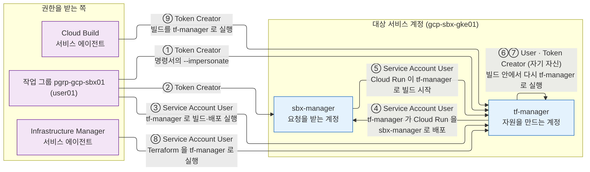

화살표 하나가 아래 명령 한 줄이고, **"누가 → 어느 계정을 쓸 수 있게 되는가"** 를 뜻합니다. 번호는 명령 순서입니다.

| 역할 | 할 수 있는 일 |
|---|---|
| Token Creator | 그 계정의 토큰을 받아 그 계정으로 직접 API 호출 (`--impersonate-service-account`) |
| Service Account User | 그 계정을 빌드 · Cloud Run 등의 실행 계정으로 지정 (`--service-account`) |

| # | 받는 쪽 → 대상 | 역할 | 쓰이는 곳 |
|---|---|---|---|
| ① | 작업 그룹 → `tf-manager` | Token Creator | 명령서의 `tf-manager` 가장 전부 |
| ② | 작업 그룹 → `sbx-manager` | Token Creator | `sbx-manager` 로 동작 확인 |
| ③ | 작업 그룹 → `tf-manager` | Service Account User | `tf-manager` 로 실행되는 빌드 · 배포 제출 |
| ④ | `tf-manager` → `sbx-manager` | Service Account User | Cloud Run 을 `sbx-manager` 로 배포 (3-20) |
| ⑤ | `sbx-manager` → `tf-manager` | Service Account User | Cloud Run 이 과제 배포 빌드를 `tf-manager` 로 시작 |
| ⑥⑦ | `tf-manager` → 자기 자신 | User · Token Creator | 빌드 안에서 Infrastructure Manager 를 `tf-manager` 로 실행 |
| ⑧ | Infrastructure Manager 에이전트 → `tf-manager` | Service Account User | Terraform(05 ~ 50) 실행 |
| ⑨ | Cloud Build 에이전트 → `tf-manager` | Token Creator | Private Pool 빌드 실행 |

⑧⑨ 의 서비스 에이전트는 1-2 에서 만든 계정입니다. 1-2 를 건너뛰었다면 이 두 줄이 `does not exist` 로 실패합니다.

```bash
# 실행 위치: infra-son01 | 대상: gcp-sbx-gke01 | 실행 계정: user01@sonmap.net
export SBX_GKE_PROJECT="gcp-sbx-gke01"
export ADMIN_ACCOUNT="user01@sonmap.net"
export OPERATOR_MEMBER="group:pgrp-gcp-sbx01@sonmap.net"
export TF_MANAGER="tf-manager@gcp-sbx-gke01.iam.gserviceaccount.com"
export SBX_MANAGER="sbx-manager@gcp-sbx-gke01.iam.gserviceaccount.com"
export SBX_GKE_PROJECT_NUMBER="402269387486"   # gcp-sbx-gke01 프로젝트 번호 (바뀌지 않음. 확인: gcloud projects describe gcp-sbx-gke01 --format='value(projectNumber)')
gcloud iam service-accounts add-iam-policy-binding "${TF_MANAGER}" --project="${SBX_GKE_PROJECT}" \
  --member="${OPERATOR_MEMBER}" --role=roles/iam.serviceAccountTokenCreator --condition=None \
  --account="${ADMIN_ACCOUNT}"
gcloud iam service-accounts add-iam-policy-binding "${SBX_MANAGER}" --project="${SBX_GKE_PROJECT}" \
  --member="${OPERATOR_MEMBER}" --role=roles/iam.serviceAccountTokenCreator --condition=None \
  --account="${ADMIN_ACCOUNT}"
gcloud iam service-accounts add-iam-policy-binding "${TF_MANAGER}" --project="${SBX_GKE_PROJECT}" \
  --member="${OPERATOR_MEMBER}" --role=roles/iam.serviceAccountUser --condition=None \
  --account="${ADMIN_ACCOUNT}"
gcloud iam service-accounts add-iam-policy-binding "${SBX_MANAGER}" --project="${SBX_GKE_PROJECT}" \
  --member="serviceAccount:${TF_MANAGER}" --role=roles/iam.serviceAccountUser --condition=None \
  --account="${ADMIN_ACCOUNT}"
gcloud iam service-accounts add-iam-policy-binding "${TF_MANAGER}" --project="${SBX_GKE_PROJECT}" \
  --member="serviceAccount:${SBX_MANAGER}" --role=roles/iam.serviceAccountUser --condition=None \
  --account="${ADMIN_ACCOUNT}"
gcloud iam service-accounts add-iam-policy-binding "${TF_MANAGER}" --project="${SBX_GKE_PROJECT}" \
  --member="serviceAccount:${TF_MANAGER}" --role=roles/iam.serviceAccountUser --condition=None \
  --account="${ADMIN_ACCOUNT}"
gcloud iam service-accounts add-iam-policy-binding "${TF_MANAGER}" --project="${SBX_GKE_PROJECT}" \
  --member="serviceAccount:${TF_MANAGER}" --role=roles/iam.serviceAccountTokenCreator --condition=None \
  --account="${ADMIN_ACCOUNT}"
gcloud iam service-accounts add-iam-policy-binding "${TF_MANAGER}" --project="${SBX_GKE_PROJECT}" \
  --member="serviceAccount:service-${SBX_GKE_PROJECT_NUMBER}@gcp-sa-config.iam.gserviceaccount.com" \
  --role=roles/iam.serviceAccountUser --condition=None --account="${ADMIN_ACCOUNT}"
gcloud iam service-accounts add-iam-policy-binding "${TF_MANAGER}" --project="${SBX_GKE_PROJECT}" \
  --member="serviceAccount:service-${SBX_GKE_PROJECT_NUMBER}@gcp-sa-cloudbuild.iam.gserviceaccount.com" \
  --role=roles/iam.serviceAccountTokenCreator --condition=None --account="${ADMIN_ACCOUNT}"

```

**확인** · 여기까지 끝나면 `user01` 이 `tf-manager` 를 가장할 수 있어야 합니다. 이후 `--impersonate-service-account="${TF_MANAGER}"` 가 붙은 명령은 모두 이것이 전제입니다.

```bash
# 실행 위치: infra-son01 | 대상: gcp-sbx-gke01 | 실행 계정: user01@sonmap.net | 가장: tf-manager
export ADMIN_ACCOUNT="user01@sonmap.net"
export TF_MANAGER="tf-manager@gcp-sbx-gke01.iam.gserviceaccount.com"
gcloud auth print-access-token --impersonate-service-account="${TF_MANAGER}" \
  --account="${ADMIN_ACCOUNT}" >/dev/null && echo "impersonation OK"
```

`Permission 'iam.serviceAccounts.getAccessToken' denied` 가 나오면 권한 반영 대기입니다. 1 ~ 2분 뒤 다시 실행합니다.

**Workspace 그룹 권한 확인 (1-4-2 를 했을 때)** · `tf-manager` 가 Workspace 그룹을 조회할 수 있는지 봅니다.

1) 고객 ID 조회 — `infra-son01` 에서 실행합니다.

```bash
# 실행 위치: infra-son01 | 대상: 조직 sonmap.net (조회) | 실행 계정: admin@sonmap.net
export CUSTOMER_ID="$(gcloud organizations list --account=admin@sonmap.net \
  --filter='displayName=sonmap.net' --format='value(owner.directoryCustomerId)')"
echo "customer id: ${CUSTOMER_ID}"        # C 로 시작하는 값 (sonmap.net 은 C03rw3vtp)
```

비어 있으면 admin.google.com → 계정 → 계정 설정 → 프로필의 **고객 ID** 를 봅니다.

2) 그룹 조회 — **Cloud Shell 에서 `user01` 로 실행합니다.** Cloud Identity API 는 `infra-son01` 의 경로(Restricted VIP)에서 지원되지 않아 VM 에서는 `not available on Google's Restricted VIPs` (403) 가 납니다. Cloud Shell 은 admin 으로 열리지만 admin 에는 `tf-manager` 가장 권한이 없으므로, 첫 줄에서 `user01` 로 로그인합니다(출력되는 주소를 브라우저에서 열어 `user01` 로 승인하고 코드를 붙여 넣습니다). 이미 로그인한 적이 있으면 "already authenticated" 질문에 `n` 으로 답해도 됩니다.

```bash
# 실행 위치: Cloud Shell | 대상: gcp-sbx-gke01 | 실행 계정: user01@sonmap.net | 가장: tf-manager
gcloud auth login user01@sonmap.net --no-launch-browser
gcloud identity groups search --customer=C03rw3vtp \
  --labels=cloudidentity.googleapis.com/groups.discussion_forum \
  --account=user01@sonmap.net \
  --impersonate-service-account=tf-manager@gcp-sbx-gke01.iam.gserviceaccount.com \
  --flatten='groups[]' --format='table(groups.groupKey.id,groups.name)'
gcloud config set account admin@sonmap.net      # Cloud Shell 기본 계정으로 되돌림
```

| 결과 | 뜻 · 조치 |
|---|---|
| 그룹 표가 나옴 (`pgrp-gcp-sbx01@sonmap.net` 등). 그룹이 없으면 빈 결과 | 성공. 오류만 없으면 권한은 정상 |
| `getAccessToken denied` | 1-8 의 가장 권한 반영 대기. 위 가장 확인부터 다시 |
| `PERMISSION_DENIED` (groups.search) | 1-4-2 의 역할 할당이 아직 반영되지 않음. 몇 분 뒤 재시도, 그래도 안 되면 1-4-2 의 관리자 목록에 `tf-manager` 가 있는지 확인 |

3) 저장소에 적힌 고객 ID 와 같은지 확인합니다. Provisioner 가 이 값으로 Workspace 디렉터리를 지정합니다.

```bash
# 실행 위치: infra-son01 (저장소 루트) | 대상: 로컬 파일 · 변수 | 실행 계정: 불필요
cd ~/GCP_SBX_Test03   # 저장소 루트에서 실행 (상대 경로 사용)
export CUSTOMER_ID="C03rw3vtp"
grep '^CLOUD_IDENTITY_CUSTOMER_ID:' 03.sandbox_deploy/03.1.request/provisioner-env.yaml
echo "조회한 값: ${CUSTOMER_ID}"
```

두 값이 다르면 저장소 값을 고쳐야 하므로 알려 주세요(저장소 `main` 에서 수정한 뒤 `git pull`).

이 확인은 **신규 과제(그룹 생성)** 를 테스트할 때만 필요합니다. 기존 과제 이전만 테스트하면 건너뛰어도 됩니다.

<a name="-9-tf-manager-권한--지정-folder의-프로젝트-생성--iam"></a>

<a name="9-tf-manager-권한--지정-folder의-프로젝트-생성--iam"></a>

### 1-9. tf-manager 권한 — 지정 Folder의 프로젝트 생성 · IAM

```bash
# 실행 위치: infra-son01 | 대상: 폴더 154455658682 | 실행 계정: admin@sonmap.net
export VPC_ADMIN_ACCOUNT="admin@sonmap.net"
export TF_MANAGER="tf-manager@gcp-sbx-gke01.iam.gserviceaccount.com"
export FOLDER_ID="154455658682"
gcloud resource-manager folders add-iam-policy-binding "${FOLDER_ID}" \
  --member="serviceAccount:${TF_MANAGER}" --role=roles/resourcemanager.projectCreator --condition=None \
  --account="${VPC_ADMIN_ACCOUNT}"
gcloud resource-manager folders add-iam-policy-binding "${FOLDER_ID}" \
  --member="serviceAccount:${TF_MANAGER}" --role=roles/resourcemanager.projectIamAdmin \
  --condition=None --account="${VPC_ADMIN_ACCOUNT}"

```

<a name="-10-gke-서비스-에이전트의-shared-vpc-사용-권한"></a>

<a name="10-gke-서비스-에이전트의-shared-vpc-사용-권한"></a>

### 1-10. GKE 서비스 에이전트의 Shared VPC 사용 권한

1-2절에서 서비스 프로젝트의 서비스 에이전트를 준비한 뒤, 호스트 프로젝트의 `roles/container.hostServiceAgentUser` 부여를 [2-2절](#2-2-서브넷별-iam)에 따라 Shared VPC 운영팀에 요청합니다.

<a name="-11-gke-노드-기본-계정-권한--노드-실행--tf-manager의-계정-사용"></a>

<a name="11-gke-노드-기본-계정-권한--노드-실행--tf-manager의-계정-사용"></a>

### 1-11. GKE 노드 기본 계정 권한 — 노드 실행 · tf-manager의 계정 사용

```bash
# 실행 위치: infra-son01 | 대상: gcp-sbx-gke01 | 실행 계정: user01@sonmap.net
export SBX_GKE_PROJECT="gcp-sbx-gke01"
export ADMIN_ACCOUNT="user01@sonmap.net"
export TF_MANAGER="tf-manager@gcp-sbx-gke01.iam.gserviceaccount.com"
export SBX_GKE_PROJECT_NUMBER="402269387486"   # gcp-sbx-gke01 프로젝트 번호 (바뀌지 않음. 확인: gcloud projects describe gcp-sbx-gke01 --format='value(projectNumber)')
gcloud projects add-iam-policy-binding "${SBX_GKE_PROJECT}" \
  --member="serviceAccount:${SBX_GKE_PROJECT_NUMBER}-compute@developer.gserviceaccount.com" \
  --role=roles/container.defaultNodeServiceAccount --condition=None --account="${ADMIN_ACCOUNT}"
gcloud iam service-accounts add-iam-policy-binding \
  "${SBX_GKE_PROJECT_NUMBER}-compute@developer.gserviceaccount.com" --project="${SBX_GKE_PROJECT}" \
  --member="serviceAccount:${TF_MANAGER}" --role=roles/iam.serviceAccountUser --condition=None \
  --account="${ADMIN_ACCOUNT}"

```

<a name="선택--신규-과제-프로젝트의-billing-연결-권한"></a>

### 1-12. 선택 · 신규 과제 프로젝트의 Billing 연결 권한

신규 과제 프로젝트에 Terraform으로 결제 계정을 연결하는 경우, 아래 내용을 결제 계정 관리자에게 전달합니다.

<a name="결제-계정-번호-확인"></a>

#### 1-12-1. 결제 계정 번호 확인

**관리자 창(Cloud Shell)** 에서 결제 계정 관리자 `admin@sonmap.net` 으로 실행합니다. `user01` 에는 결제 계정 조회 권한이 없습니다.

```bash
# 실행 위치: Cloud Shell (관리자 창) | 대상: 결제 계정 sonmap_billing | 실행 계정: admin@sonmap.net (결제 계정 관리자)
gcloud billing accounts list \
  --account=admin@sonmap.net \
  --format='table(name.basename():label=BILLING_ACCOUNT_ID,displayName:label=DISPLAY_NAME,open:label=OPEN)'
```

출력 예시

```text
BILLING_ACCOUNT_ID  DISPLAY_NAME    OPEN
019BE7-53DD39-AF5098 sonmap_billing  True
```

`DISPLAY_NAME`이 `sonmap_billing`이고 `OPEN`이 `True`인 행의 `BILLING_ACCOUNT_ID`를 아래 요청 양식에 사용합니다. 다른 환경에서 작업하는 경우 해당 환경의 활성 결제 계정 번호로 바꿉니다.

<a name="결제-계정-관리자-요청-양식"></a>

#### 1-12-2. 결제 계정 관리자 요청 양식

**제목** · [GCP Sandbox] Terraform 서비스 계정 결제 연결 권한 부여 요청

신규 Sandbox 과제 프로젝트를 생성할 때 Terraform이 지정된 결제 계정을 연결할 수 있도록 아래 서비스 계정에 **Billing Account User** 역할을 부여해 주세요.

| 항목 | 요청 값 |
|---|---|
| 결제 계정 | `sonmap_billing` (`019BE7-53DD39-AF5098`) |
| 권한 부여 위치 | 위 결제 계정의 IAM |
| 권한을 받을 서비스 계정 | `tf-manager@gcp-sbx-gke01.iam.gserviceaccount.com` |
| 역할 | Billing Account User (`roles/billing.user`) |
| IAM 조건 | 없음 |

작업 후 결제 계정 ID와 현재 서비스 계정의 역할 등록 결과를 회신해 주세요.

<a name="관리자-작업-및-확인"></a>

#### 1-12-3. 관리자 작업 및 확인

[결제 계정 목록](https://console.cloud.google.com/billing)에서 `sonmap_billing` 왼쪽 체크박스를 선택합니다. **Permissions → Add principal**에서 요청 양식의 서비스 계정을 입력하고 **Billing Account User → Save**를 선택합니다.

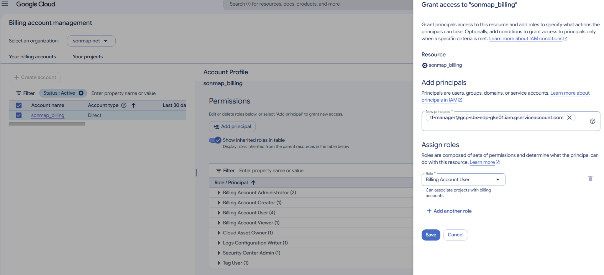

등록 결과는 이 환경에서 조회가 성공한 Cloud Billing REST API로 확인합니다.

```bash
# 실행 위치: Cloud Shell (관리자 창) | 대상: 결제 계정 sonmap_billing | 실행 계정: admin@sonmap.net (결제 계정 관리자)
(
  set -euo pipefail
  TOKEN="$(gcloud auth print-access-token --account=admin@sonmap.net)"
  curl -fsS \
    -H "Authorization: Bearer ${TOKEN}" \
    'https://cloudbilling.googleapis.com/v1/billingAccounts/019BE7-53DD39-AF5098:getIamPolicy?options.requestedPolicyVersion=3' |
  jq -er '
    .bindings[]?
    | select(.role == "roles/billing.user" and .condition == null)
    | .members[]?
    | select(. == "serviceAccount:tf-manager@gcp-sbx-gke01.iam.gserviceaccount.com")
  '
)
```

현재 서비스 계정의 `serviceAccount:tf-manager@...` 항목이 출력되면 등록 완료입니다. `deleted:serviceAccount:tf-manager@...?uid=...` 항목은 삭제된 이전 서비스 계정의 바인딩입니다.

Workspace 그룹 자동 생성 권한이 필요한 배포는 [1-4-2절](#1-4-2-google-workspace-그룹스-관리자-역할-부여)의 절차를 따릅니다.

</details>

<a name="2-shared-vpc와-네트워크"></a>

<a name="-2-shared-vpc와-네트워크"></a>

## 2. Shared VPC와 네트워크

<details>
<summary>내용 펼치기 / 접기</summary>

2-2절은 요청할 권한의 기준입니다. 프로젝트 관리자는 2-4절의 첫 조회를 요청 전에, 사용 가능한 서브넷 조회를 운영팀 회신 후에 실행합니다.

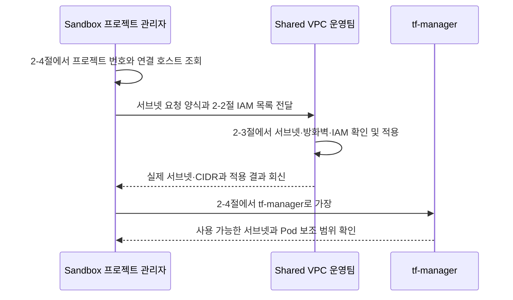

기존 `vpc-prod-edp-hub`를 사용합니다. 호스트 `gcp-prod-edp-hub-vpchost`는 Shared VPC로 활성화되어 있고, 서비스 프로젝트 `gcp-sbx-gke01`의 연결도 확인했습니다. Sandbox 프로젝트팀은 서비스 프로젝트에서 준비와 조회를 수행하고, 호스트 서브넷·방화벽·PSA·IAM 변경은 Shared VPC 운영팀에 요청합니다.

프로젝트팀은 [2-4절의 확인 명령](#2-4-sandbox-프로젝트-관리자-실행-명령)으로 서비스 프로젝트 번호와 현재 연결을 조회한 뒤 아래 요청 양식을 전달합니다.

<a name="shared-vpc-운영팀-요청-양식"></a>

<a name="2-0-shared-vpc-운영팀-요청-양식"></a>

### 2-1. Shared VPC 운영팀 요청 양식

**제목** · [GCP Sandbox] 기존 Shared VPC 서브넷 준비 및 사용 권한 요청

`gcp-sbx-gke01`의 GKE Autopilot과 내부 ALB에서 아래 서브넷을 사용할 수 있도록 기존 구성을 확인하고 필요한 항목을 적용해 주세요.

| 요청 항목 | 요청 내용 |
|---|---|
| 대상 | 호스트 `gcp-prod-edp-hub-vpchost` · VPC `vpc-prod-edp-hub` · 리전 `asia-northeast3` |
| GKE 서브넷 | `subnet-prod-sbx-gke-01` · Primary `10.252.0.0/24` · Pod Secondary `subnet-prod-sbx-pod-01` (`100.64.128.0/19`) |
| 내부 ALB VIP 서브넷 | 기존 `subnet-prod-edp-alb-frontend-an3` 재사용 검토 · 예상 CIDR `172.31.96.0/27` |
| 프록시 전용 서브넷 | 동일 VPC·리전의 `REGIONAL_MANAGED_PROXY` / `ACTIVE` 서브넷 재사용 · 미존재 시 후보 `subnet-prod-sbx-ilb-proxy` (`172.31.111.64/26`) 검토 |
| 컨트롤 플레인용 서브넷 | `subnet-prod-sbx-control-plane-an3` · `10.253.3.16/28` · 기존 사용 대역과 경로 중복 확인 후 생성 |
| ALB 헬스 체크 방화벽 | `fw-sbxtest01-alb-hc` · `35.191.0.0/16`, `130.211.0.0/22` → GKE Pod CIDR · 인바운드 TCP `8000` |
| ALB 프록시 방화벽 | `fw-sbxtest01-ilb-proxy` · 실제 프록시 전용 서브넷 CIDR → GKE Pod CIDR · 인바운드 TCP `8000` |
| Cloud Build Private Pool용 PSA (보류) | `psa-prod-edp-cloudbuild` · 후보 `10.250.0.0/24` (Pool 은 그중 `10.250.0.0/29`) · Private Pool 사용 확정 후 요청 |
| IAM | 2-2절의 서비스 계정별 역할 적용 |

CIDR은 운영팀의 중복 검토 후 확정합니다. 완료 회신에 실제 서브넷 이름과 CIDR, Pod 보조 범위 이름, 방화벽 적용 결과, 필요한 경우 PSA 연결 상태를 포함해 주세요. 프로젝트팀은 회신값을 3절 변수와 맞춘 뒤 구축을 진행합니다.

<a name="2-1-서브넷별-iam"></a>

### 2-2. 서브넷별 IAM

프로젝트팀은 2-4절에서 조회한 프로젝트 번호로 `NUM`을 바꿔 Shared VPC 운영팀에 전달합니다. 운영팀은 아래 범위에서 권한을 적용하고 결과를 회신합니다.

| 권한 적용 위치 | 주 구성원 | 역할 |
|---|---|---|
| GKE 서브넷 `subnet-prod-sbx-gke-01` | `tf-manager@gcp-sbx-gke01.iam.gserviceaccount.com` | `roles/compute.networkUser` |
| GKE 서브넷 `subnet-prod-sbx-gke-01` | `service-NUM@container-engine-robot.iam.gserviceaccount.com` | `roles/compute.networkUser` |
| GKE 서브넷 `subnet-prod-sbx-gke-01` | `NUM@cloudservices.gserviceaccount.com` | `roles/compute.networkUser` |
| ALB VIP 서브넷 `subnet-prod-edp-alb-frontend-an3` | `tf-manager@gcp-sbx-gke01.iam.gserviceaccount.com` | `roles/compute.networkUser` |
| 호스트 프로젝트 `gcp-prod-edp-hub-vpchost` | `service-NUM@container-engine-robot.iam.gserviceaccount.com` | `roles/container.hostServiceAgentUser` |
| 호스트 프로젝트 `gcp-prod-edp-hub-vpchost` | `tf-manager@gcp-sbx-gke01.iam.gserviceaccount.com` | `roles/compute.networkViewer`, `roles/serviceusage.serviceUsageConsumer` |

Pod 보조 범위는 GKE 서브넷 IAM을 따릅니다. ALB 프록시 전용 서브넷에는 별도 Network User 부여가 필요하지 않습니다.

운영팀은 GKE에 필요한 호스트 API와 서비스 에이전트도 확인합니다. Private Pool 경로를 사용하는 경우 Service Networking API, 호스트 서비스 에이전트의 `roles/servicenetworking.serviceAgent`, PSA 연결을 함께 확인합니다.

프로젝트팀은 운영팀 회신에서 서브넷별 사용 권한을 확인합니다. 2-4절의 `tf-manager` 가장 조회는 서브넷을 읽을 수 있는지 확인하는 용도입니다.

<a name="2-2-shared-vpc-운영팀-실행-명령"></a>

### 2-3. Shared VPC 운영팀 실행 명령

아래 명령은 `gcp-prod-edp-hub-vpchost`의 네트워크 및 IAM 변경 권한을 가진 운영팀이 실행합니다. `VPC_ADMIN_ACCOUNT`에 실제 작업 계정을 적고 아래 선언을 실행합니다. 프로젝트 번호는 `gcloud`로 조회합니다. 운영팀 계정으로 서비스 프로젝트를 조회할 수 없으면 2-4절의 프로젝트팀 조회 결과를 받아 `export SBX_PROJECT_NUMBER=` 뒤에 숫자 번호를 직접 넣습니다.

```bash
# 실행 위치: infra-son01 또는 Cloud Shell | 대상: gcp-prod-edp-hub-vpchost | 실행 계정: admin@sonmap.net (Shared VPC 관리자)
export VPC_ADMIN_ACCOUNT="admin@sonmap.net"
export SBX_GKE_PROJECT="gcp-sbx-gke01"

# 프로젝트 번호 조회 대상: gcp-sbx-gke01
SBX_PROJECT_NUMBER="402269387486"   # gcp-sbx-gke01 프로젝트 번호 (바뀌지 않음. 확인: gcloud projects describe gcp-sbx-gke01 --format='value(projectNumber)')
export SBX_PROJECT_NUMBER
echo "$SBX_PROJECT_NUMBER"
export HOST="gcp-prod-edp-hub-vpchost"
export NETWORK="vpc-prod-edp-hub"
export REGION="asia-northeast3"
export MAIN_SUBNET="subnet-prod-sbx-gke-01"
export VIP_SUBNET="subnet-prod-edp-alb-frontend-an3"
export VIP_CIDR="172.31.96.0/27"
export PROXY_SUBNET="subnet-prod-sbx-ilb-proxy"
export NODE_CIDR="10.252.0.0/24"
export POD_RANGE="subnet-prod-sbx-pod-01"
export POD_CIDR="100.64.128.0/19"
export PROXY_CIDR="172.31.111.64/26"
export TF_MANAGER="tf-manager@gcp-sbx-gke01.iam.gserviceaccount.com"

gcloud compute networks describe "$NETWORK" --project="$HOST" --account="$VPC_ADMIN_ACCOUNT"
gcloud compute networks subnets list --project="$HOST" --account="$VPC_ADMIN_ACCOUNT" \
  --filter="network:$NETWORK AND region:$REGION" \
  --format='table(name,ipCidrRange,purpose,role,secondaryIpRanges)'
```

<a name="2-3-0-서비스-프로젝트-shared-vpc-연결"></a>

#### 2-3-0. 서비스 프로젝트 Shared VPC 연결

`gcp-sbx-gke01` 을 호스트 `gcp-prod-edp-hub-vpchost` 의 서비스 프로젝트로 연결합니다. **연결이 없으면** 뒤의 서브넷 IAM 을 모두 줘도 GKE 가 호스트 서브넷을 쓰지 못하고, 2-4 의 `list-usable` 이 `HTTPError 400 ... not associated` 로 실패합니다. 조직 수준 `roles/compute.xpnAdmin` 이 필요합니다.

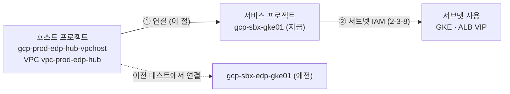

```bash
# 실행 위치: Cloud Shell (관리자 창) | 대상: gcp-prod-edp-hub-vpchost | 실행 계정: admin@sonmap.net (Shared VPC 관리자)
export HOST="gcp-prod-edp-hub-vpchost"
export VPC_ADMIN_ACCOUNT="admin@sonmap.net"

# 1) 지금 연결된 서비스 프로젝트 → gcp-sbx-gke01 이 있으면 2) 는 건너뜀
gcloud compute shared-vpc list-associated-resources "$HOST" --account="$VPC_ADMIN_ACCOUNT"

# 2) 연결
gcloud compute shared-vpc associated-projects add gcp-sbx-gke01 \
  --host-project="$HOST" --account="$VPC_ADMIN_ACCOUNT"

# 3) 확인 → gcp-prod-edp-hub-vpchost 가 나오면 성공
gcloud compute shared-vpc get-host-project gcp-sbx-gke01 \
  --account="$VPC_ADMIN_ACCOUNT" --format='value(name)'
```

- 2) 에서 `PERMISSION_DENIED` 면 `admin@sonmap.net` 에 조직의 `roles/compute.xpnAdmin` 이 없는 것입니다.
- 예전 `gcp-sbx-edp-gke01` 의 연결은 그대로 두어도 지금 작업과 충돌하지 않습니다. 정리하려면 `gcloud compute shared-vpc associated-projects remove gcp-sbx-edp-gke01 --host-project="$HOST"` (그 프로젝트가 호스트 서브넷을 쓰는 자원이 없을 때만 됨).

<a name="gke-서브넷-생성에-필요한-값"></a>

#### 2-3-1. GKE 서브넷 생성에 필요한 값

신규 생성 대상은 **GKE 서브넷**, **내부 ALB VIP 서브넷**, **내부 ALB 프록시 전용 서브넷**, **컨트롤 플레인용 서브넷**입니다. 각 서브넷은 기존 구성을 먼저 조회한 뒤 필요한 경우에만 생성합니다.

| 항목 | 변수 | 설정값 |
|---|---|---|
| 작업 계정 | `VPC_ADMIN_ACCOUNT` | `admin@sonmap.net` |
| Shared VPC 호스트 프로젝트 | `HOST` | `gcp-prod-edp-hub-vpchost` |
| 대상 VPC | `NETWORK` | `vpc-prod-edp-hub` |
| 리전 | `REGION` | `asia-northeast3` |
| GKE 서브넷 이름 | `MAIN_SUBNET` | `subnet-prod-sbx-gke-01` |
| Primary CIDR (노드 IP 대역) | `NODE_CIDR` | `10.252.0.0/24` |
| Secondary 범위 이름 (Pod) | `POD_RANGE` | `subnet-prod-sbx-pod-01` |
| Secondary CIDR (Pod IP 대역) | `POD_CIDR` | `100.64.128.0/19` |
| 내부 ALB VIP 서브넷 이름 | `VIP_SUBNET` | `subnet-prod-edp-alb-frontend-an3` |
| 내부 ALB VIP 서브넷 CIDR | `VIP_CIDR` | `172.31.96.0/27` |
| 내부 ALB 프록시 전용 서브넷 이름 | `PROXY_SUBNET` | `subnet-prod-sbx-ilb-proxy` |
| 내부 ALB 프록시 전용 서브넷 CIDR | `PROXY_CIDR` | `172.31.111.64/26` |
| 프록시 전용 서브넷 용도 및 역할 | `--purpose`, `--role` | `REGIONAL_MANAGED_PROXY`, `ACTIVE` |
| 컨트롤 플레인용 서브넷 이름 | `CP_SUBNET` | `subnet-prod-sbx-control-plane-an3` |
| 컨트롤 플레인용 서브넷 CIDR | `CP_SUBNET_CIDR` | `10.253.3.16/28` · 운영팀 중복 확인 후 사용 |

기존 GKE 서브넷이 있으면 2-3-3절의 조회 명령으로 Primary CIDR과 Pod 보조 범위를 확인합니다. 계획과 다르면 Shared VPC 운영팀에 확인을 요청합니다.

**컨트롤 플레인용 서브넷** · Shared VPC 운영팀이 2-3-6절에서 `10.253.3.16/28` 서브넷을 준비합니다. 향후 신규 클러스터에서 이 서브넷을 사용하려면 `--private-endpoint-subnetwork`로 지정합니다. 해당 서브넷의 CIDR을 `--master-ipv4-cidr` 값으로 사용하면 기존 서브넷 대역과 겹칩니다.

**Kubernetes Service 대역** · `subnet-prod-sbx-svc-01`을 사용자 관리 Service 보조 범위로 쓰려면 별도 CIDR을 확정해야 합니다. `10.252.0.0/24`는 이미 노드 Primary이고, 그 안의 `10.252.0.0/28`도 노드 대역과 겹칩니다.

<a name="1-gke-서브넷-신규-생성"></a>

#### 2-3-2. GKE 서브넷 신규 생성

앞의 조회에서 `$MAIN_SUBNET`이 없고 CIDR 승인이 완료되면 아래 생성 명령을 실행합니다. `--secondary-range`로 Pod 보조 범위도 함께 생성됩니다. **생성 후 2-3-3절에서 확인합니다.**

```bash
# 실행 위치: infra-son01 또는 Cloud Shell | 대상: gcp-prod-edp-hub-vpchost | 실행 계정: admin@sonmap.net (Shared VPC 관리자)
export REGION="asia-northeast3"
export HOST="gcp-prod-edp-hub-vpchost"
export NETWORK="vpc-prod-edp-hub"
export VPC_ADMIN_ACCOUNT="admin@sonmap.net"
export MAIN_SUBNET="subnet-prod-sbx-gke-01"
export POD_RANGE="subnet-prod-sbx-pod-01"
export NODE_CIDR="10.252.0.0/24"
export POD_CIDR="100.64.128.0/19"
gcloud compute networks subnets create "$MAIN_SUBNET" \
  --project="$HOST" --network="$NETWORK" --region="$REGION" --account="$VPC_ADMIN_ACCOUNT" \
  --range="$NODE_CIDR" --secondary-range="$POD_RANGE=$POD_CIDR"
```

<a name="2-gke-서브넷과-pod-보조-범위-확인"></a>

#### 2-3-3. GKE 서브넷과 Pod 보조 범위 확인

```bash
# 실행 위치: infra-son01 또는 Cloud Shell | 대상: gcp-prod-edp-hub-vpchost | 실행 계정: admin@sonmap.net (Shared VPC 관리자)
export REGION="asia-northeast3"
export HOST="gcp-prod-edp-hub-vpchost"
export VPC_ADMIN_ACCOUNT="admin@sonmap.net"
export MAIN_SUBNET="subnet-prod-sbx-gke-01"
gcloud compute networks subnets describe "$MAIN_SUBNET" \
  --project="$HOST" --region="$REGION" --account="$VPC_ADMIN_ACCOUNT" \
  --format='yaml(ipCidrRange,secondaryIpRanges)'
```

Primary `10.252.0.0/24`와 Pod 보조 범위 `subnet-prod-sbx-pod-01` (`100.64.128.0/19`)를 확인합니다. `Range names must be distinct`가 나오면 같은 이름의 보조 범위가 이미 있으므로, 위 조회로 실제 CIDR을 확인한 뒤 다음 단계로 진행합니다.

<a name="3-내부-alb-vip-서브넷-확인-및-신규-생성"></a>

#### 2-3-4. 내부 ALB VIP 서브넷 확인 및 신규 생성

Shared VPC 운영팀이 프런트엔드 VIP에 사용할 일반 서브넷을 조회합니다.

```bash
# 실행 위치: infra-son01 또는 Cloud Shell | 대상: gcp-prod-edp-hub-vpchost | 실행 계정: admin@sonmap.net (Shared VPC 관리자)
export REGION="asia-northeast3"
export HOST="gcp-prod-edp-hub-vpchost"
export VPC_ADMIN_ACCOUNT="admin@sonmap.net"
export VIP_SUBNET="subnet-prod-edp-alb-frontend-an3"
gcloud compute networks subnets describe "$VIP_SUBNET" --project="$HOST" \
  --region="$REGION" --account="$VPC_ADMIN_ACCOUNT" \
  --format='yaml(name,network,ipCidrRange,purpose)'
```

- **조회 성공** · 같은 VPC와 리전의 일반 서브넷인지 확인하고 운영팀이 승인한 CIDR로 재사용합니다.
- **`Not Found`** · 이름과 CIDR에 대해 운영팀의 중복 확인 및 승인을 받은 뒤 아래 명령으로 생성합니다.
- **`403` 또는 기타 조회 오류** · 운영팀 계정과 조회 권한을 확인합니다.

```bash
# 실행 위치: infra-son01 또는 Cloud Shell | 대상: gcp-prod-edp-hub-vpchost | 실행 계정: admin@sonmap.net (Shared VPC 관리자)
export REGION="asia-northeast3"
export HOST="gcp-prod-edp-hub-vpchost"
export NETWORK="vpc-prod-edp-hub"
export VPC_ADMIN_ACCOUNT="admin@sonmap.net"
export VIP_SUBNET="subnet-prod-edp-alb-frontend-an3"
export VIP_CIDR="172.31.96.0/27"
gcloud compute networks subnets create "$VIP_SUBNET" \
  --project="$HOST" --network="$NETWORK" --region="$REGION" \
  --range="$VIP_CIDR" --account="$VPC_ADMIN_ACCOUNT"
```

생성 후 위 조회 명령을 다시 실행하여 이름과 CIDR을 확인합니다.

<a name="4-프록시-전용-서브넷-확인-및-신규-생성"></a>

#### 2-3-5. 프록시 전용 서브넷 확인 및 신규 생성

같은 VPC·리전에 활성 프록시 전용 서브넷이 있으면 해당 CIDR을 `PROXY_CIDR`에 반영합니다. 활성 서브넷이 없고 대역 승인이 끝났을 때만 아래 명령을 실행합니다.

```bash
# 실행 위치: infra-son01 또는 Cloud Shell | 대상: gcp-prod-edp-hub-vpchost | 실행 계정: admin@sonmap.net (Shared VPC 관리자)
export REGION="asia-northeast3"
export HOST="gcp-prod-edp-hub-vpchost"
export NETWORK="vpc-prod-edp-hub"
export VPC_ADMIN_ACCOUNT="admin@sonmap.net"
export PROXY_SUBNET="subnet-prod-sbx-ilb-proxy"
export PROXY_CIDR="172.31.111.64/26"
gcloud compute networks subnets create "$PROXY_SUBNET" \
  --project="$HOST" --network="$NETWORK" --region="$REGION" --account="$VPC_ADMIN_ACCOUNT" \
  --range="$PROXY_CIDR" --purpose=REGIONAL_MANAGED_PROXY --role=ACTIVE
```

<a name="5-컨트롤-플레인용-서브넷-신규-생성"></a>

#### 2-3-6. 컨트롤 플레인용 서브넷 신규 생성

Shared VPC 운영팀이 아래 명령으로 기존 서브넷을 조회합니다.

```bash
# 실행 위치: infra-son01 또는 Cloud Shell | 대상: gcp-prod-edp-hub-vpchost | 실행 계정: admin@sonmap.net (Shared VPC 관리자)
export REGION="asia-northeast3"
export HOST="gcp-prod-edp-hub-vpchost"
export VPC_ADMIN_ACCOUNT="admin@sonmap.net"
export CP_SUBNET="subnet-prod-sbx-control-plane-an3"
export CP_SUBNET_CIDR="10.253.3.16/28"

gcloud compute networks subnets describe "$CP_SUBNET" \
  --project="$HOST" --region="$REGION" --account="$VPC_ADMIN_ACCOUNT" \
  --format='yaml(name,network,ipCidrRange)'
```

조회 결과가 `Not Found`이고 CIDR 중복 확인이 끝났으면 아래 명령을 실행합니다. 생성 후 위 조회 명령으로 `10.253.3.16/28`을 확인합니다.

```bash
# 실행 위치: infra-son01 또는 Cloud Shell | 대상: gcp-prod-edp-hub-vpchost | 실행 계정: admin@sonmap.net (Shared VPC 관리자)
export REGION="asia-northeast3"
export HOST="gcp-prod-edp-hub-vpchost"
export NETWORK="vpc-prod-edp-hub"
export VPC_ADMIN_ACCOUNT="admin@sonmap.net"
export CP_SUBNET="subnet-prod-sbx-control-plane-an3"
export CP_SUBNET_CIDR="10.253.3.16/28"
gcloud compute networks subnets create "$CP_SUBNET" \
  --project="$HOST" --network="$NETWORK" --region="$REGION" \
  --range="$CP_SUBNET_CIDR" --account="$VPC_ADMIN_ACCOUNT"
```

<a name="6-방화벽-조회-및-생성"></a>

#### 2-3-7. 방화벽 조회 및 생성

기존 방화벽을 조회합니다. 각 규칙이 없으면 해당 생성 명령을 실행합니다. 기존 규칙의 CIDR이나 포트가 다르면 운영팀 변경 절차에 따라 조정합니다.

<a name="6-1-기존-방화벽-조회"></a>

##### 2-3-7-1. 기존 방화벽 조회

```bash
# 실행 위치: infra-son01 또는 Cloud Shell | 대상: gcp-prod-edp-hub-vpchost | 실행 계정: admin@sonmap.net (Shared VPC 관리자)
export HOST="gcp-prod-edp-hub-vpchost"
export VPC_ADMIN_ACCOUNT="admin@sonmap.net"
gcloud compute firewall-rules list --project="$HOST" --account="$VPC_ADMIN_ACCOUNT" \
  --filter='name=(fw-sbxtest01-alb-hc fw-sbxtest01-ilb-proxy)'
```

<a name="6-2-alb-헬스-체크-방화벽-생성"></a>

##### 2-3-7-2. ALB 헬스 체크 방화벽 생성

```bash
# 실행 위치: infra-son01 또는 Cloud Shell | 대상: gcp-prod-edp-hub-vpchost | 실행 계정: admin@sonmap.net (Shared VPC 관리자)
export HOST="gcp-prod-edp-hub-vpchost"
export NETWORK="vpc-prod-edp-hub"
export VPC_ADMIN_ACCOUNT="admin@sonmap.net"
export POD_CIDR="100.64.128.0/19"
gcloud compute firewall-rules create fw-sbxtest01-alb-hc \
  --project="$HOST" --network="$NETWORK" --account="$VPC_ADMIN_ACCOUNT" \
  --direction=INGRESS --allow=tcp:8080-8089 \
  --source-ranges=35.191.0.0/16,130.211.0.0/22 --destination-ranges="$POD_CIDR"
```

<a name="6-3-alb-프록시-방화벽-생성"></a>

##### 2-3-7-3. ALB 프록시 방화벽 생성

```bash
# 실행 위치: infra-son01 또는 Cloud Shell | 대상: gcp-prod-edp-hub-vpchost | 실행 계정: admin@sonmap.net (Shared VPC 관리자)
export HOST="gcp-prod-edp-hub-vpchost"
export NETWORK="vpc-prod-edp-hub"
export VPC_ADMIN_ACCOUNT="admin@sonmap.net"
export POD_CIDR="100.64.128.0/19"
export PROXY_CIDR="172.31.111.64/26"
gcloud compute firewall-rules create fw-sbxtest01-ilb-proxy \
  --project="$HOST" --network="$NETWORK" --account="$VPC_ADMIN_ACCOUNT" \
  --direction=INGRESS --allow=tcp:8080-8089 \
  --source-ranges="$PROXY_CIDR" --destination-ranges="$POD_CIDR"
```

<a name="7-서브넷-및-호스트-iam-적용"></a>

#### 2-3-8. 서브넷 및 호스트 IAM 적용

확인한 실제 서브넷 이름을 변수에 반영하고 2-2절 IAM을 적용합니다. 두 서비스 에이전트 주소에 들어가는 프로젝트 번호는 `gcp-sbx-gke01`의 숫자 번호입니다. 위에서 출력된 프로젝트 번호가 숫자로 확인되면 아래 명령을 번호 순서대로 하나씩 실행합니다. 오류가 나오면 해당 명령의 입력값을 확인한 뒤 이어서 진행합니다.

<a name="7-1-서비스-에이전트-변수-선언-및-확인"></a>

##### 2-3-8-1. 서비스 에이전트 변수 선언 및 확인

2-3-8-2 이후 명령과 같은 터미널에서 실행합니다. 새 Cloud Shell을 열었으면 2-3절 첫 변수 선언 블록부터 다시 실행합니다. `SBX_PROJECT_NUMBER`에는 2-4절에서 조회한 숫자만 넣습니다.

```bash
# 실행 위치: infra-son01 또는 Cloud Shell | 대상: gcp-prod-edp-hub-vpchost | 실행 계정: admin@sonmap.net (Shared VPC 관리자)
export SBX_PROJECT_NUMBER="402269387486"   # gcp-sbx-gke01 프로젝트 번호 (바뀌지 않음. 확인: gcloud projects describe gcp-sbx-gke01 --format='value(projectNumber)')
# 실행 예시: export SBX_PROJECT_NUMBER="프로젝트팀에서 확인한 숫자 번호"
export GKE_AGENT="service-${SBX_PROJECT_NUMBER}@container-engine-robot.iam.gserviceaccount.com"
export GOOGLE_APIS_AGENT="${SBX_PROJECT_NUMBER}@cloudservices.gserviceaccount.com"
printf '프로젝트 번호: %s\nGKE 서비스 에이전트: %s\nGoogle APIs 서비스 에이전트: %s\n' \
  "$SBX_PROJECT_NUMBER" "$GKE_AGENT" "$GOOGLE_APIS_AGENT"
```

프로젝트 번호가 비어 있거나 이메일이 `service-@`로 시작하면 번호를 확인하고 7-1을 다시 실행합니다. 7-3은 프로젝트 번호를 조회해 GKE 서비스 에이전트 이메일을 구성합니다.

<a name="7-2-gke-서브넷--terraform-서비스-계정"></a>

##### 2-3-8-2. GKE 서브넷 · Terraform 서비스 계정

```bash
# 실행 위치: infra-son01 또는 Cloud Shell | 대상: gcp-prod-edp-hub-vpchost | 실행 계정: admin@sonmap.net (Shared VPC 관리자)
export REGION="asia-northeast3"
export HOST="gcp-prod-edp-hub-vpchost"
export VPC_ADMIN_ACCOUNT="admin@sonmap.net"
export TF_MANAGER="tf-manager@gcp-sbx-gke01.iam.gserviceaccount.com"
export MAIN_SUBNET="subnet-prod-sbx-gke-01"
gcloud compute networks subnets add-iam-policy-binding "$MAIN_SUBNET" \
  --project="$HOST" --region="$REGION" --account="$VPC_ADMIN_ACCOUNT" \
  --member="serviceAccount:$TF_MANAGER" --role=roles/compute.networkUser
```

<a name="7-3-gke-서브넷--gke-서비스-에이전트"></a>

##### 2-3-8-3. GKE 서브넷 · GKE 서비스 에이전트

프로젝트 번호가 숫자로 조회되면 이어서 권한을 부여합니다. 운영팀 계정에 조회 권한이 없으면 Sandbox 프로젝트팀에서 받은 숫자로 첫 번째 선언을 바꿉니다.

```bash
# 실행 위치: infra-son01 또는 Cloud Shell | 대상: gcp-prod-edp-hub-vpchost | 실행 계정: admin@sonmap.net
# 프로젝트 번호 조회 대상: gcp-sbx-gke01 | IAM 적용 대상: gcp-prod-edp-hub-vpchost
export SBX_PROJECT_NUMBER="402269387486"   # gcp-sbx-gke01 프로젝트 번호 (바뀌지 않음. 확인: gcloud projects describe gcp-sbx-gke01 --format='value(projectNumber)')
echo "$SBX_PROJECT_NUMBER"
```

숫자 프로젝트 번호가 출력되면 아래 명령을 실행합니다.

```bash
# 실행 위치: infra-son01 또는 Cloud Shell | 대상: gcp-prod-edp-hub-vpchost | 실행 계정: admin@sonmap.net
export SBX_PROJECT_NUMBER="402269387486"   # gcp-sbx-gke01 프로젝트 번호 (바뀌지 않음. 확인: gcloud projects describe gcp-sbx-gke01 --format='value(projectNumber)')
gcloud compute networks subnets add-iam-policy-binding subnet-prod-sbx-gke-01 \
  --project=gcp-prod-edp-hub-vpchost --region=asia-northeast3 --account=admin@sonmap.net \
  --member="serviceAccount:service-${SBX_PROJECT_NUMBER}@container-engine-robot.iam.gserviceaccount.com" \
  --role=roles/compute.networkUser
```

<a name="7-4-gke-서브넷--google-apis-서비스-에이전트"></a>

##### 2-3-8-4. GKE 서브넷 · Google APIs 서비스 에이전트

```bash
# 실행 위치: infra-son01 또는 Cloud Shell | 대상: gcp-prod-edp-hub-vpchost | 실행 계정: admin@sonmap.net (Shared VPC 관리자)
export REGION="asia-northeast3"
export HOST="gcp-prod-edp-hub-vpchost"
export VPC_ADMIN_ACCOUNT="admin@sonmap.net"
export MAIN_SUBNET="subnet-prod-sbx-gke-01"
export SBX_PROJECT_NUMBER="402269387486"   # gcp-sbx-gke01 프로젝트 번호 (바뀌지 않음. 확인: gcloud projects describe gcp-sbx-gke01 --format='value(projectNumber)')
export GOOGLE_APIS_AGENT="${SBX_PROJECT_NUMBER}@cloudservices.gserviceaccount.com"
gcloud compute networks subnets add-iam-policy-binding "$MAIN_SUBNET" \
  --project="$HOST" --region="$REGION" --account="$VPC_ADMIN_ACCOUNT" \
  --member="serviceAccount:$GOOGLE_APIS_AGENT" --role=roles/compute.networkUser
```

<a name="7-5-alb-vip-서브넷--terraform-서비스-계정"></a>

##### 2-3-8-5. ALB VIP 서브넷 · Terraform 서비스 계정

```bash
# 실행 위치: infra-son01 또는 Cloud Shell | 대상: gcp-prod-edp-hub-vpchost | 실행 계정: admin@sonmap.net (Shared VPC 관리자)
export REGION="asia-northeast3"
export HOST="gcp-prod-edp-hub-vpchost"
export VPC_ADMIN_ACCOUNT="admin@sonmap.net"
export TF_MANAGER="tf-manager@gcp-sbx-gke01.iam.gserviceaccount.com"
export VIP_SUBNET="subnet-prod-edp-alb-frontend-an3"
gcloud compute networks subnets add-iam-policy-binding "$VIP_SUBNET" \
  --project="$HOST" --region="$REGION" --account="$VPC_ADMIN_ACCOUNT" \
  --member="serviceAccount:$TF_MANAGER" --role=roles/compute.networkUser
```

<a name="7-6-호스트-프로젝트--gke-서비스-에이전트"></a>

##### 2-3-8-6. 호스트 프로젝트 · GKE 서비스 에이전트

```bash
# 실행 위치: infra-son01 또는 Cloud Shell | 대상: gcp-prod-edp-hub-vpchost | 실행 계정: admin@sonmap.net (Shared VPC 관리자)
export HOST="gcp-prod-edp-hub-vpchost"
export VPC_ADMIN_ACCOUNT="admin@sonmap.net"
export SBX_PROJECT_NUMBER="402269387486"   # gcp-sbx-gke01 프로젝트 번호 (바뀌지 않음. 확인: gcloud projects describe gcp-sbx-gke01 --format='value(projectNumber)')
export GKE_AGENT="service-${SBX_PROJECT_NUMBER}@container-engine-robot.iam.gserviceaccount.com"
gcloud projects add-iam-policy-binding "$HOST" --account="$VPC_ADMIN_ACCOUNT" \
  --member="serviceAccount:$GKE_AGENT" --role=roles/container.hostServiceAgentUser --condition=None
```

<a name="7-7-호스트-프로젝트--terraform-네트워크-조회-권한"></a>

##### 2-3-8-7. 호스트 프로젝트 · Terraform 네트워크 조회 권한

```bash
# 실행 위치: infra-son01 또는 Cloud Shell | 대상: gcp-prod-edp-hub-vpchost | 실행 계정: admin@sonmap.net (Shared VPC 관리자)
export HOST="gcp-prod-edp-hub-vpchost"
export VPC_ADMIN_ACCOUNT="admin@sonmap.net"
export TF_MANAGER="tf-manager@gcp-sbx-gke01.iam.gserviceaccount.com"
gcloud projects add-iam-policy-binding "$HOST" --account="$VPC_ADMIN_ACCOUNT" \
  --member="serviceAccount:$TF_MANAGER" --role=roles/compute.networkViewer --condition=None
```

<a name="7-8-호스트-프로젝트--terraform-서비스-사용-권한"></a>

##### 2-3-8-8. 호스트 프로젝트 · Terraform 서비스 사용 권한

```bash
# 실행 위치: infra-son01 또는 Cloud Shell | 대상: gcp-prod-edp-hub-vpchost | 실행 계정: admin@sonmap.net (Shared VPC 관리자)
export HOST="gcp-prod-edp-hub-vpchost"
export VPC_ADMIN_ACCOUNT="admin@sonmap.net"
export TF_MANAGER="tf-manager@gcp-sbx-gke01.iam.gserviceaccount.com"
gcloud projects add-iam-policy-binding "$HOST" --account="$VPC_ADMIN_ACCOUNT" \
  --member="serviceAccount:$TF_MANAGER" --role=roles/serviceusage.serviceUsageConsumer --condition=None
```

<a name="7-9-gke-서브넷-iam-확인"></a>

##### 2-3-8-9. GKE 서브넷 IAM 확인

```bash
# 실행 위치: infra-son01 또는 Cloud Shell | 대상: gcp-prod-edp-hub-vpchost | 실행 계정: admin@sonmap.net (Shared VPC 관리자)
export REGION="asia-northeast3"
export HOST="gcp-prod-edp-hub-vpchost"
export VPC_ADMIN_ACCOUNT="admin@sonmap.net"
export MAIN_SUBNET="subnet-prod-sbx-gke-01"
gcloud compute networks subnets get-iam-policy "$MAIN_SUBNET" \
  --project="$HOST" --region="$REGION" --account="$VPC_ADMIN_ACCOUNT" --format=json
```

<a name="7-10-alb-vip-서브넷-iam-확인"></a>

##### 2-3-8-10. ALB VIP 서브넷 IAM 확인

```bash
# 실행 위치: infra-son01 또는 Cloud Shell | 대상: gcp-prod-edp-hub-vpchost | 실행 계정: admin@sonmap.net (Shared VPC 관리자)
export REGION="asia-northeast3"
export HOST="gcp-prod-edp-hub-vpchost"
export VPC_ADMIN_ACCOUNT="admin@sonmap.net"
export VIP_SUBNET="subnet-prod-edp-alb-frontend-an3"
gcloud compute networks subnets get-iam-policy "$VIP_SUBNET" \
  --project="$HOST" --region="$REGION" --account="$VPC_ADMIN_ACCOUNT" --format=json
```

<a name="8-private-pool용-psa-보류"></a>

#### 2-3-9. Private Pool용 PSA (보류)

PSA는 Cloud Build Private Pool과 Shared VPC 간 사설 연결에 사용합니다. 예약 범위 및 Service Networking 피어링의 적용 결과를 확인한 뒤 3-17절으로 진행합니다.

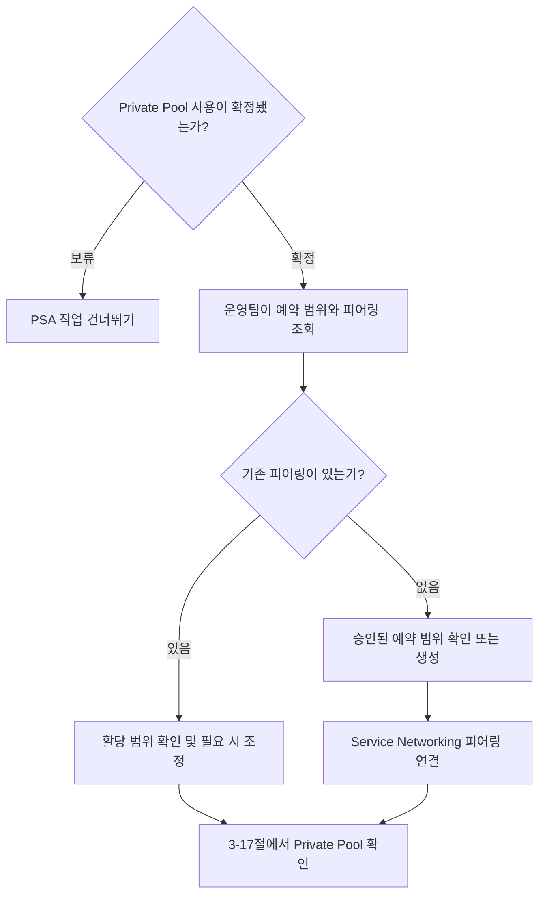

Private Pool 구성을 보류하는 동안 아래 명령을 건너뜁니다. 사용이 확정되면 운영팀에서 기존 PSA 예약 범위와 피어링을 확인합니다. 예약 범위 및 연결이 모두 없는 신규 구성에서는 대역 승인과 Service Networking API 및 서비스 에이전트 준비 후 생성 명령을 실행합니다. 기존 피어링이 있으면 현재 할당 범위를 확인하고 운영팀 절차에 따라 조정합니다.

```bash
# 실행 위치: infra-son01 또는 Cloud Shell | 대상: gcp-prod-edp-hub-vpchost | 실행 계정: admin@sonmap.net (Shared VPC 관리자)
export HOST="gcp-prod-edp-hub-vpchost"
export NETWORK="vpc-prod-edp-hub"
export VPC_ADMIN_ACCOUNT="admin@sonmap.net"
export PSA_NAME="psa-prod-edp-cloudbuild"
gcloud compute addresses describe "$PSA_NAME" --global --project="$HOST" --account="$VPC_ADMIN_ACCOUNT"
gcloud services vpc-peerings list --project="$HOST" --network="$NETWORK" \
  --service=servicenetworking.googleapis.com --account="$VPC_ADMIN_ACCOUNT"

# 예약 범위가 없을 때만
gcloud compute addresses create "$PSA_NAME" --global --project="$HOST" \
  --purpose=VPC_PEERING --addresses=10.250.0.0 --prefix-length=24 \
  --network="$NETWORK" --account="$VPC_ADMIN_ACCOUNT"

# 해당 VPC에 Service Networking 피어링이 없을 때만
gcloud services vpc-peerings connect --project="$HOST" --network="$NETWORK" \
  --service=servicenetworking.googleapis.com --ranges="$PSA_NAME" --account="$VPC_ADMIN_ACCOUNT"
```

##### 2-3-9-1. (선택) 기존 PSA 삭제 후 다시 구성

이전 테스트의 PSA 를 지우고 새로 만들 때만 실행합니다. **순서를 지켜야 합니다.** 피어링이 예약 범위를 쓰고 있으면 예약이 지워지지 않고, 피어링 안에 Private Pool 같은 사용 자원이 남아 있으면 피어링이 지워지지 않습니다.

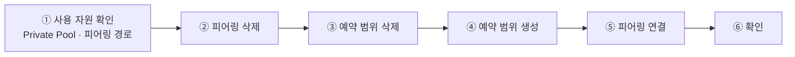

**① 사용 자원 확인** · 두 결과가 모두 비어 있어야 다음으로 갑니다.

```bash
# 실행 위치: Cloud Shell (관리자 창) | 대상: gcp-prod-edp-hub-vpchost (조회) | 실행 계정: admin@sonmap.net (Shared VPC 관리자)
export HOST="gcp-prod-edp-hub-vpchost"
export NETWORK="vpc-prod-edp-hub"
export REGION="asia-northeast3"
export VPC_ADMIN_ACCOUNT="admin@sonmap.net"

# 이 VPC 에 피어링된 Private Pool (예전 · 새 프로젝트 모두) → "Listed 0 items" 이어야 함
for p in gcp-sbx-edp-gke01 gcp-sbx-gke01; do
  echo "== $p"
  gcloud builds worker-pools list --project="$p" --region="$REGION" --account="$VPC_ADMIN_ACCOUNT" \
    --format='table(name.basename(),state,privatePoolV1Config.networkConfig.peeredNetwork)' 2>&1 | tail -n +1
done

# 피어링으로 들어오는 경로 (Pool · Cloud SQL 등 사용 자원이 있으면 10.250.0.0/24 안의 경로가 보임) → 비어 있어야 함
gcloud compute networks peerings list-routes servicenetworking-googleapis-com \
  --network="$NETWORK" --region="$REGION" --direction=INCOMING \
  --project="$HOST" --account="$VPC_ADMIN_ACCOUNT"
```

**② ~ ③ 삭제**

```bash
# 실행 위치: Cloud Shell (관리자 창) | 대상: gcp-prod-edp-hub-vpchost | 실행 계정: admin@sonmap.net (Shared VPC 관리자)
export HOST="gcp-prod-edp-hub-vpchost"
export NETWORK="vpc-prod-edp-hub"
export VPC_ADMIN_ACCOUNT="admin@sonmap.net"
export PSA_NAME="psa-prod-edp-cloudbuild"

# ② Service Networking 피어링 삭제 (이 VPC 의 피어링 범위가 psa-prod-edp-cloudbuild 하나일 때)
gcloud services vpc-peerings delete --service=servicenetworking.googleapis.com \
  --network="$NETWORK" --project="$HOST" --account="$VPC_ADMIN_ACCOUNT"

# ③ 예약 범위 삭제
gcloud compute addresses delete "$PSA_NAME" --global --project="$HOST" --account="$VPC_ADMIN_ACCOUNT"
```

- ② 에서 `Producer services ... still using this peering` 가 나오면 ① 에서 못 찾은 사용 자원이 있는 것입니다. 멈추고 그 자원부터 정리합니다.
- 이 예약은 다른 Terraform 이 만든 자원입니다(라벨 `goog-terraform-provisioned: true`). 손으로 지우면 그 Terraform State 와 어긋나므로, 그 코드를 더 쓰지 않을 때만 지웁니다.

**④ ~ ⑥ 다시 구성** · 위 2-3-9 블록의 생성 명령과 같습니다.

```bash
# 실행 위치: Cloud Shell (관리자 창) | 대상: gcp-prod-edp-hub-vpchost | 실행 계정: admin@sonmap.net (Shared VPC 관리자)
export HOST="gcp-prod-edp-hub-vpchost"
export NETWORK="vpc-prod-edp-hub"
export VPC_ADMIN_ACCOUNT="admin@sonmap.net"
export PSA_NAME="psa-prod-edp-cloudbuild"

# ④ 예약 범위 생성
gcloud compute addresses create "$PSA_NAME" --global --project="$HOST" \
  --purpose=VPC_PEERING --addresses=10.250.0.0 --prefix-length=24 \
  --network="$NETWORK" --account="$VPC_ADMIN_ACCOUNT"

# ⑤ 피어링 연결 (몇 분 걸림)
gcloud services vpc-peerings connect --service=servicenetworking.googleapis.com \
  --ranges="$PSA_NAME" --network="$NETWORK" --project="$HOST" --account="$VPC_ADMIN_ACCOUNT"

# ⑥ 확인 → RESERVED, 피어링 목록에 psa-prod-edp-cloudbuild
gcloud compute addresses describe "$PSA_NAME" --global --project="$HOST" \
  --account="$VPC_ADMIN_ACCOUNT" --format='value(address,prefixLength,status)'
gcloud services vpc-peerings list --network="$NETWORK" --project="$HOST" \
  --account="$VPC_ADMIN_ACCOUNT" --format='table(service,peering,reservedPeeringRanges)'
```

**PSA 와 피어링 구조** · 무엇을 지우고 다시 만드는지 한눈에 봅니다.

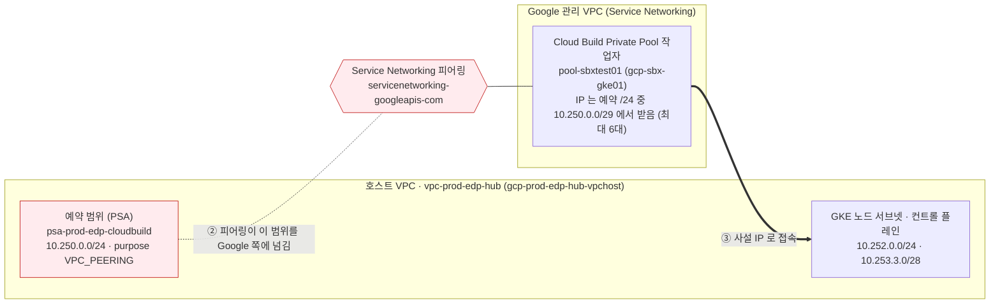

| 구성 요소 | 무엇인가 | 삭제 순서 | 생성 순서 |
|---|---|---|---|
| 예약 범위 `psa-prod-edp-cloudbuild` | 호스트 VPC 안에서 "Google 관리 서비스용" 으로 비워 둔 대역. 이 VPC 의 다른 서브넷과 겹치면 안 됨 | ③ | ④ |
| Service Networking 피어링 | 호스트 VPC 와 Google 관리 VPC 를 잇는 연결. 예약 범위를 Google 쪽에 넘김. VPC 당 하나이고, Cloud SQL · Memorystore 등도 같은 피어링을 씀 | ② | ⑤ |
| Private Pool | Google 관리 VPC 안의 빌드 작업자. 예약 범위에서 IP 를 받아 피어링을 거쳐 GKE 등에 사설 IP 로 접근 | 먼저 정리 (①) | 3-17 |

- 피어링이 범위를 쓰는 동안에는 범위를 지울 수 없고, Pool 같은 사용 자원이 남아 있으면 피어링을 지울 수 없습니다. 그래서 **사용 자원 → 피어링 → 범위** 순으로 지우고, 반대 순서로 만듭니다.
- 피어링은 VPC 전체가 공유합니다. 다른 관리형 서비스가 같은 피어링에 있으면 ② 에서 함께 끊기므로 ① 의 경로 확인이 비어 있을 때만 진행합니다.

<a name="9-gke-노드용-private-google-access와-restricted-vip"></a>

#### 2-3-10. GKE 노드용 Private Google Access와 Restricted VIP

Private DNS가 Google API와 이미지 레지스트리의 이름을 restricted VIP로 해석합니다. 노드에서 VIP로 연결하려면 서브넷 PGA, VPC 라우트, 송신 정책이 모두 맞아야 합니다.

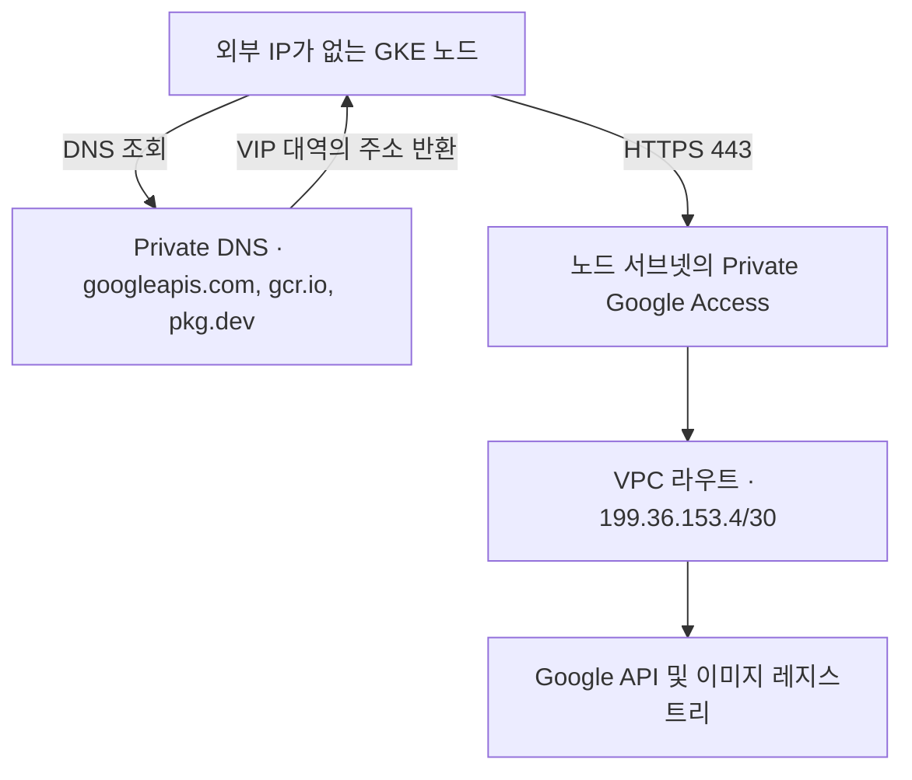

사설 GKE 노드의 Google 관리 이미지 다운로드가 TCP 443 타임아웃으로 실패할 때 사용하는 절차입니다. VPC 운영팀이 `restricted.googleapis.com` 사용을 승인한 환경을 기준으로 합니다. **PGA는 노드 서브넷에 적용되며, 라우트와 DNS는 Shared VPC 전체에 영향을 줄 수 있습니다.** 기존 중앙 DNS, 피어링·포워딩 영역, 라우트 및 보안 정책을 확인하고 승인된 구성을 재사용합니다. [Google Cloud PGA 구성](https://docs.cloud.google.com/vpc/docs/configure-private-google-access) · [GKE 레지스트리 접근](https://docs.cloud.google.com/artifact-registry/docs/gke-private-clusters)

<a name="9-1-변수-선언-및-기존-구성-확인"></a>

##### 2-3-10-1. 변수 선언 및 기존 구성 확인

```bash
# 실행 위치: infra-son01 또는 Cloud Shell | 대상: gcp-prod-edp-hub-vpchost | 실행 계정: admin@sonmap.net
export VPC_ADMIN_ACCOUNT="admin@sonmap.net"
export HOST="gcp-prod-edp-hub-vpchost"
export NETWORK="vpc-prod-edp-hub"
export REGION="asia-northeast3"
export PGA_IPS="199.36.153.4,199.36.153.5,199.36.153.6,199.36.153.7"

gcloud compute networks subnets describe subnet-prod-sbx-gke-01 \
  --project="$HOST" --region="$REGION" --account="$VPC_ADMIN_ACCOUNT" \
  --format='yaml(name,ipCidrRange,privateIpGoogleAccess)'

gcloud compute routes list --project="$HOST" --account="$VPC_ADMIN_ACCOUNT" \
  --filter="network:$NETWORK" --format='table(name,destRange,priority,nextHopGateway)'

gcloud dns managed-zones list --project="$HOST" --account="$VPC_ADMIN_ACCOUNT"
```

<a name="9-2-노드-서브넷-pga-활성화"></a>

##### 2-3-10-2. 노드 서브넷 PGA 활성화

`privateIpGoogleAccess: false`일 때 실행합니다.

```bash
# 실행 위치: infra-son01 또는 Cloud Shell | 대상: 로컬 (변수 · 파일) | 실행 계정: admin@sonmap.net
export REGION="asia-northeast3"
export HOST="gcp-prod-edp-hub-vpchost"
export VPC_ADMIN_ACCOUNT="admin@sonmap.net"
gcloud compute networks subnets update subnet-prod-sbx-gke-01 \
  --project="$HOST" --region="$REGION" --account="$VPC_ADMIN_ACCOUNT" \
  --enable-private-ip-google-access
```

<a name="9-3-restricted-vip-라우트-생성"></a>

##### 2-3-10-3. Restricted VIP 라우트 생성

`199.36.153.4/30`으로 가는 유효 경로의 다음 홉이 이미 `default-internet-gateway`라면 재사용합니다. 해당 경로가 없으면 아래 명령을 실행합니다. 적용되는 이그레스 방화벽 정책에서 VIP 대역의 TCP 443 허용 여부도 확인합니다.

```bash
# 실행 위치: infra-son01 또는 Cloud Shell | 대상: 로컬 (변수 · 파일) | 실행 계정: admin@sonmap.net
export HOST="gcp-prod-edp-hub-vpchost"
export NETWORK="vpc-prod-edp-hub"
export VPC_ADMIN_ACCOUNT="admin@sonmap.net"
gcloud compute routes create rt-prod-edp-restricted-googleapis \
  --project="$HOST" --network="$NETWORK" --account="$VPC_ADMIN_ACCOUNT" \
  --destination-range=199.36.153.4/30 \
  --next-hop-gateway=default-internet-gateway --priority=1000
```

<a name="9-4-private-dns-영역-생성"></a>

##### 2-3-10-4. Private DNS 영역 생성

해당 도메인의 기존 영역이 없을 때만 해당 명령을 실행합니다. 기존 영역이 있으면 운영팀이 관리하는 영역과 레코드를 확인합니다.

```bash
# 실행 위치: infra-son01 또는 Cloud Shell | 대상: 로컬 (변수 · 파일) | 실행 계정: admin@sonmap.net
export HOST="gcp-prod-edp-hub-vpchost"
export NETWORK="vpc-prod-edp-hub"
export VPC_ADMIN_ACCOUNT="admin@sonmap.net"
gcloud dns managed-zones create zone-googleapis-com --dns-name=googleapis.com. \
  --visibility=private --networks="$NETWORK" --description="Restricted Google APIs" \
  --project="$HOST" --account="$VPC_ADMIN_ACCOUNT"

gcloud dns managed-zones create zone-gcr-io --dns-name=gcr.io. \
  --visibility=private --networks="$NETWORK" --description="Restricted Google Registry" \
  --project="$HOST" --account="$VPC_ADMIN_ACCOUNT"

gcloud dns managed-zones create zone-pkg-dev --dns-name=pkg.dev. \
  --visibility=private --networks="$NETWORK" --description="Restricted Artifact Registry" \
  --project="$HOST" --account="$VPC_ADMIN_ACCOUNT"
```

<a name="9-5-restricted-vip-dns-레코드-등록"></a>

##### 2-3-10-5. Restricted VIP DNS 레코드 등록

`gcloud dns record-sets list --zone=영역이름 --project="$HOST" --account="$VPC_ADMIN_ACCOUNT"`로 기존 레코드를 확인합니다. 누락된 레코드만 생성하며, 기존 레코드의 대상이 다르면 운영팀에서 영향 범위를 확인합니다.

```bash
# 실행 위치: infra-son01 또는 Cloud Shell | 대상: 로컬 (변수 · 파일) | 실행 계정: admin@sonmap.net
export HOST="gcp-prod-edp-hub-vpchost"
export VPC_ADMIN_ACCOUNT="admin@sonmap.net"
export PGA_IPS="199.36.153.4,199.36.153.5,199.36.153.6,199.36.153.7"
gcloud dns record-sets create restricted.googleapis.com. --zone=zone-googleapis-com \
  --type=A --ttl=300 --rrdatas="$PGA_IPS" --project="$HOST" --account="$VPC_ADMIN_ACCOUNT"
gcloud dns record-sets create "*.googleapis.com." --zone=zone-googleapis-com \
  --type=CNAME --ttl=300 --rrdatas=restricted.googleapis.com. --project="$HOST" --account="$VPC_ADMIN_ACCOUNT"

gcloud dns record-sets create gcr.io. --zone=zone-gcr-io \
  --type=A --ttl=300 --rrdatas="$PGA_IPS" --project="$HOST" --account="$VPC_ADMIN_ACCOUNT"
gcloud dns record-sets create "*.gcr.io." --zone=zone-gcr-io \
  --type=CNAME --ttl=300 --rrdatas=gcr.io. --project="$HOST" --account="$VPC_ADMIN_ACCOUNT"

gcloud dns record-sets create pkg.dev. --zone=zone-pkg-dev \
  --type=A --ttl=300 --rrdatas="$PGA_IPS" --project="$HOST" --account="$VPC_ADMIN_ACCOUNT"
gcloud dns record-sets create "*.pkg.dev." --zone=zone-pkg-dev \
  --type=CNAME --ttl=300 --rrdatas=pkg.dev. --project="$HOST" --account="$VPC_ADMIN_ACCOUNT"
```

<a name="9-6-적용-확인"></a>

##### 2-3-10-6. 적용 확인

**선행 확인 (DNS · 도달성)** · GKE 클러스터 생성 여부와 무관하게 수행합니다. 같은 Shared VPC의 관리 VM에서 DNS 응답이 `199.36.153.4/30`인지 확인합니다.

```bash
# 실행 위치: infra-son01 | 대상: 로컬 (DNS 조회) | 실행 계정: user01@sonmap.net
dig +short asia-northeast3-artifactregistry.gcr.io
dig +short asia-northeast3-docker.pkg.dev
dig +short bigquery.googleapis.com

curl -sS -o /dev/null -w '%{http_code}\n' https://bigquery.googleapis.com/
```

DNS 응답이 모두 `199.36.153.4` ~ `199.36.153.7` 범위여야 합니다. 범위를 벗어나면 private zone의 레코드가 restricted VIP가 아닌 대상을 가리키는 것이므로 2-3-10-5를 먼저 바로잡습니다. `curl`은 인증 없이 호출하므로 `401` 또는 `403` 응답이면 경로까지 정상입니다. 응답 없이 멈추면 송신 방화벽 규칙과 라우트를 확인합니다.

**사후 확인 (GKE 생성 이후)** · 클러스터가 아직 없으면 이 블록은 건너뛰고 3-18 클러스터 생성 후에 수행합니다. 관리 VM DNS 확인은 노드의 통신 성공까지 보장하지 않으므로, 여전히 타임아웃이 발생하면 GKE 노드의 이그레스 정책과 유효 경로를 확인합니다.

```bash
# 실행 위치: infra-son01 | 대상: 클러스터 gke-sbx-main-an3 (gcp-sbx-gke01) | 실행 계정: user01@sonmap.net
export REGION="asia-northeast3"
export KUBECONFIG="$HOME/.kube/config-sbx-dns"
gcloud container clusters get-credentials gke-sbx-main-an3 \
  --region="$REGION" --project=gcp-sbx-gke01 --account=user01@sonmap.net --dns-endpoint

kubectl get nodes
kubectl get pods -A -o wide | grep -v Running   # 이미지 받기 실패(ImagePullBackOff) 가 없어야 함
```

<a name="0-private-google-access와-private-dns-선행-필수"></a>

<a name="9-7-초기-구축-및-송신-방화벽-점검"></a>

##### 2-3-10-7. 초기 구축 및 송신 방화벽 점검

신규 구성에서는 GKE 서브넷을 준비한 뒤 2-3-10-1~2-3-10-6의 기본 경로를 적용합니다. 아래는 기존 DNS·라우트와 송신 방화벽을 함께 점검하는 절차입니다. 기존 자원에 대해서는 조회 후 필요한 명령만 실행합니다.

폐쇄망에서 Private Node GKE를 쓰려면 노드가 Google 레지스트리에 닿을 경로가 먼저 있어야 합니다. 이 단계를 건너뛰면 클러스터 생성은 성공해도 노드가 `NotReady`로 남고, 파드는 계속 `Pending`입니다. GKE 시스템 이미지(pause, cilium)는 내부 AR로 미러링할 수 없고 Autopilot은 containerd 설정도 바꿀 수 없으므로, 네트워크에서 해결해야 합니다.

`restricted.googleapis.com`(199.36.153.4/30)은 인터넷에서 라우팅되지 않는 대역이며 VPC-SC 지원 API만 노출합니다. `--next-hop-gateway=default-internet-gateway`는 이름과 달리 인터넷 송신을 열지 않습니다. 노드에 외부 IP가 없으면 이 경로로는 나가지 못합니다.

<a name="9-7-1-현재-상태-조회"></a>

###### 2-3-10-7-1. 현재 상태 조회

```bash
# 실행 위치: infra-son01 또는 Cloud Shell | 대상: gcp-prod-edp-hub-vpchost | 실행 계정: admin@sonmap.net (Shared VPC 관리자)
export REGION="asia-northeast3"
export HOST="gcp-prod-edp-hub-vpchost"
export VPC_ADMIN_ACCOUNT="admin@sonmap.net"
export MAIN_SUBNET="subnet-prod-sbx-gke-01"
gcloud dns managed-zones list --project="$HOST" --account="$VPC_ADMIN_ACCOUNT"
gcloud dns policies list --project="$HOST" --account="$VPC_ADMIN_ACCOUNT"
gcloud compute routes list --project="$HOST" --account="$VPC_ADMIN_ACCOUNT" \
  --filter="destRange~199.36.153"
gcloud compute networks subnets describe "$MAIN_SUBNET" \
  --project="$HOST" --region="$REGION" --account="$VPC_ADMIN_ACCOUNT" \
  --format='yaml(name,ipCidrRange,privateIpGoogleAccess)'
```

이미 zone과 route가 있으면 2-3-10-7-2의 서브넷 PGA만 적용합니다. DNS 정책이 조회되면 온프레미스 DNS 포워딩이 걸려 있을 수 있으므로, private zone 대신 사내 DNS에 레코드를 등록해야 하는지 담당자와 확인합니다.

<a name="9-7-2-서브넷-private-google-access-활성화"></a>

###### 2-3-10-7-2. 서브넷 Private Google Access 활성화

```bash
# 실행 위치: infra-son01 또는 Cloud Shell | 대상: gcp-prod-edp-hub-vpchost | 실행 계정: admin@sonmap.net (Shared VPC 관리자)
export REGION="asia-northeast3"
export HOST="gcp-prod-edp-hub-vpchost"
export VPC_ADMIN_ACCOUNT="admin@sonmap.net"
export MAIN_SUBNET="subnet-prod-sbx-gke-01"
gcloud compute networks subnets update "$MAIN_SUBNET" \
  --project="$HOST" --region="$REGION" --account="$VPC_ADMIN_ACCOUNT" \
  --enable-private-ip-google-access
```

GKE Autopilot 노드는 기본적으로 외부 IP가 없으므로 이 설정이 필수입니다. 서브넷 속성만 변경하는 것으로 기존 트래픽 중단은 없으며, `--no-enable-private-ip-google-access` 로 즉시 복구할 수 있습니다.

**구성 개요** · 외부 IP 없는 노드가 구글 API에 접근하려면 private DNS 영역, restricted VIP 라우트, 서브넷 PGA 세 요소가 모두 충족되어야 합니다.

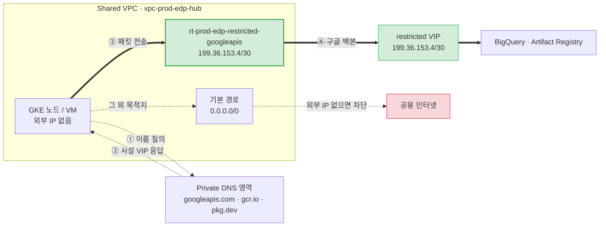

| 요소 | 역할 | 설정 절 |
|---|---|---|
| Private DNS 영역 | 구글 API 도메인을 restricted VIP로 응답 | 2-3-10-7-4 |
| 라우트 | VIP 대역으로 가는 경로 제공 | 2-3-10-7-3 |
| 서브넷 PGA | 외부 IP 없는 인스턴스의 VIP 접근 허용 | 이 절 |

하나라도 누락되면 증상은 동일하게 타임아웃으로 나타나므로, 장애 시 세 가지를 함께 확인합니다.

`--next-hop-gateway=default-internet-gateway` 는 GCP에서 "VPC 밖으로 내보낸다"는 의미의 기호에 가깝습니다. 목적지가 `199.36.153.4/30` 인 경우 구글 네트워크가 이를 내부 백본으로 처리하여 자사 API 프런트엔드로 전달하며, 패킷은 공용 인터넷을 거치지 않습니다. 기본 경로 `0.0.0.0/0` 가 존재함에도 전용 경로를 별도로 생성하는 이유는, 보안 설계상 기본 경로를 제거하거나 제약하는 환경에서도 구글 API 통신을 유지하기 위해서입니다. 더 구체적인 대역이 항상 우선하므로 인터넷 접근을 차단해도 이 통로는 유지됩니다.

`199.36.153.4/30` 은 restricted VIP, `199.36.153.8/30` 은 private VIP로 서로 다릅니다. DNS 레코드와 라우트가 동일한 대역을 가리켜야 하며, 어긋나면 타임아웃으로만 나타납니다.

<a name="9-7-3-restricted-vip-라우트"></a>

###### 2-3-10-7-3. restricted VIP 라우트

```bash
# 실행 위치: infra-son01 또는 Cloud Shell | 대상: gcp-prod-edp-hub-vpchost | 실행 계정: admin@sonmap.net (Shared VPC 관리자)
export HOST="gcp-prod-edp-hub-vpchost"
export NETWORK="vpc-prod-edp-hub"
export VPC_ADMIN_ACCOUNT="admin@sonmap.net"
gcloud compute routes create rt-prod-edp-restricted-googleapis \
  --project="$HOST" --network="$NETWORK" --account="$VPC_ADMIN_ACCOUNT" \
  --destination-range=199.36.153.4/30 \
  --next-hop-gateway=default-internet-gateway --priority=1000
```

<a name="9-7-4-private-dns-존과-레코드"></a>

###### 2-3-10-7-4. Private DNS 존과 레코드

`gcr.io`는 GKE 시스템 이미지, `pkg.dev`는 AR(edge 프로젝트의 Runner · Provisioner · 과제 Jupyter 이미지), `googleapis.com`은 나머지 API 경로입니다. 셋 중 하나라도 빠지면 배포 중 다른 지점에서 같은 타임아웃이 납니다.

```bash
# 실행 위치: infra-son01 또는 Cloud Shell | 대상: gcp-prod-edp-hub-vpchost | 실행 계정: admin@sonmap.net (Shared VPC 관리자)
export HOST="gcp-prod-edp-hub-vpchost"
export NETWORK="vpc-prod-edp-hub"
export VPC_ADMIN_ACCOUNT="admin@sonmap.net"
export PGA_IPS="199.36.153.4,199.36.153.5,199.36.153.6,199.36.153.7"

for Z in googleapis.com gcr.io pkg.dev; do
  gcloud dns managed-zones create "zone-$(echo $Z | tr '.' '-')" \
    --project="$HOST" --account="$VPC_ADMIN_ACCOUNT" \
    --dns-name="$Z." --visibility=private \
    --networks="$NETWORK" --description="Private Google Access"
done

gcloud dns record-sets create restricted.googleapis.com. --project="$HOST" \
  --zone=zone-googleapis-com --type=A --ttl=300 --rrdatas="$PGA_IPS" \
  --account="$VPC_ADMIN_ACCOUNT"
gcloud dns record-sets create "*.googleapis.com." --project="$HOST" \
  --zone=zone-googleapis-com --type=CNAME --ttl=300 \
  --rrdatas=restricted.googleapis.com. --account="$VPC_ADMIN_ACCOUNT"

gcloud dns record-sets create gcr.io. --project="$HOST" --zone=zone-gcr-io \
  --type=A --ttl=300 --rrdatas="$PGA_IPS" --account="$VPC_ADMIN_ACCOUNT"
gcloud dns record-sets create "*.gcr.io." --project="$HOST" --zone=zone-gcr-io \
  --type=CNAME --ttl=300 --rrdatas=gcr.io. --account="$VPC_ADMIN_ACCOUNT"

gcloud dns record-sets create pkg.dev. --project="$HOST" --zone=zone-pkg-dev \
  --type=A --ttl=300 --rrdatas="$PGA_IPS" --account="$VPC_ADMIN_ACCOUNT"
gcloud dns record-sets create "*.pkg.dev." --project="$HOST" --zone=zone-pkg-dev \
  --type=CNAME --ttl=300 --rrdatas=pkg.dev. --account="$VPC_ADMIN_ACCOUNT"
```

<a name="9-7-5-egress-방화벽-deny-all이-있는-경우에만"></a>

###### 2-3-10-7-5. EGRESS 방화벽 (deny-all이 있는 경우에만)

2-3-7-1의 조회에서 커스텀 EGRESS 규칙이 없으면 기본 `default-egress-allow`가 적용되므로 이 명령은 건너뜁니다.

```bash
# 실행 위치: infra-son01 또는 Cloud Shell | 대상: gcp-prod-edp-hub-vpchost | 실행 계정: admin@sonmap.net (Shared VPC 관리자)
export HOST="gcp-prod-edp-hub-vpchost"
export NETWORK="vpc-prod-edp-hub"
export VPC_ADMIN_ACCOUNT="admin@sonmap.net"
gcloud compute firewall-rules create fw-prod-edp-egress-restricted-vip \
  --project="$HOST" --network="$NETWORK" --account="$VPC_ADMIN_ACCOUNT" \
  --direction=EGRESS --priority=900 --action=ALLOW --rules=tcp:443 \
  --destination-ranges=199.36.153.4/30
```

<a name="9-7-6-확인"></a>

###### 2-3-10-7-6. 확인

클러스터가 이미 있으면 노드가 `Ready`인지 확인합니다. `NotReady`가 지속되면 노드 이벤트와 이미지 다운로드 경로를 확인합니다.

```bash
# 실행 위치: infra-son01 | 대상: 로컬 (변수 · 파일) | 실행 계정: user01@sonmap.net
dig +short asia-northeast3-artifactregistry.gcr.io
kubectl get nodes
```

`dig` 결과가 `199.36.153.x`이면 정상입니다. `infra-son01`이 다른 VPC에 있으면 공인 IP가 그대로 나올 수 있으므로 최종 판단은 `kubectl get nodes`로 합니다.

**증상 대조** · 이 단계를 누락하면 다음과 같이 나타납니다.

```text
Warning  FailedCreatePodSandBox  kubelet  failed to pull image
"asia-northeast3-artifactregistry.gcr.io/.../pause:3.8":
dial tcp 142.251.169.82:443: i/o timeout

Ready  False  KubeletNotReady  container runtime network not ready:
NetworkReady=false reason:NetworkPluginNotReady message:Network plugin
returns error: cni plugin not initialized
```

타임아웃 IP가 `142.x` · `172.x` · `192.178.x`이면 공인 IP로 해석되고 있다는 뜻입니다. `199.36.153.x`가 아니면 이 절이 적용되지 않은 상태입니다.

<a name="2-3-sandbox-프로젝트-관리자-실행-명령"></a>

### 2-4. Sandbox 프로젝트 관리자 실행 명령

앞부분에서 운영팀에 전달할 서비스 프로젝트 정보를 수집합니다. 뒷부분에서는 실제 배포 계정인 `tf-manager`로 조회해 운영팀의 회신과 대조합니다.

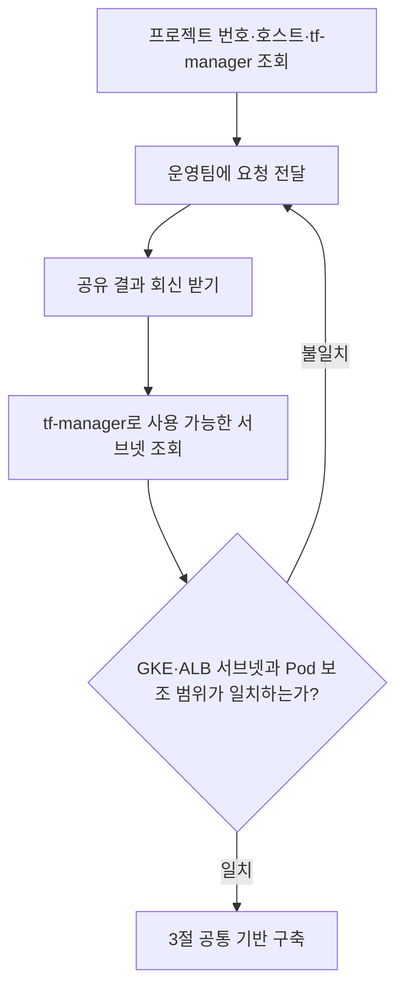

`gcp-sbx-gke01` 관리자는 1절의 프로젝트 API 활성화와 서비스 에이전트 준비를 수행합니다. 운영팀에 요청하기 전에 아래 명령으로 서비스 프로젝트 번호와 연결된 호스트를 확인합니다.

```bash
# 실행 위치: infra-son01 | 대상: gcp-sbx-gke01 | 실행 계정: user01@sonmap.net
export ADMIN_ACCOUNT="user01@sonmap.net"
export SBX_GKE_PROJECT="gcp-sbx-gke01"
export TF_MANAGER="tf-manager@gcp-sbx-gke01.iam.gserviceaccount.com"

gcloud projects describe "$SBX_GKE_PROJECT" \
  --account="$ADMIN_ACCOUNT" --format='value(projectNumber)'

gcloud compute shared-vpc get-host-project "$SBX_GKE_PROJECT" \
  --account="$ADMIN_ACCOUNT" --format='value(name)'

gcloud iam service-accounts describe "$TF_MANAGER" \
  --project="$SBX_GKE_PROJECT" --account="$ADMIN_ACCOUNT" --format='yaml(email,uniqueId)'
```

운영팀 회신 후 아래 명령을 배포 주체인 `tf-manager`로 실행해 서비스 프로젝트에 사용 가능한 서브넷을 확인합니다. 실행 계정에는 1절에 따라 `tf-manager` 가장 권한이 필요합니다.

```bash
# 실행 위치: infra-son01 | 대상: gcp-prod-edp-hub-vpchost | 실행 계정: user01@sonmap.net
export SBX_GKE_PROJECT="gcp-sbx-gke01"
export ADMIN_ACCOUNT="user01@sonmap.net"
export TF_MANAGER="tf-manager@gcp-sbx-gke01.iam.gserviceaccount.com"
# 수행 계정(가장): TF_MANAGER (tf-manager@gcp-sbx-gke01.iam.gserviceaccount.com)
# 조회 대상: gcp-prod-edp-hub-vpchost | 서비스 프로젝트: gcp-sbx-gke01
gcloud compute networks subnets list-usable --project=gcp-prod-edp-hub-vpchost \
  --service-project="$SBX_GKE_PROJECT" \
  --account="$ADMIN_ACCOUNT" --impersonate-service-account="$TF_MANAGER" --format=json
```

응답에서 운영팀이 회신한 GKE·ALB VIP 서브넷과 GKE Pod 보조 범위를 확인합니다. 서브넷 사용 목록과 운영팀 IAM 적용 결과가 확인되면 3절의 서비스 프로젝트 구축 명령을 실행합니다.

<a name="2-4-1-list-usable-오류"></a>

#### 2-4-1. `list-usable` 이 실패할 때

| 결과 | 원인 | 조치 |
|---|---|---|
| `HTTPError 400: Project gcp-sbx-gke01 does not exist or ... is not associated with gcp-prod-edp-hub-vpchost in Shared VPC` | 서비스 프로젝트가 호스트에 연결되지 않음 (또는 프로젝트 ID 오타) | [2-3-0](#2-3-0-서비스-프로젝트-shared-vpc-연결) |
| `[]` (빈 목록) | 연결은 됐지만 서브넷 IAM 이 없거나 반영 전 | [2-3-8](#2-3-8-서브넷-및-호스트-iam-적용) 실행 후 1 ~ 2분 뒤 재조회 |
| `getAccessToken denied` | `user01` 의 `tf-manager` 가장 권한 없음 | 1-8 |

이 400 오류는 "프로젝트 없음" 과 "연결 안 됨" 을 구분하지 않습니다. 호스트에는 `gcp-sbx-edp-gke01` (예전) 과 `gcp-sbx-gke01` (지금) 처럼 한 토막만 다른 ID 가 함께 붙어 있을 수 있으니 ID 부터 확인합니다.

</details>

<a name="3-공통-기반"></a>

<a name="-3-공통-기반"></a>

## 3. 공통 기반

<details>
<summary>내용 펼치기 / 접기</summary>

GCS와 AR을 준비한 뒤 GKE와 배포 이미지를 구성합니다. 기존 Workflows 자동 배포를 사용한다면 해당 런타임 구간을 적용하고, 접속용 내부 ALB와 TLS도 준비합니다.

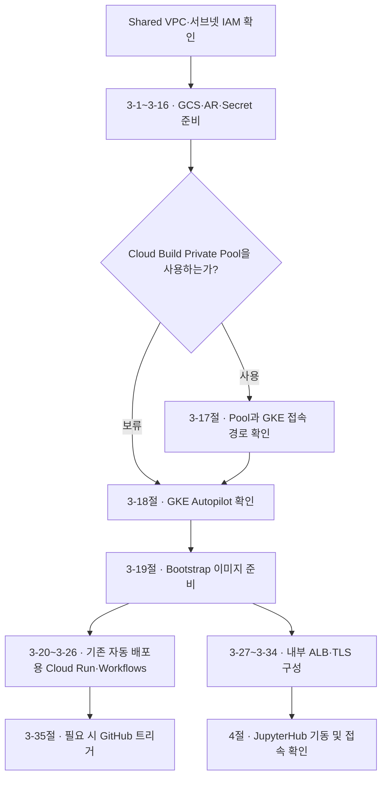

**3-1~3-9절 · Cloud Storage 버킷 구성**

세 버킷은 `gcp-sbx-gke01`의 `asia-northeast3`에 생성합니다. 도식의 이름은 공통 접두사 `gcp-sbx-gke01-sbxtest01-` 뒤에 붙습니다. 생성 시 균일한 버킷 수준 액세스와 공개 액세스 방지를 설정하고, 후속 명령에서 객체 버전 관리를 활성화합니다.

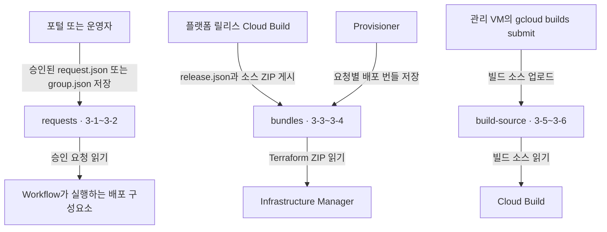

3-7~3-8절은 `sbx-manager`에 두 버킷(`requests`, `bundles`)의 객체 관리 권한을 부여합니다. 3-9절은 Infrastructure Manager 서비스 에이전트에 `bundles`의 객체 읽기 권한을 부여합니다.

필요한 변수 선언을 아래 코드 블록 맨 앞에 포함했습니다. 별도 문서에서 변수를 설정할 필요 없이, 이 문서의 선언부터 같은 터미널에서 실행합니다. `# 주석`을 보며 순서대로 실행하고, **기존 자원이 있으면 해당 생성 명령을 건너뜁니다.** 403·인증·연결 오류면 중단합니다. 선택 작업은 주석을 해제한 경우에만 실행합니다.

```bash
# ── 이 문서에서 사용하는 변수 선언 ──
# 아래 값을 확인하고 이 블록부터 같은 터미널에서 실행합니다.
unset CLOUDSDK_AUTH_IMPERSONATE_SERVICE_ACCOUNT
export ADMIN_ACCOUNT=user01@sonmap.net
# 실행 프로젝트 작업자는 user01(그룹 pgrp-gcp-sbx01), Shared VPC·초기 권한 관리자는 admin으로 구분합니다.
export VPC_ADMIN_ACCOUNT="${VPC_ADMIN_ACCOUNT:-admin@sonmap.net}"
export OPERATOR_MEMBER=group:pgrp-gcp-sbx01@sonmap.net
export SBX_GKE_PROJECT="gcp-sbx-gke01"
export AR_PROJECT="gcp-prod-edp-edge-509423"
export AR_REPOSITORY="ar-sbxtest01-platform"
export VPC_HOST_PROJECT="gcp-prod-edp-hub-vpchost"
export REGION=asia-northeast3
export NETWORK=vpc-prod-edp-hub
# 내부 ALB 대역 후보: VPC Admin의 실제 중복 확인·승인 후 실행합니다.
export ILB_VIP_SUBNET=subnet-prod-edp-alb-frontend-an3
export ILB_VIP_CIDR=172.31.96.0/27
export ILB_VIP_ADDRESS="" # 예약 후 실제 할당 주소 조회
export ILB_PROXY_SUBNET=subnet-prod-sbx-ilb-proxy
export ILB_PROXY_CIDR=172.31.111.64/26
export MAIN_CLUSTER=gke-sbx-main-an3
export MAIN_SUBNET=subnet-prod-sbx-gke-01
export MAIN_POD_RANGE=subnet-prod-sbx-pod-01
export MAIN_CP_CIDR=10.253.3.0/28
export PSA_CIDR=10.250.0.0/24
export ADMIN_CIDR=172.31.10.0/24
export TF_MANAGER="tf-manager@${SBX_GKE_PROJECT}.iam.gserviceaccount.com"
export SBX_MANAGER="sbx-manager@${SBX_GKE_PROJECT}.iam.gserviceaccount.com"
# 실행 위치: infra-son01 | 대상: gcp-sbx-gke01 | 실행 계정: user01@sonmap.net
export SBX_GKE_PROJECT_NUMBER="402269387486"   # gcp-sbx-gke01 프로젝트 번호 (바뀌지 않음. 확인: gcloud projects describe gcp-sbx-gke01 --format='value(projectNumber)')
# 프로젝트 번호는 자동 조회합니다. 조회 실패 또는 숫자가 아닌 결과이면 이후 명령을 중단합니다.

# 2절의 네트워크·서브넷 IAM 확인 후 저장소 루트에서 실행합니다.
# 기존 GKE는 Autopilot · Private Nodes/Endpoint · Subnet · Pod Range를 확인합니다.
# Private Pool이 필요해지면 GKE 사설 접속 경로를 별도로 검토합니다.

```

<a name="-1-storage-buckets-create-gsgcp-sbx-gke01-sbxtest01-requests"></a>

<a name="1-storage-buckets-create-gsgcp-sbx-gke01-sbxtest01-requests"></a>

### 3-1. storage buckets create gs://gcp-sbx-gke01-sbxtest01-requests

```bash
# 기존 자원 확인
# 실행 위치: infra-son01 | 대상: gcp-sbx-gke01 | 실행 계정: user01@sonmap.net | 가장: tf-manager
export SBX_GKE_PROJECT="gcp-sbx-gke01"
export REGION="asia-northeast3"
export ADMIN_ACCOUNT="user01@sonmap.net"
export TF_MANAGER="tf-manager@gcp-sbx-gke01.iam.gserviceaccount.com"
gcloud storage buckets describe "gs://${SBX_GKE_PROJECT}-sbxtest01-requests" --format=json \
  --account="${ADMIN_ACCOUNT}" --impersonate-service-account="${TF_MANAGER}"
# 조회 결과가 명시적 Not Found일 때만 아래 생성 명령을 실행합니다.
gcloud storage buckets create "gs://${SBX_GKE_PROJECT}-sbxtest01-requests" \
  --project="${SBX_GKE_PROJECT}" --location="${REGION}" --uniform-bucket-level-access \
  --public-access-prevention --account="${ADMIN_ACCOUNT}" \
  --impersonate-service-account="${TF_MANAGER}"

```

<a name="-2-storage-buckets-update-gsgcp-sbx-gke01-sbxtest01-requests"></a>

<a name="2-storage-buckets-update-gsgcp-sbx-gke01-sbxtest01-requests"></a>

### 3-2. storage buckets update gs://gcp-sbx-gke01-sbxtest01-requests

```bash
# 실행 위치: infra-son01 | 대상: gcp-sbx-gke01 | 실행 계정: user01@sonmap.net | 가장: tf-manager
export SBX_GKE_PROJECT="gcp-sbx-gke01"
export ADMIN_ACCOUNT="user01@sonmap.net"
export TF_MANAGER="tf-manager@gcp-sbx-gke01.iam.gserviceaccount.com"
gcloud storage buckets update "gs://${SBX_GKE_PROJECT}-sbxtest01-requests" --versioning \
  --public-access-prevention --account="${ADMIN_ACCOUNT}" \
  --impersonate-service-account="${TF_MANAGER}"

```

<a name="-3-storage-buckets-create-gsgcp-sbx-gke01-sbxtest01-bundles"></a>

<a name="3-storage-buckets-create-gsgcp-sbx-gke01-sbxtest01-bundles"></a>

### 3-3. storage buckets create gs://gcp-sbx-gke01-sbxtest01-bundles

```bash
# 기존 자원 확인
# 실행 위치: infra-son01 | 대상: gcp-sbx-gke01 | 실행 계정: user01@sonmap.net | 가장: tf-manager
export SBX_GKE_PROJECT="gcp-sbx-gke01"
export REGION="asia-northeast3"
export ADMIN_ACCOUNT="user01@sonmap.net"
export TF_MANAGER="tf-manager@gcp-sbx-gke01.iam.gserviceaccount.com"
gcloud storage buckets describe "gs://${SBX_GKE_PROJECT}-sbxtest01-bundles" --format=json \
  --account="${ADMIN_ACCOUNT}" --impersonate-service-account="${TF_MANAGER}"
# 조회 결과가 명시적 Not Found일 때만 아래 생성 명령을 실행합니다.
gcloud storage buckets create "gs://${SBX_GKE_PROJECT}-sbxtest01-bundles" \
  --project="${SBX_GKE_PROJECT}" --location="${REGION}" --uniform-bucket-level-access \
  --public-access-prevention --account="${ADMIN_ACCOUNT}" \
  --impersonate-service-account="${TF_MANAGER}"

```

<a name="-4-storage-buckets-update-gsgcp-sbx-gke01-sbxtest01-bundles"></a>

<a name="4-storage-buckets-update-gsgcp-sbx-gke01-sbxtest01-bundles"></a>

### 3-4. storage buckets update gs://gcp-sbx-gke01-sbxtest01-bundles

```bash
# 실행 위치: infra-son01 | 대상: gcp-sbx-gke01 | 실행 계정: user01@sonmap.net | 가장: tf-manager
export SBX_GKE_PROJECT="gcp-sbx-gke01"
export ADMIN_ACCOUNT="user01@sonmap.net"
export TF_MANAGER="tf-manager@gcp-sbx-gke01.iam.gserviceaccount.com"
gcloud storage buckets update "gs://${SBX_GKE_PROJECT}-sbxtest01-bundles" --versioning \
  --public-access-prevention --account="${ADMIN_ACCOUNT}" \
  --impersonate-service-account="${TF_MANAGER}"

```

<a name="-5-storage-buckets-create-gsgcp-sbx-gke01-sbxtest01-build-source"></a>

<a name="5-storage-buckets-create-gsgcp-sbx-gke01-sbxtest01-build-source"></a>

### 3-5. storage buckets create gs://gcp-sbx-gke01-sbxtest01-build-source

```bash
# 기존 자원 확인
# 실행 위치: infra-son01 | 대상: gcp-sbx-gke01 | 실행 계정: user01@sonmap.net | 가장: tf-manager
export SBX_GKE_PROJECT="gcp-sbx-gke01"
export REGION="asia-northeast3"
export ADMIN_ACCOUNT="user01@sonmap.net"
export TF_MANAGER="tf-manager@gcp-sbx-gke01.iam.gserviceaccount.com"
gcloud storage buckets describe "gs://${SBX_GKE_PROJECT}-sbxtest01-build-source" --format=json \
  --account="${ADMIN_ACCOUNT}" --impersonate-service-account="${TF_MANAGER}"
# 조회 결과가 명시적 Not Found일 때만 아래 생성 명령을 실행합니다.
gcloud storage buckets create "gs://${SBX_GKE_PROJECT}-sbxtest01-build-source" \
  --project="${SBX_GKE_PROJECT}" --location="${REGION}" --uniform-bucket-level-access \
  --public-access-prevention --account="${ADMIN_ACCOUNT}" \
  --impersonate-service-account="${TF_MANAGER}"

```

<a name="-6-storage-buckets-update-gsgcp-sbx-gke01-sbxtest01-build-source"></a>

<a name="6-storage-buckets-update-gsgcp-sbx-gke01-sbxtest01-build-source"></a>

### 3-6. storage buckets update gs://gcp-sbx-gke01-sbxtest01-build-source

```bash
# 실행 위치: infra-son01 | 대상: gcp-sbx-gke01 | 실행 계정: user01@sonmap.net | 가장: tf-manager
export SBX_GKE_PROJECT="gcp-sbx-gke01"
export ADMIN_ACCOUNT="user01@sonmap.net"
export TF_MANAGER="tf-manager@gcp-sbx-gke01.iam.gserviceaccount.com"
gcloud storage buckets update "gs://${SBX_GKE_PROJECT}-sbxtest01-build-source" --versioning \
  --public-access-prevention --account="${ADMIN_ACCOUNT}" \
  --impersonate-service-account="${TF_MANAGER}"

```

<a name="-7-storage-buckets-add-iam-policy-binding-gsgcp-sbx-gke01-sbxtest01-requests--rolesstorageobjectadmin"></a>

<a name="7-storage-buckets-add-iam-policy-binding-gsgcp-sbx-gke01-sbxtest01-requests--rolesstorageobjectadmin"></a>

### 3-7. storage buckets add-iam-policy-binding gs://gcp-sbx-gke01-sbxtest01-requests · roles/storage.objectAdmin

```bash
# 실행 위치: infra-son01 | 대상: gcp-sbx-gke01 | 실행 계정: user01@sonmap.net | 가장: tf-manager
export SBX_GKE_PROJECT="gcp-sbx-gke01"
export ADMIN_ACCOUNT="user01@sonmap.net"
export TF_MANAGER="tf-manager@gcp-sbx-gke01.iam.gserviceaccount.com"
export SBX_MANAGER="sbx-manager@gcp-sbx-gke01.iam.gserviceaccount.com"
gcloud storage buckets add-iam-policy-binding "gs://${SBX_GKE_PROJECT}-sbxtest01-requests" \
  --member="serviceAccount:${SBX_MANAGER}" --role=roles/storage.objectAdmin \
  --account="${ADMIN_ACCOUNT}" --impersonate-service-account="${TF_MANAGER}"

```

<a name="-8-storage-buckets-add-iam-policy-binding-gsgcp-sbx-gke01-sbxtest01-bundles--rolesstorageobjectadmin"></a>

<a name="8-storage-buckets-add-iam-policy-binding-gsgcp-sbx-gke01-sbxtest01-bundles--rolesstorageobjectadmin"></a>

### 3-8. storage buckets add-iam-policy-binding gs://gcp-sbx-gke01-sbxtest01-bundles · roles/storage.objectAdmin

```bash
# 실행 위치: infra-son01 | 대상: gcp-sbx-gke01 | 실행 계정: user01@sonmap.net | 가장: tf-manager
export SBX_GKE_PROJECT="gcp-sbx-gke01"
export ADMIN_ACCOUNT="user01@sonmap.net"
export TF_MANAGER="tf-manager@gcp-sbx-gke01.iam.gserviceaccount.com"
export SBX_MANAGER="sbx-manager@gcp-sbx-gke01.iam.gserviceaccount.com"
gcloud storage buckets add-iam-policy-binding "gs://${SBX_GKE_PROJECT}-sbxtest01-bundles" \
  --member="serviceAccount:${SBX_MANAGER}" --role=roles/storage.objectAdmin \
  --account="${ADMIN_ACCOUNT}" --impersonate-service-account="${TF_MANAGER}"

```

<a name="-9-storage-buckets-add-iam-policy-binding-gsgcp-sbx-gke01-sbxtest01-bundles--rolesstorageobjectviewer"></a>

<a name="9-storage-buckets-add-iam-policy-binding-gsgcp-sbx-gke01-sbxtest01-bundles--rolesstorageobjectviewer"></a>

### 3-9. storage buckets add-iam-policy-binding gs://gcp-sbx-gke01-sbxtest01-bundles · roles/storage.objectViewer

```bash
# 실행 위치: infra-son01 | 대상: gcp-sbx-gke01 | 실행 계정: user01@sonmap.net | 가장: tf-manager
export SBX_GKE_PROJECT="gcp-sbx-gke01"
export ADMIN_ACCOUNT="user01@sonmap.net"
export TF_MANAGER="tf-manager@gcp-sbx-gke01.iam.gserviceaccount.com"
export SBX_GKE_PROJECT_NUMBER="402269387486"   # gcp-sbx-gke01 프로젝트 번호 (바뀌지 않음. 확인: gcloud projects describe gcp-sbx-gke01 --format='value(projectNumber)')
gcloud storage buckets add-iam-policy-binding "gs://${SBX_GKE_PROJECT}-sbxtest01-bundles" \
  --member="serviceAccount:service-${SBX_GKE_PROJECT_NUMBER}@gcp-sa-config.iam.gserviceaccount.com" \
  --role=roles/storage.objectViewer --account="${ADMIN_ACCOUNT}" \
  --impersonate-service-account="${TF_MANAGER}"

```

<a name="-10-artifacts-repositories-create-ar-sbxtest01-platform"></a>

<a name="10-artifacts-repositories-create-ar-sbxtest01-platform"></a>

### 3-10. Artifact Registry — edge 프로젝트의 기존 저장소 사용

이미지는 `gcp-sbx-gke01` 에 저장소를 만들지 않고 **`gcp-prod-edp-edge-509423` 의 Artifact Registry** 를 씁니다. Runner · Provisioner 이미지와 과제 Jupyter 이미지가 모두 여기에 있습니다. 저장소가 다른 프로젝트에 있으므로 **3-11 · 3-12 의 권한은 edge 프로젝트 관리자가 부여**합니다.

edge 는 운영 프로젝트이므로 Sandbox 작업 계정(`user01@sonmap.net`)이 아닌 edge 관리자 계정으로 실행합니다. 변수도 `ADMIN_ACCOUNT` 와 분리해 앞 절의 export 가 남아 있어도 섞이지 않도록 합니다.

| 작업 | 필요 역할 |
|---|---|
| 저장소 조회 (3-10) | `roles/artifactregistry.reader` 이상 |
| 권한 부여 (3-11 · 3-12) | `roles/artifactregistry.admin` 또는 `roles/resourcemanager.projectIamAdmin` |

```bash
# 실행 위치: infra-son01 | 대상: gcp-prod-edp-edge-509423 | 실행 계정: admin@sonmap.net (edge 프로젝트 관리자)
export REGION="asia-northeast3"
export AR_ADMIN_ACCOUNT="admin@sonmap.net"
export AR_PROJECT="gcp-prod-edp-edge-509423"
export AR_REPOSITORY="ar-sbxtest01-platform"   # 실제 사용할 저장소 이름으로 바꿉니다
gcloud artifacts repositories list --project="${AR_PROJECT}" --location="${REGION}" \
  --format='table(name.basename(),format,createTime)' --account="${AR_ADMIN_ACCOUNT}"
gcloud artifacts repositories describe "${AR_REPOSITORY}" --project="${AR_PROJECT}" \
  --location="${REGION}" --account="${AR_ADMIN_ACCOUNT}"
```

실행 전 해당 계정이 필요한 권한을 보유하고 있는지 확인합니다. `gcloud` 에는 권한 시험 명령이 없어 Resource Manager API 를 직접 호출합니다.

```bash
# 실행 위치: infra-son01 | 대상: gcp-prod-edp-edge-509423 (조회) | 실행 계정: admin@sonmap.net (edge 프로젝트 관리자)
export AR_ADMIN_ACCOUNT="admin@sonmap.net"
export AR_PROJECT="gcp-prod-edp-edge-509423"
curl -sS -X POST \
  -H "Authorization: Bearer $(gcloud auth print-access-token --account="${AR_ADMIN_ACCOUNT}")" \
  -H "Content-Type: application/json" \
  -d '{"permissions":["artifactregistry.repositories.get","artifactregistry.repositories.create","artifactregistry.repositories.setIamPolicy"]}' \
  "https://cloudresourcemanager.googleapis.com/v1/projects/${AR_PROJECT}:testIamPermissions"
```

응답의 `permissions` 에 있는 것이 이 계정이 **가진** 권한입니다.

| 응답에 있는 권한 | 할 수 있는 절 |
|---|---|
| `artifactregistry.repositories.get` | 3-10 조회 |
| `artifactregistry.repositories.create` | 3-10 저장소 생성 |
| `artifactregistry.repositories.setIamPolicy` | 3-11 · 3-12 권한 부여 |

`setIamPolicy` 가 없으면 3-11 · 3-12 를 수행할 수 없으므로 edge 프로젝트 관리자에게 해당 작업을 요청합니다. 응답이 `{}` 이면 세 가지 모두 없는 것입니다.

**`describe` 가 `NOT_FOUND` 이면** 그 이름의 저장소가 edge 프로젝트에 없는 것입니다. 둘 중 하나로 진행합니다.

| 경우 | 조치 |
|---|---|
| 위 `list` 결과에 쓸 저장소가 있음 | 그 이름을 알려 주면 저장소 전체의 `ar-sbxtest01-platform` 을 그 이름으로 바꿉니다 (3-11 · 3-12 · 3-19 · `provisioner-env.yaml` · 요청 예시 모두) |
| 쓸 저장소가 없음 | 아래 명령으로 만듭니다 |

```bash
# 실행 위치: infra-son01 | 대상: gcp-prod-edp-edge-509423 | 실행 계정: admin@sonmap.net (edge 프로젝트 관리자)
export REGION="asia-northeast3"
export AR_ADMIN_ACCOUNT="admin@sonmap.net"
export AR_PROJECT="gcp-prod-edp-edge-509423"
export AR_REPOSITORY="ar-sbxtest01-platform"
gcloud artifacts repositories create "${AR_REPOSITORY}" --project="${AR_PROJECT}" \
  --location="${REGION}" --repository-format=docker \
  --description="Sandbox GKE runner, provisioner and task Jupyter images" \
  --account="${AR_ADMIN_ACCOUNT}"
gcloud artifacts repositories describe "${AR_REPOSITORY}" --project="${AR_PROJECT}" \
  --location="${REGION}" --account="${AR_ADMIN_ACCOUNT}" --format='value(name,format)'
```

`PERMISSION_DENIED` 면 `admin@sonmap.net` 에 edge 프로젝트의 `roles/artifactregistry.admin` 이 없는 것이므로 edge 프로젝트 관리자에게 생성을 요청합니다.

### 3-11. 이미지 올리기 권한 — tf-manager

Cloud Build(`tf-manager` 로 실행)가 Runner · Provisioner 이미지를 올립니다.

```bash
# 실행 위치: Cloud Shell | 대상: gcp-prod-edp-edge-509423 | 실행 계정: admin@sonmap.net (edge 프로젝트 AR 관리자)
export REGION="asia-northeast3"
export AR_ADMIN_ACCOUNT="admin@sonmap.net"
export TF_MANAGER="tf-manager@gcp-sbx-gke01.iam.gserviceaccount.com"
export AR_PROJECT="gcp-prod-edp-edge-509423"
export AR_REPOSITORY="ar-sbxtest01-platform"
gcloud artifacts repositories add-iam-policy-binding "${AR_REPOSITORY}" \
  --project="${AR_PROJECT}" --location="${REGION}" \
  --member="serviceAccount:${TF_MANAGER}" --role=roles/artifactregistry.writer \
  --account="${AR_ADMIN_ACCOUNT}"
```

### 3-12. 이미지 받기 권한 — GKE 노드 · Cloud Run · Cloud Build

다른 프로젝트의 이미지를 받으려면 받는 쪽 계정마다 읽기 권한이 필요합니다.

| 받는 계정 | 받는 이미지 |
|---|---|
| GKE 노드 계정 `${SBX_GKE_PROJECT_NUMBER}-compute@developer.gserviceaccount.com` | 과제 Jupyter 이미지 |
| Cloud Run 서비스 에이전트 `service-${SBX_GKE_PROJECT_NUMBER}@serverless-robot-prod.iam.gserviceaccount.com` | Provisioner 이미지 |
| `tf-manager` (Cloud Build 실행 계정) | Runner 이미지 (3-11 writer 에 포함) |

```bash
# 실행 위치: Cloud Shell | 대상: gcp-prod-edp-edge-509423 | 실행 계정: admin@sonmap.net (edge 프로젝트 AR 관리자)
export REGION="asia-northeast3"
export AR_ADMIN_ACCOUNT="admin@sonmap.net"
export AR_PROJECT="gcp-prod-edp-edge-509423"
export AR_REPOSITORY="ar-sbxtest01-platform"
export SBX_GKE_PROJECT_NUMBER="402269387486"   # gcp-sbx-gke01 프로젝트 번호 (바뀌지 않음. 확인: gcloud projects describe gcp-sbx-gke01 --format='value(projectNumber)')
echo "SBX_GKE_PROJECT_NUMBER=${SBX_GKE_PROJECT_NUMBER}"   # 402269387486
if [[ "${SBX_GKE_PROJECT_NUMBER}" =~ ^[0-9]+$ ]]; then
  for member in \
    "serviceAccount:${SBX_GKE_PROJECT_NUMBER}-compute@developer.gserviceaccount.com" \
    "serviceAccount:service-${SBX_GKE_PROJECT_NUMBER}@serverless-robot-prod.iam.gserviceaccount.com"; do
    gcloud artifacts repositories add-iam-policy-binding "${AR_REPOSITORY}" \
      --project="${AR_PROJECT}" --location="${REGION}" \
      --member="${member}" --role=roles/artifactregistry.reader \
      --account="${AR_ADMIN_ACCOUNT}" --format=none && echo "[OK] reader: ${member}"
  done
else
  echo "프로젝트 번호 조회 실패. 위 오류를 확인하세요. 권한은 부여하지 않았습니다."
fi
```

VPC Service Controls 경계가 있으면 두 프로젝트가 같은 경계 안에 있거나 경계 규칙이 허용해야 받을 수 있습니다.

<a name="-13-secrets-create-jupyter-oauth-client-id"></a>

<a name="13-secrets-create-jupyter-oauth-client-id"></a>

### 3-13. secrets create jupyter-oauth-client-id

> **테스트 중에는 3-13 ~ 3-16 을 건너뛰고 3-17 로 갑니다.** `HUB_AUTH_MODE: dummy` 에서는 이 Secret 을 쓰지 않습니다. 실제 로그인 서버를 연동할 때(`oauth`) 실행하고, 값은 4-5절에서 등록합니다.

```bash
# 기존 자원 확인
# 실행 위치: infra-son01 | 대상: gcp-sbx-gke01 | 실행 계정: user01@sonmap.net | 가장: tf-manager
export SBX_GKE_PROJECT="gcp-sbx-gke01"
export REGION="asia-northeast3"
export ADMIN_ACCOUNT="user01@sonmap.net"
export TF_MANAGER="tf-manager@gcp-sbx-gke01.iam.gserviceaccount.com"
gcloud secrets describe jupyter-oauth-client-id --project="${SBX_GKE_PROJECT}" --format=json \
  --account="${ADMIN_ACCOUNT}" --impersonate-service-account="${TF_MANAGER}"
# 조회 결과가 명시적 Not Found일 때만 아래 생성 명령을 실행합니다.
gcloud secrets create jupyter-oauth-client-id --project="${SBX_GKE_PROJECT}" \
  --replication-policy=user-managed --locations="${REGION}" --account="${ADMIN_ACCOUNT}" \
  --impersonate-service-account="${TF_MANAGER}"

```

<a name="-14-secrets-add-iam-policy-binding-jupyter-oauth-client-id--rolessecretmanagersecretaccessor"></a>

<a name="14-secrets-add-iam-policy-binding-jupyter-oauth-client-id--rolessecretmanagersecretaccessor"></a>

### 3-14. secrets add-iam-policy-binding jupyter-oauth-client-id · roles/secretmanager.secretAccessor

```bash
# 실행 위치: infra-son01 | 대상: gcp-sbx-gke01 | 실행 계정: user01@sonmap.net | 가장: tf-manager
export SBX_GKE_PROJECT="gcp-sbx-gke01"
export ADMIN_ACCOUNT="user01@sonmap.net"
export TF_MANAGER="tf-manager@gcp-sbx-gke01.iam.gserviceaccount.com"
gcloud secrets add-iam-policy-binding jupyter-oauth-client-id --project="${SBX_GKE_PROJECT}" \
  --member="serviceAccount:${TF_MANAGER}" --role=roles/secretmanager.secretAccessor \
  --account="${ADMIN_ACCOUNT}" --impersonate-service-account="${TF_MANAGER}"

```

<a name="-15-secrets-create-jupyter-oauth-client-secret"></a>

<a name="15-secrets-create-jupyter-oauth-client-secret"></a>

### 3-15. secrets create jupyter-oauth-client-secret

```bash
# 기존 자원 확인
# 실행 위치: infra-son01 | 대상: gcp-sbx-gke01 | 실행 계정: user01@sonmap.net | 가장: tf-manager
export SBX_GKE_PROJECT="gcp-sbx-gke01"
export REGION="asia-northeast3"
export ADMIN_ACCOUNT="user01@sonmap.net"
export TF_MANAGER="tf-manager@gcp-sbx-gke01.iam.gserviceaccount.com"
gcloud secrets describe jupyter-oauth-client-secret --project="${SBX_GKE_PROJECT}" --format=json \
  --account="${ADMIN_ACCOUNT}" --impersonate-service-account="${TF_MANAGER}"
# 조회 결과가 명시적 Not Found일 때만 아래 생성 명령을 실행합니다.
gcloud secrets create jupyter-oauth-client-secret --project="${SBX_GKE_PROJECT}" \
  --replication-policy=user-managed --locations="${REGION}" --account="${ADMIN_ACCOUNT}" \
  --impersonate-service-account="${TF_MANAGER}"

```

<a name="-16-secrets-add-iam-policy-binding-jupyter-oauth-client-secret--rolessecretmanagersecretaccessor"></a>

<a name="16-secrets-add-iam-policy-binding-jupyter-oauth-client-secret--rolessecretmanagersecretaccessor"></a>

### 3-16. secrets add-iam-policy-binding jupyter-oauth-client-secret · roles/secretmanager.secretAccessor

```bash
# 실행 위치: infra-son01 | 대상: gcp-sbx-gke01 | 실행 계정: user01@sonmap.net | 가장: tf-manager
export SBX_GKE_PROJECT="gcp-sbx-gke01"
export ADMIN_ACCOUNT="user01@sonmap.net"
export TF_MANAGER="tf-manager@gcp-sbx-gke01.iam.gserviceaccount.com"
gcloud secrets add-iam-policy-binding jupyter-oauth-client-secret --project="${SBX_GKE_PROJECT}" \
  --member="serviceAccount:${TF_MANAGER}" --role=roles/secretmanager.secretAccessor \
  --account="${ADMIN_ACCOUNT}" --impersonate-service-account="${TF_MANAGER}"

```

<a name="-17-shared-vpc-운영팀-작업--private-pool-초기-구성"></a>

<a name="17-shared-vpc-운영팀-작업--private-pool-초기-구성"></a>

### 3-17. Shared VPC 운영팀 작업 · Private Pool 초기 구성

과제 자동화(Infrastructure Manager 와 ALB 단계)에 사용할 `pool-sbxtest01`을 준비합니다. **2-3-9절**에서 `psa-prod-edp-cloudbuild`의 `10.250.0.0/24` 예약과 Service Networking 피어링이 확인됐다면 아래 조회부터 진행합니다. Pool 은 그중 `10.250.0.0/29` 만 씁니다.

<a name="17-1-기존-pool-조회"></a>

#### 3-17-1. 기존 Pool 조회

```bash
# 실행 위치: Cloud Shell 또는 infra-son01 | 대상: gcp-sbx-gke01 | 실행 계정: admin@sonmap.net
gcloud builds worker-pools describe pool-sbxtest01 \
  --project=gcp-sbx-gke01 --region=asia-northeast3 \
  --account=admin@sonmap.net --format='value(state)'
```

`RUNNING`이면 생성 단계를 건너뛰고 3-17-3의 접속 점검으로 진행합니다. `NOT_FOUND`이면 3-17-2를 실행합니다.

<a name="17-2-private-pool-생성"></a>

#### 3-17-2. Private Pool 생성

Pool 작업자 IP 는 PSA 예약 `10.250.0.0/24` 안에서 **`10.250.0.0/29` 만** 씁니다. 나머지 `10.250.0.8 ~ 10.250.0.255` 는 같은 피어링을 쓰는 다른 관리형 서비스(다른 Pool, Cloud SQL 등)용으로 남습니다.

| 범위 | 주소 | 작업자 VM 최대 |
|---|---|---|
| `/29` (이 설정) | 8개 (사용 6개) | **6대** |
| `/24` (기본값) | 256개 (사용 254개) | 254대 |

과제 요청 하나가 Pool 작업자를 **최대 2대** 씁니다(배포 빌드 1대 + 그 안에서 실행되는 Infrastructure Manager 빌드 1대). 그래서 `/29` 에서는 **과제 3개 정도까지 동시에** 처리되고, 넘치는 빌드는 대기열에서 기다립니다. 테스트에는 충분합니다. `/29` 가 Cloud Build 가 허용하는 가장 작은 범위이고, **Pool 을 만든 뒤에는 범위를 바꿀 수 없으므로** 늘리려면 Pool 을 다시 만들어야 합니다.

```bash
# 실행 위치: Cloud Shell 또는 infra-son01 | 대상: gcp-sbx-gke01 (Pool) · gcp-prod-edp-hub-vpchost (피어링 VPC) | 실행 계정: admin@sonmap.net
gcloud builds worker-pools create pool-sbxtest01 \
  --project=gcp-sbx-gke01 \
  --region=asia-northeast3 \
  --worker-machine-type=e2-standard-4 \
  --worker-disk-size=100GB \
  --peered-network=projects/gcp-prod-edp-hub-vpchost/global/networks/vpc-prod-edp-hub \
  --peered-network-ip-range=10.250.0.0/29 \
  --account=admin@sonmap.net

# 확인 → RUNNING · 10.250.0.0/29
gcloud builds worker-pools describe pool-sbxtest01 \
  --project=gcp-sbx-gke01 --region=asia-northeast3 --account=admin@sonmap.net \
  --format='value(state,privatePoolV1Config.networkConfig.peeredNetworkIpRange)'
```

**테스트에서는 `--no-public-egress` 를 넣지 않습니다.** 이 옵션을 넣으면 작업자가 인터넷에 나가지 못해, `50-workload` 가 Kubernetes provider 를 `registry.terraform.io` 에서 받지 못하고 4-1 점검이 `curl: (28) Connection timed out` 으로 실패합니다. 이미 이 옵션으로 만들었다면 4-1-1 에서 송신을 엽니다. 피어링(GKE · PSA 사설 접속)은 그대로 유지됩니다.

<a name="17-3-상태-및-gke-접속-확인"></a>

#### 3-17-3. 상태 및 GKE 접속 확인

3-17-1을 다시 실행해 `RUNNING`을 확인합니다. 이어서 `infra-son01`에서 [Private Pool의 GKE 접속 점검](reference/cloudbuild-private-gke-vpn-design.md)을 수행합니다. 점검 빌드가 성공하면 [2차 Sandbox의 Workflow 실행 전 확인](../03.sandbox_deploy/README.md#5-배포-전-확인)으로 진행합니다.

<a name="-18-container-clusters-create-auto-gke-sbx-main-an3"></a>

<a name="18-container-clusters-create-auto-gke-sbx-main-an3"></a>

### 3-18. container clusters create-auto gke-sbx-main-an3

```bash
# 기존 자원 확인
# 실행 위치: infra-son01 | 대상: gcp-sbx-gke01 | 실행 계정: user01@sonmap.net | 가장: tf-manager
export SBX_GKE_PROJECT="gcp-sbx-gke01"
export REGION="asia-northeast3"
export VPC_HOST_PROJECT="gcp-prod-edp-hub-vpchost"
export NETWORK="vpc-prod-edp-hub"
export ADMIN_ACCOUNT="user01@sonmap.net"
export TF_MANAGER="tf-manager@gcp-sbx-gke01.iam.gserviceaccount.com"
export MAIN_SUBNET="subnet-prod-sbx-gke-01"
export MAIN_POD_RANGE="subnet-prod-sbx-pod-01"
export MAIN_CP_CIDR="10.253.3.0/28"
export MAIN_CLUSTER="gke-sbx-main-an3"
export ADMIN_CIDR="172.31.10.0/24"
gcloud container clusters describe "${MAIN_CLUSTER}" --project="${SBX_GKE_PROJECT}" \
  --region="${REGION}" --format=json --account="${ADMIN_ACCOUNT}" \
  --impersonate-service-account="${TF_MANAGER}"
# 조회 결과가 명시적 Not Found일 때만 아래 생성 명령을 실행합니다.
# 기존 자원 확인값: {"autopilot.enabled": true, "privateClusterConfig.enablePrivateNodes": true, "privateClusterConfig.enablePrivateEndpoint": true, "ipAllocationPolicy.clusterSecondaryRangeName": "subnet-prod-sbx-pod-01"} — 다르면 중단합니다.
# 실행 위치: infra-son01 | 대상: gcp-sbx-gke01 | 실행 계정: user01@sonmap.net | 가장: tf-manager | Shared VPC gcp-prod-edp-hub-vpchost
gcloud container clusters create-auto "${MAIN_CLUSTER}" --project="${SBX_GKE_PROJECT}" \
  --region="${REGION}" --network="projects/${VPC_HOST_PROJECT}/global/networks/${NETWORK}" \
  --subnetwork="projects/${VPC_HOST_PROJECT}/regions/${REGION}/subnetworks/${MAIN_SUBNET}" \
  --cluster-secondary-range-name="${MAIN_POD_RANGE}" --enable-private-nodes --enable-private-endpoint \
  --master-ipv4-cidr="${MAIN_CP_CIDR}" --enable-master-authorized-networks \
  --master-authorized-networks="${ADMIN_CIDR}" --enable-master-global-access \
  --release-channel=regular --account="${ADMIN_ACCOUNT}" --impersonate-service-account="${TF_MANAGER}"

```

<a name="-19-bootstrap-이미지-빌드-및-ar-게시"></a>

<a name="19-bootstrap-이미지-빌드-및-ar-게시"></a>

### 3-19. Bootstrap 이미지 빌드 및 AR 게시

**3-19-1 수동** 과 **3-19-2 자동** 은 결과가 같습니다. 둘 다 같은 이름 · 같은 `:bootstrap` 태그의 이미지 2개를 edge AR 에 올립니다. **하나만 하면 되고, 둘 다 하면 뒤의 것이 앞의 것을 덮어씁니다.** 3-19-1 이 성공했으면 3-19-2 는 건너뛰고 3-20 으로 갑니다.

| | 3-19-1 수동 | 3-19-2 자동 |
|---|---|---|
| 빌드 위치 | `infra-son01` 의 Docker | Cloud Build 기본 풀 (Google 관리, 인터넷 가능) |
| 필요한 것 | VM 의 Docker, VM 에서 apt · pip 다운로드 가능 | 빌드 소스 버킷(3-1 ~ 3-9), `tf-manager` 의 AR 쓰기 권한(3-11) |
| 언제 | VM 에서 빌드가 되면 | VM 에 Docker 가 없거나, VM 에서 패키지 다운로드가 막혀 3-19-1 빌드가 실패하면 |

이미지 2개는 다음과 같습니다.

| 이미지 | 쓰는 곳 |
|---|---|
| `…/ar-sbxtest01-platform/sbxtest01-automation-runner:bootstrap` | 3-17-3 · 4-1 의 Private Pool 점검 빌드 |
| `…/ar-sbxtest01-platform/run-sbxtest01-provisioner:bootstrap` | 3-20 Cloud Run 첫 배포 |

과제 배포 때는 이 `:bootstrap` 이 아니라 2차 문서의 릴리스 게시(`platform-release.yaml`)로 만든 `:git-<커밋>` 태그 이미지를 씁니다.

<a name="19-1-수동-작업--infra-son01에서-helm-차트-반입-및-이미지-빌드"></a>

#### 3-19-1. 수동 작업 · infra-son01에서 이미지 빌드

**1. 준비물** · Helm 차트는 쓰지 않습니다. Runner 이미지는 gcloud · kubectl · Python 만 담습니다. Terraform 은 Infrastructure Manager 가 실행합니다(4-1절).

**2. AR 로그인 및 이미지 빌드** · `infra-son01`의 Test03 저장소 루트에서 실행합니다. Docker 가 설치되어 있어야 합니다. edge 저장소 쓰기 권한은 `tf-manager` 에만 있으므로(3-11) `user01` 이 `tf-manager` 를 가장해 로그인합니다. 로그인 토큰은 1시간 유효하므로, 빌드가 길어 업로드가 `unauthorized` 로 실패하면 로그인 블록을 다시 실행합니다.

```bash
# 실행 위치: infra-son01, Test03 저장소 루트 | 대상: gcp-prod-edp-edge-509423 (AR) | 실행 계정: user01@sonmap.net | 가장: tf-manager
cd ~/GCP_SBX_Test03   # 저장소 루트에서 실행 (상대 경로 사용)
export AR_ACCOUNT="user01@sonmap.net"
export TF_MANAGER="tf-manager@gcp-sbx-gke01.iam.gserviceaccount.com"
export AR_HOST="asia-northeast3-docker.pkg.dev"

# edge 저장소의 쓰기 권한은 tf-manager 에만 있으므로(3-11) tf-manager 토큰으로 로그인합니다.
gcloud auth print-access-token --account="$AR_ACCOUNT" --impersonate-service-account="$TF_MANAGER" |
  docker login "$AR_HOST" --username oauth2accesstoken --password-stdin
```

로그인이 성공하면 두 이미지를 빌드합니다.

```bash
# 실행 위치: infra-son01, Test03 저장소 루트 | 대상: gcp-prod-edp-edge-509423 (AR) | 실행 계정: VM 로그인 사용자
cd ~/GCP_SBX_Test03   # 저장소 루트에서 실행 (상대 경로 사용)
export AR_REPO="asia-northeast3-docker.pkg.dev/gcp-prod-edp-edge-509423/ar-sbxtest01-platform"
docker build -f 03.sandbox_deploy/03.3.gke/Dockerfile \
  -t "${AR_REPO}/sbxtest01-automation-runner:bootstrap" .

docker build -t "${AR_REPO}/run-sbxtest01-provisioner:bootstrap" \
  03.sandbox_deploy/03.1.request
```

**3. 이미지 업로드 및 확인** · 두 빌드가 성공하면 같은 터미널에서 실행합니다. 업로드와 조회 모두 `tf-manager` 권한으로 합니다. `user01` 은 edge 저장소에 권한이 없습니다.

VM 에 `gcloud auth configure-docker` 가 설정돼 있으면(`~/.docker/config.json` 의 `credHelpers`) Docker 는 위 `docker login` 대신 **gcloud 의 현재 계정(user01)** 으로 인증합니다. 그래서 `CLOUDSDK_AUTH_IMPERSONATE_SERVICE_ACCOUNT` 를 붙여 그 경우에도 `tf-manager` 로 올라가게 합니다.

```bash
# 실행 위치: infra-son01 | 대상: gcp-prod-edp-edge-509423 (AR) | 실행 계정: user01@sonmap.net | 가장: tf-manager
export AR_ACCOUNT="user01@sonmap.net"
export TF_MANAGER="tf-manager@gcp-sbx-gke01.iam.gserviceaccount.com"
export AR_REPO="asia-northeast3-docker.pkg.dev/gcp-prod-edp-edge-509423/ar-sbxtest01-platform"

CLOUDSDK_AUTH_IMPERSONATE_SERVICE_ACCOUNT="$TF_MANAGER" CLOUDSDK_CORE_ACCOUNT="$AR_ACCOUNT" \
  docker push "${AR_REPO}/sbxtest01-automation-runner:bootstrap"
CLOUDSDK_AUTH_IMPERSONATE_SERVICE_ACCOUNT="$TF_MANAGER" CLOUDSDK_CORE_ACCOUNT="$AR_ACCOUNT" \
  docker push "${AR_REPO}/run-sbxtest01-provisioner:bootstrap"

gcloud artifacts docker images list "$AR_REPO" --include-tags \
  --account="$AR_ACCOUNT" --impersonate-service-account="$TF_MANAGER"
```

`uploadArtifacts denied` 가 나오면 아래 순서로 확인합니다.

```bash
# 실행 위치: Cloud Shell 또는 infra-son01 | 대상: gcp-prod-edp-edge-509423 (조회) | 실행 계정: admin@sonmap.net (edge 프로젝트 관리자)
export AR_ADMIN_ACCOUNT="admin@sonmap.net"
# ① 저장소가 있는지 → 경로와 DOCKER 가 나와야 함. NOT_FOUND 면 3-10 의 생성 블록
gcloud artifacts repositories describe ar-sbxtest01-platform --project=gcp-prod-edp-edge-509423 \
  --location=asia-northeast3 --account="$AR_ADMIN_ACCOUNT" --format='value(name,format)'
# ② 저장소 권한 → tf-manager 가 roles/artifactregistry.writer 로 보여야 함. 없으면 3-11
gcloud artifacts repositories get-iam-policy ar-sbxtest01-platform --project=gcp-prod-edp-edge-509423 \
  --location=asia-northeast3 --account="$AR_ADMIN_ACCOUNT" \
  --flatten='bindings[].members' --format='table(bindings.role,bindings.members)'
```

```bash
# 실행 위치: infra-son01 | 대상: 로컬 Docker 설정 | 실행 계정: 불필요
# ③ Docker 가 어떤 방식으로 인증하는지 → credHelpers 에 asia-northeast3-docker.pkg.dev 가 있으면 gcloud 계정 사용
cat ~/.docker/config.json
```

두 이미지에 `bootstrap` 태그가 표시되면 3-20절으로 진행합니다.

<a name="19-2-자동-작업--cloud-build로-bootstrap-이미지-빌드-및-게시"></a>

#### 3-19-2. 자동 작업 · Cloud Build로 bootstrap 이미지 빌드 및 게시

`infra-son01`의 Test03 저장소 루트에서 기존 Cloud Build 명령을 실행합니다. 이 명령은 bootstrap 이미지 2개를 게시합니다. 빌드가 `SUCCESS`이고 두 이미지의 `bootstrap` 태그가 확인되면 3-20절으로 진행합니다.

```bash
# 실행 위치: infra-son01 | 대상: gcp-sbx-gke01 | 실행 계정: user01@sonmap.net | 가장: tf-manager | 워크로드 실행: tf-manager
cd ~/GCP_SBX_Test03   # 저장소 루트에서 실행 (상대 경로 사용)
export SBX_GKE_PROJECT="gcp-sbx-gke01"
export REGION="asia-northeast3"
export ADMIN_ACCOUNT="user01@sonmap.net"
export TF_MANAGER="tf-manager@gcp-sbx-gke01.iam.gserviceaccount.com"
gcloud builds submit . --project="${SBX_GKE_PROJECT}" --region="${REGION}" \
  --service-account="projects/${SBX_GKE_PROJECT}/serviceAccounts/${TF_MANAGER}" \
  --gcs-source-staging-dir="gs://${SBX_GKE_PROJECT}-sbxtest01-build-source/source" \
  --config=03.sandbox_deploy/03.3.gke/cloudbuild/bootstrap-build.yaml --account="${ADMIN_ACCOUNT}" \
  --impersonate-service-account="${TF_MANAGER}"

```

<a name="-20-run-deploy-run-sbxtest01-provisioner"></a>

<a name="20-run-deploy-run-sbxtest01-provisioner"></a>

### 3-20. 요청 접수 서비스(Provisioner) 배포 — Cloud Run `run-sbxtest01-provisioner`

**Provisioner** 는 과제 요청 JSON 을 받아 처리를 시작하는 작은 웹 서비스입니다(코드 `03.sandbox_deploy/03.1.request/main.py`). Cloud Run 에서 `sbx-manager` 계정으로 실행됩니다. 3-20 ~ 3-26 은 이 서비스와 그 앞의 Workflow 를 한 번 설치하는 절입니다.

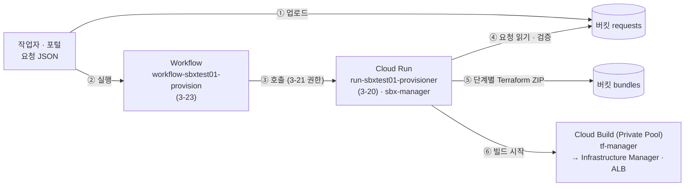

| Provisioner 가 하는 일 | 내용 |
|---|---|
| 검증 | 요청 형식(schema 2.0), 환경 규칙(영역 · 이름 · 이미지 저장소 · 도메인), 이전 적용분과 비교 |
| 번들 생성 | 요청이 관리하는 단계(05 ~ 50)의 Terraform ZIP 과 변수를 `bundles` 버킷에 저장 |
| 빌드 시작 | Private Pool 에서 Infrastructure Manager 적용 → ALB 연결 빌드를 `tf-manager` 로 시작 |

| 옵션 | 뜻 |
|---|---|
| `--image …:bootstrap` | 3-19 에서 올린 이미지로 첫 배포. 이후 릴리스 게시 때 `:git-<커밋>` 으로 바뀜 |
| `--service-account=sbx-manager` | 서비스의 실행 계정 |
| `--no-allow-unauthenticated` | 아무나 호출 못 함. 3-21 에서 Workflow 만 호출 허용 |
| `--env-vars-file=…/provisioner-env.yaml` | 프로젝트 · 버킷 · 영역 · 도메인 · 로그인 방식 등 환경 값 (저장소 파일) |
| `--max-instances=2` | 요청 처리용이라 인스턴스는 적게 |

```bash
# 실행 위치: infra-son01 | 대상: gcp-sbx-gke01 | 실행 계정: user01@sonmap.net | 가장: tf-manager | 워크로드 실행: sbx-manager
cd ~/GCP_SBX_Test03   # 저장소 루트에서 실행 (상대 경로 사용)
export SBX_GKE_PROJECT="gcp-sbx-gke01"
export REGION="asia-northeast3"
export ADMIN_ACCOUNT="user01@sonmap.net"
export TF_MANAGER="tf-manager@gcp-sbx-gke01.iam.gserviceaccount.com"
export SBX_MANAGER="sbx-manager@gcp-sbx-gke01.iam.gserviceaccount.com"
export AR_PROJECT="gcp-prod-edp-edge-509423"
export AR_REPOSITORY="ar-sbxtest01-platform"
gcloud run deploy run-sbxtest01-provisioner --project="${SBX_GKE_PROJECT}" --region="${REGION}" \
  --image="${REGION}-docker.pkg.dev/${AR_PROJECT}/${AR_REPOSITORY}/run-sbxtest01-provisioner:bootstrap" \
  --service-account="${SBX_MANAGER}" --no-allow-unauthenticated --ingress=all --timeout=300 \
  --max-instances=2 --env-vars-file=03.sandbox_deploy/03.1.request/provisioner-env.yaml \
  --clear-network --account="${ADMIN_ACCOUNT}" --impersonate-service-account="${TF_MANAGER}"

```

<a name="-21-run-services-add-iam-policy-binding-run-sbxtest01-provisioner--rolesruninvoker"></a>

<a name="21-run-services-add-iam-policy-binding-run-sbxtest01-provisioner--rolesruninvoker"></a>

### 3-21. Provisioner 호출 권한 — Workflow 가 Cloud Run 을 부를 수 있게

```bash
# 실행 위치: infra-son01 | 대상: gcp-sbx-gke01 | 실행 계정: user01@sonmap.net | 가장: tf-manager
export SBX_GKE_PROJECT="gcp-sbx-gke01"
export REGION="asia-northeast3"
export ADMIN_ACCOUNT="user01@sonmap.net"
export TF_MANAGER="tf-manager@gcp-sbx-gke01.iam.gserviceaccount.com"
export SBX_MANAGER="sbx-manager@gcp-sbx-gke01.iam.gserviceaccount.com"
gcloud run services add-iam-policy-binding run-sbxtest01-provisioner --project="${SBX_GKE_PROJECT}" \
  --region="${REGION}" --member="serviceAccount:${SBX_MANAGER}" --role=roles/run.invoker \
  --account="${ADMIN_ACCOUNT}" --impersonate-service-account="${TF_MANAGER}"

```

<a name="-22-run-services-describe-run-sbxtest01-provisioner"></a>

<a name="22-run-services-describe-run-sbxtest01-provisioner"></a>

### 3-22. Provisioner 배포 확인

```bash
# 실행 위치: infra-son01 | 대상: gcp-sbx-gke01 | 실행 계정: user01@sonmap.net | 가장: tf-manager
cd ~/GCP_SBX_Test03   # 저장소 루트에서 실행 (상대 경로 사용)
export SBX_GKE_PROJECT="gcp-sbx-gke01"
export REGION="asia-northeast3"
export ADMIN_ACCOUNT="user01@sonmap.net"
export TF_MANAGER="tf-manager@gcp-sbx-gke01.iam.gserviceaccount.com"
gcloud run services describe run-sbxtest01-provisioner --project="${SBX_GKE_PROJECT}" \
  --region="${REGION}" '--format=value(status.url)' --account="${ADMIN_ACCOUNT}" \
  --impersonate-service-account="${TF_MANAGER}"

# ── Workflow 입력 파일 준비 ──
# Cloud Run URL 조회가 성공했고 값이 비어 있지 않은지 확인합니다.
# URL만 치환합니다. Workflows의 ${args}, ${response.body}는 그대로 유지합니다.
# 실행 위치: infra-son01 | 대상: gcp-sbx-gke01 | 실행 계정: user01@sonmap.net | 가장: tf-manager
export PROVISIONER_URL="$(gcloud run services describe run-sbxtest01-provisioner --project="${SBX_GKE_PROJECT}" --region="${REGION}" --account="${ADMIN_ACCOUNT}" --impersonate-service-account="${TF_MANAGER}" --format='value(status.url)')"
mkdir -p .local
sed "s|__PROVISIONER_URL__|${PROVISIONER_URL}|g" 03.sandbox_deploy/03.1.request/workflow.template.yaml > .local/workflow.yaml

```

<a name="-23-workflows-deploy-workflow-sbxtest01-provision"></a>

<a name="23-workflows-deploy-workflow-sbxtest01-provision"></a>

### 3-23. 요청 Workflow 배포 — `workflow-sbxtest01-provision`

```bash
# 실행 위치: infra-son01 | 대상: gcp-sbx-gke01 | 실행 계정: user01@sonmap.net | 가장: tf-manager | 워크로드 실행: sbx-manager
export SBX_GKE_PROJECT="gcp-sbx-gke01"
export REGION="asia-northeast3"
export ADMIN_ACCOUNT="user01@sonmap.net"
export TF_MANAGER="tf-manager@gcp-sbx-gke01.iam.gserviceaccount.com"
export SBX_MANAGER="sbx-manager@gcp-sbx-gke01.iam.gserviceaccount.com"
gcloud workflows deploy workflow-sbxtest01-provision --project="${SBX_GKE_PROJECT}" \
  --location="${REGION}" --service-account="${SBX_MANAGER}" --source=.local/workflow.yaml \
  --account="${ADMIN_ACCOUNT}" --impersonate-service-account="${TF_MANAGER}"

```

<a name="-24-projects-add-iam-policy-binding-gcp-sbx-gke01--rolesworkflowsinvoker"></a>

<a name="24-projects-add-iam-policy-binding-gcp-sbx-gke01--rolesworkflowsinvoker"></a>

### 3-24. Workflow 실행 권한

```bash
# 실행 위치: infra-son01 | 대상: gcp-sbx-gke01 | 실행 계정: user01@sonmap.net | 가장: tf-manager
export SBX_GKE_PROJECT="gcp-sbx-gke01"
export ADMIN_ACCOUNT="user01@sonmap.net"
export OPERATOR_MEMBER="group:pgrp-gcp-sbx01@sonmap.net"
export TF_MANAGER="tf-manager@gcp-sbx-gke01.iam.gserviceaccount.com"
gcloud projects add-iam-policy-binding "${SBX_GKE_PROJECT}" --member="${OPERATOR_MEMBER}" \
  --role=roles/workflows.invoker --condition=None --account="${ADMIN_ACCOUNT}" \
  --impersonate-service-account="${TF_MANAGER}"

```

<a name="-25-storage-buckets-add-iam-policy-binding-gsgcp-sbx-gke01-sbxtest01-requests--rolesstorageobjectadmin"></a>

<a name="25-storage-buckets-add-iam-policy-binding-gsgcp-sbx-gke01-sbxtest01-requests--rolesstorageobjectadmin"></a>

### 3-25. 요청 버킷 권한 — `requests`

```bash
# 실행 위치: infra-son01 | 대상: gcp-sbx-gke01 | 실행 계정: user01@sonmap.net | 가장: tf-manager
export SBX_GKE_PROJECT="gcp-sbx-gke01"
export ADMIN_ACCOUNT="user01@sonmap.net"
export OPERATOR_MEMBER="group:pgrp-gcp-sbx01@sonmap.net"
export TF_MANAGER="tf-manager@gcp-sbx-gke01.iam.gserviceaccount.com"
gcloud storage buckets add-iam-policy-binding "gs://${SBX_GKE_PROJECT}-sbxtest01-requests" \
  --member="${OPERATOR_MEMBER}" --role=roles/storage.objectAdmin --account="${ADMIN_ACCOUNT}" \
  --impersonate-service-account="${TF_MANAGER}"

```

<a name="-26-storage-buckets-add-iam-policy-binding-gsgcp-sbx-gke01-sbxtest01-bundles--rolesstorageobjectviewer"></a>

<a name="26-storage-buckets-add-iam-policy-binding-gsgcp-sbx-gke01-sbxtest01-bundles--rolesstorageobjectviewer"></a>

### 3-26. 번들 버킷 권한 — `bundles`

```bash
# 실행 위치: infra-son01 | 대상: gcp-sbx-gke01 | 실행 계정: user01@sonmap.net | 가장: tf-manager
export SBX_GKE_PROJECT="gcp-sbx-gke01"
export REGION="asia-northeast3"
export VPC_HOST_PROJECT="gcp-prod-edp-hub-vpchost"
export ADMIN_ACCOUNT="user01@sonmap.net"
export OPERATOR_MEMBER="group:pgrp-gcp-sbx01@sonmap.net"
export TF_MANAGER="tf-manager@gcp-sbx-gke01.iam.gserviceaccount.com"
export ILB_VIP_SUBNET="subnet-prod-edp-alb-frontend-an3"
gcloud storage buckets add-iam-policy-binding "gs://${SBX_GKE_PROJECT}-sbxtest01-bundles" \
  --member="${OPERATOR_MEMBER}" --role=roles/storage.objectViewer --account="${ADMIN_ACCOUNT}" \
  --impersonate-service-account="${TF_MANAGER}"

# ── ALB 사전 확인: tf-manager로 VIP Subnet 조회 ──
# 실행 위치: infra-son01 | 대상: gcp-prod-edp-hub-vpchost | 실행 계정: user01@sonmap.net | 가장: tf-manager
gcloud compute networks subnets describe "${ILB_VIP_SUBNET}" --project="${VPC_HOST_PROJECT}" \
  --region="${REGION}" --format=json --account="${ADMIN_ACCOUNT}" \
  --impersonate-service-account="${TF_MANAGER}"
# 조회는 Network Viewer로도 성공할 수 있습니다. 실제 사용 권한은 2-1절의 운영팀 회신에서 확인합니다.
# 조회 실패 또는 바인딩 미확인 상태에서는 VPC Admin에게 요청하고 ALB 생성을 중단합니다.

```

<a name="-27-regional-internal-alb-사설-vip-예약"></a>

<a name="27-regional-internal-alb-사설-vip-예약"></a>

### 3-27. Regional Internal ALB: 사설 VIP 예약

```bash
# 서브넷·프록시 전용 Subnet·방화벽 준비가 완료된 뒤 실행합니다.
# 기존 Global 외부 ALB를 제자리 변환하지 않습니다. Regional 자원을 별도로 생성합니다.
# 실행 위치: infra-son01 | 대상: gcp-sbx-gke01 | 실행 계정: user01@sonmap.net | 가장: tf-manager
export SBX_GKE_PROJECT="gcp-sbx-gke01"
export REGION="asia-northeast3"
export VPC_HOST_PROJECT="gcp-prod-edp-hub-vpchost"
export ADMIN_ACCOUNT="user01@sonmap.net"
export TF_MANAGER="tf-manager@gcp-sbx-gke01.iam.gserviceaccount.com"
export ILB_VIP_SUBNET="subnet-prod-edp-alb-frontend-an3"
gcloud compute addresses describe ip-alb-sbxtest01-shared --project="${SBX_GKE_PROJECT}" \
  --region="${REGION}" --format=json --account="${ADMIN_ACCOUNT}" \
  --impersonate-service-account="${TF_MANAGER}"
# 명시적 Not Found일 때만 생성합니다.
# 실행 위치: infra-son01 | 대상: gcp-sbx-gke01 | 실행 계정: user01@sonmap.net | 가장: tf-manager | Shared VPC gcp-prod-edp-hub-vpchost
gcloud compute addresses create ip-alb-sbxtest01-shared --project="${SBX_GKE_PROJECT}" \
  --region="${REGION}" \
  --subnet="projects/${VPC_HOST_PROJECT}/regions/${REGION}/subnetworks/${ILB_VIP_SUBNET}" \
  --purpose=SHARED_LOADBALANCER_VIP --account="${ADMIN_ACCOUNT}" \
  --impersonate-service-account="${TF_MANAGER}"
# 자동 예약된 실제 VIP를 이후 프런트엔드 구성에 사용합니다.
# 실행 위치: infra-son01 | 대상: gcp-sbx-gke01 | 실행 계정: user01@sonmap.net | 가장: tf-manager
export ILB_VIP_ADDRESS="$(gcloud compute addresses describe ip-alb-sbxtest01-shared --project="${SBX_GKE_PROJECT}" --region="${REGION}" --account="${ADMIN_ACCOUNT}" --impersonate-service-account="${TF_MANAGER}" --format='value(address)')"

```

<a name="-28-기본-regional-health-checkbackend"></a>

<a name="28-기본-regional-health-checkbackend"></a>

### 3-28. 기본 Regional Health Check·Backend

```bash
# 실행 위치: infra-son01 | 대상: gcp-sbx-gke01 | 실행 계정: user01@sonmap.net | 가장: tf-manager
export SBX_GKE_PROJECT="gcp-sbx-gke01"
export REGION="asia-northeast3"
export ADMIN_ACCOUNT="user01@sonmap.net"
export TF_MANAGER="tf-manager@gcp-sbx-gke01.iam.gserviceaccount.com"
gcloud compute health-checks describe hc-alb-sbxtest01-shared-default --project="${SBX_GKE_PROJECT}" \
  --region="${REGION}" --format=json --account="${ADMIN_ACCOUNT}" \
  --impersonate-service-account="${TF_MANAGER}"
# 명시적 Not Found일 때만 생성합니다.
gcloud compute health-checks create http hc-alb-sbxtest01-shared-default \
  --project="${SBX_GKE_PROJECT}" --region="${REGION}" --port=8000 --request-path=/_chp_healthz \
  --account="${ADMIN_ACCOUNT}" --impersonate-service-account="${TF_MANAGER}"
gcloud compute backend-services describe bes-alb-sbxtest01-shared-default \
  --project="${SBX_GKE_PROJECT}" --region="${REGION}" --format=json --account="${ADMIN_ACCOUNT}" \
  --impersonate-service-account="${TF_MANAGER}"
# 명시적 Not Found일 때만 생성합니다. 기존 scheme은 INTERNAL_MANAGED여야 합니다.
gcloud compute backend-services create bes-alb-sbxtest01-shared-default --project="${SBX_GKE_PROJECT}" \
  --region="${REGION}" --protocol=HTTP --load-balancing-scheme=INTERNAL_MANAGED \
  --health-checks=hc-alb-sbxtest01-shared-default --health-checks-region="${REGION}" \
  --account="${ADMIN_ACCOUNT}" --impersonate-service-account="${TF_MANAGER}"

```

<a name="-29-regional-url-map"></a>

<a name="29-regional-url-map"></a>

### 3-29. Regional URL Map

```bash
# 실행 위치: infra-son01 | 대상: gcp-sbx-gke01 | 실행 계정: user01@sonmap.net | 가장: tf-manager
export SBX_GKE_PROJECT="gcp-sbx-gke01"
export REGION="asia-northeast3"
export ADMIN_ACCOUNT="user01@sonmap.net"
export TF_MANAGER="tf-manager@gcp-sbx-gke01.iam.gserviceaccount.com"
gcloud compute url-maps describe urlmap-alb-sbxtest01-shared --project="${SBX_GKE_PROJECT}" \
  --region="${REGION}" --format=json --account="${ADMIN_ACCOUNT}" \
  --impersonate-service-account="${TF_MANAGER}"
# 명시적 Not Found일 때만 생성합니다.
gcloud compute url-maps create urlmap-alb-sbxtest01-shared --project="${SBX_GKE_PROJECT}" \
  --region="${REGION}" \
  --default-service="projects/${SBX_GKE_PROJECT}/regions/${REGION}/backendServices/bes-alb-sbxtest01-shared-default" \
  --account="${ADMIN_ACCOUNT}" --impersonate-service-account="${TF_MANAGER}"

```

<a name="-30-regional-http-proxy"></a>

<a name="30-regional-http-proxy"></a>

### 3-30. Regional HTTP Proxy

```bash
# 실행 위치: infra-son01 | 대상: gcp-sbx-gke01 | 실행 계정: user01@sonmap.net | 가장: tf-manager
export SBX_GKE_PROJECT="gcp-sbx-gke01"
export REGION="asia-northeast3"
export ADMIN_ACCOUNT="user01@sonmap.net"
export TF_MANAGER="tf-manager@gcp-sbx-gke01.iam.gserviceaccount.com"
gcloud compute target-http-proxies describe http-proxy-alb-sbxtest01-shared \
  --project="${SBX_GKE_PROJECT}" --region="${REGION}" --format=json --account="${ADMIN_ACCOUNT}" \
  --impersonate-service-account="${TF_MANAGER}"
# 명시적 Not Found일 때만 생성합니다.
gcloud compute target-http-proxies create http-proxy-alb-sbxtest01-shared \
  --project="${SBX_GKE_PROJECT}" --region="${REGION}" \
  --url-map="projects/${SBX_GKE_PROJECT}/regions/${REGION}/urlMaps/urlmap-alb-sbxtest01-shared" \
  --account="${ADMIN_ACCOUNT}" --impersonate-service-account="${TF_MANAGER}"

```

<a name="-31-내부-http-forwarding-rule"></a>

<a name="31-내부-http-forwarding-rule"></a>

### 3-31. 내부 HTTP Forwarding Rule

```bash
# 실행 위치: infra-son01 | 대상: gcp-sbx-gke01 | 실행 계정: user01@sonmap.net | 가장: tf-manager
export SBX_GKE_PROJECT="gcp-sbx-gke01"
export REGION="asia-northeast3"
export VPC_HOST_PROJECT="gcp-prod-edp-hub-vpchost"
export NETWORK="vpc-prod-edp-hub"
export ADMIN_ACCOUNT="user01@sonmap.net"
export TF_MANAGER="tf-manager@gcp-sbx-gke01.iam.gserviceaccount.com"
export ILB_VIP_SUBNET="subnet-prod-edp-alb-frontend-an3"
gcloud compute forwarding-rules describe fr-alb-sbxtest01-shared-http --project="${SBX_GKE_PROJECT}" \
  --region="${REGION}" --format=json --account="${ADMIN_ACCOUNT}" \
  --impersonate-service-account="${TF_MANAGER}"
# 명시적 Not Found일 때만 생성합니다. global-access는 사설 연결의 리전 제한만 해제합니다.
# 실행 위치: infra-son01 | 대상: gcp-sbx-gke01 | 실행 계정: user01@sonmap.net | 가장: tf-manager | Shared VPC gcp-prod-edp-hub-vpchost
gcloud compute forwarding-rules create fr-alb-sbxtest01-shared-http --project="${SBX_GKE_PROJECT}" \
  --region="${REGION}" --load-balancing-scheme=INTERNAL_MANAGED \
  --network="projects/${VPC_HOST_PROJECT}/global/networks/${NETWORK}" \
  --subnet="projects/${VPC_HOST_PROJECT}/regions/${REGION}/subnetworks/${ILB_VIP_SUBNET}" \
  --address=ip-alb-sbxtest01-shared --ports=80 --target-http-proxy=http-proxy-alb-sbxtest01-shared \
  --target-http-proxy-region="${REGION}" --allow-global-access --account="${ADMIN_ACCOUNT}" \
  --impersonate-service-account="${TF_MANAGER}"

```

<a name="-32-regional-ssl-인증서-확인-및-등록"></a>

<a name="32-regional-ssl-인증서-확인-및-등록"></a>

### 3-32. Regional SSL 인증서 확인 및 등록

공유 내부 ALB에는 **Certificate Manager의 리전 Google 관리형 인증서만 적용**합니다. 그룹을 추가할 때는 그룹 JSON의 `domain`과 일치하는 호스트에 대해 DNS 승인과 인증서를 준비합니다. 아래 명령은 `sbx.sonmap.net` 기준입니다.

<a name="32-4-google-관리형-인증서-자동-갱신"></a>

<a name="3-32-4-google-관리형-인증서-자동-갱신"></a>

#### 3-32-1. 대상 및 권한 확인

**실행 위치** `infra-son01` · **로그인 계정** `user01@sonmap.net` · **가장 계정** `tf-manager`

1-4절에서 `tf-manager`에 Certificate Manager 권한을 적용했는지 확인합니다. `sonmap.net` 공개 DNS에 검증 레코드를 추가할 권한이 있는 담당자와 협의합니다.

```bash
# 실행 위치: infra-son01 | 대상: gcp-sbx-gke01 | 실행 계정: user01@sonmap.net
export SBX_GKE_PROJECT="gcp-sbx-gke01"
export REGION="asia-northeast3"
export ADMIN_ACCOUNT="user01@sonmap.net"
export TF_MANAGER="tf-manager@${SBX_GKE_PROJECT}.iam.gserviceaccount.com"
export DOMAIN="sbx.sonmap.net"
export DNS_AUTH="dns-auth-sbx"
export MANAGED_CERT="cert-sbx-managed"

gcloud services enable certificatemanager.googleapis.com \
  --project="${SBX_GKE_PROJECT}" --account="${ADMIN_ACCOUNT}"
```

#### 3-32-2. DNS 승인과 레코드 등록

DNS 승인 리소스가 이미 있으면 조회 명령만 실행합니다. 출력된 `dnsResourceRecord.name`과 `dnsResourceRecord.data`를 공개 CNAME에 그대로 사용합니다.

```bash
# 실행 위치: infra-son01 | 대상: gcp-sbx-gke01 | 실행 계정: user01@sonmap.net | 가장: tf-manager
export SBX_GKE_PROJECT="gcp-sbx-gke01"
export REGION="asia-northeast3"
export ADMIN_ACCOUNT="user01@sonmap.net"
export TF_MANAGER="tf-manager@gcp-sbx-gke01.iam.gserviceaccount.com"
export DOMAIN="sbx.sonmap.net"
export DNS_AUTH="dns-auth-sbx"
gcloud certificate-manager dns-authorizations create "${DNS_AUTH}" \
  --project="${SBX_GKE_PROJECT}" --location="${REGION}" --domain="${DOMAIN}" \
  --account="${ADMIN_ACCOUNT}" --impersonate-service-account="${TF_MANAGER}"

gcloud certificate-manager dns-authorizations describe "${DNS_AUTH}" \
  --project="${SBX_GKE_PROJECT}" --location="${REGION}" \
  --account="${ADMIN_ACCOUNT}" --impersonate-service-account="${TF_MANAGER}" \
  --format='yaml(dnsResourceRecord)'
```

| 등록 위치 | 유형 | 이름 | 값 |
|---|---|---|---|
| `sonmap.net` 공개 DNS | CNAME | `dnsResourceRecord.name` | `dnsResourceRecord.data` |
| 사내 DNS | A | `sbx.sonmap.net` | 실제 내부 ALB VIP (`172.31.96.2`) |

Google은 공개 CNAME을 발급 및 자동 갱신 검증에 사용합니다. 인증서를 사용하는 동안 CNAME을 유지합니다. 사용자는 사내 DNS에서 내부 ALB IP를 확인해 접속합니다. [리전 Google 관리형 인증서 가이드](https://docs.cloud.google.com/certificate-manager/docs/deploy-google-managed-regional)

##### 3-32-2-1. 외부 DNS 요청서 · 공개 CNAME 등록

아래 값은 `gcp-sbx-gke01` 의 `dns-auth-sbx` 가 발급한 실제 값입니다(2026-11-28 확인). DNS 승인을 지우고 다시 만들면 값이 바뀌므로 3-32-2 의 `describe` 로 다시 확인합니다. 운영 도메인은 3-32-4절에서 새로 조회한 값으로 작성합니다.

```text
1.작업대상(외부DNS or 내부DNS) :
외부DNS

2.작업내용
[등록]
도메인명 : _acme-challenge_fahvn3ng4zlsxwxs.sbx.sonmap.net
IP 정보 : b453a935-c98c-4bdb-b13d-f381dc3e6895.4.asia-northeast3.authorize.certificatemanager.goog
TYPE : CNAME

3.등록/변경/삭제 목적
GCP Sandbox JupyterHub 전환으로 SSL 인증서 프로비저닝을 위한 DNS 승인(CNAME) 등록이 필요합니다.

4.완료희망일자
[DNS 반영과 인증서 검증 시간을 고려해 기입]

5.기타
본 CNAME은 인증서 자동 갱신 때마다 재검증에 사용되므로,
작업 완료 후에도 삭제하지 말고 영구 유지 바랍니다.
```

요청서의 `IP 정보` 칸에는 CNAME 대상의 전체 도메인명을 입력합니다. 위 양식에서는 출력 끝의 점을 뺐습니다. DNS 운영 도구가 절대 이름을 요구하면 끝의 점을 포함하고, DNS 영역 접미사가 중복으로 붙지 않았는지 확인합니다.

##### 3-32-2-1-1. `sonmap.net` 공개 DNS 에 직접 등록할 때 (개인 테스트 환경)

인증서 상태가 "`sbx.sonmap.net` 도메인에 CNAME 레코드가 없습니다" 이면 아직 이 레코드가 공개 DNS 에 없는 것입니다. 먼저 `sonmap.net` 의 공개 DNS 를 누가 운영하는지 확인합니다.

```bash
# 실행 위치: Cloud Shell 또는 아무 PC | 대상: 공개 DNS (조회) | 실행 계정: 불필요
dig +short NS sonmap.net
```

**`sonmap.net` 은 Squarespace Domains(예전 Google Domains)의 DNS 를 씁니다.** 네임서버가 `ns-cloud-c1 ~ c4.googledomains.com` 이지만 GCP 프로젝트의 Cloud DNS 영역이 아닙니다(2026-11-28 확인: admin 이 보는 모든 프로젝트에 `sonmap.net` 영역 없음). 네임서버 이름만으로는 Cloud DNS 와 Squarespace 를 구분할 수 없습니다.

**Squarespace 에 등록 (sonmap.net)**

1. https://domains.squarespace.com 에 `sonmap.net` 소유 계정으로 로그인 → `sonmap.net` → **DNS** → **DNS Settings**
2. **Custom records** → **Add record**
3. 아래 값 입력 후 **Save**. 기존 레코드(A · MX · TXT 등)는 건드리지 않습니다.

| 칸 | 값 |
|---|---|
| Type | `CNAME` |
| Name | `_acme-challenge_fahvn3ng4zlsxwxs.sbx` (`.sonmap.net` 은 자동으로 붙음) |
| TTL | 기본값 |
| Data | `b453a935-c98c-4bdb-b13d-f381dc3e6895.4.asia-northeast3.authorize.certificatemanager.goog` |

내부 ALB 주소 `sbx.sonmap.net → 172.31.96.2` (A 레코드) 는 **여기에 넣지 않습니다.** 사설 IP 이므로 사내 DNS(3-32-2-2)에 등록합니다.

다른 도메인이 GCP Cloud DNS 영역에 있는 경우에는 아래 명령으로 등록합니다.

Cloud DNS 인 경우 — `sonmap.net` 공개 영역이 있는 프로젝트를 찾아 등록합니다.

```bash
# 실행 위치: Cloud Shell | 대상: sonmap.net 공개 영역이 있는 프로젝트 | 실행 계정: admin@sonmap.net
export DNS_PROJECT="<sonmap.net 공개 영역이 있는 프로젝트>"
gcloud dns managed-zones list --project="$DNS_PROJECT" --account=admin@sonmap.net \
  --filter='dnsName=sonmap.net. AND visibility=public' --format='table(name,dnsName,visibility)'
export DNS_ZONE="<위 결과의 NAME>"
gcloud dns record-sets create "_acme-challenge_fahvn3ng4zlsxwxs.sbx.sonmap.net." \
  --zone="$DNS_ZONE" --project="$DNS_PROJECT" --account=admin@sonmap.net --type=CNAME --ttl=300 \
  --rrdatas="b453a935-c98c-4bdb-b13d-f381dc3e6895.4.asia-northeast3.authorize.certificatemanager.goog."
```

등록 확인 — 공개 DNS 에서 값이 보이면 됩니다.

```bash
# 실행 위치: Cloud Shell 또는 아무 PC | 대상: 공개 DNS (조회) | 실행 계정: 불필요
dig +short CNAME _acme-challenge_fahvn3ng4zlsxwxs.sbx.sonmap.net @8.8.8.8
# b453a935-c98c-4bdb-b13d-f381dc3e6895.4.asia-northeast3.authorize.certificatemanager.goog.
```

인증서는 다시 만들 필요가 없습니다. Certificate Manager 가 주기적으로 다시 검증하므로, 레코드가 보이기 시작하면 보통 수십 분 안에 `ACTIVE` 가 됩니다(3-32-3 의 `describe`). 몇 시간이 지나도 `PROVISIONING` 이면 `dig` 결과의 값 끝 부분까지 정확한지 확인합니다.

##### 3-32-2-2. 내부 DNS 요청서 · 접속용 A 레코드 등록

```text
1.작업대상(외부DNS or 내부DNS) :
내부DNS

2.작업내용
[등록]
도메인명 : sbx.sonmap.net
IP 정보 : 172.31.96.2
TYPE : A

3.등록/변경/삭제 목적
GCP Sandbox JupyterHub 전환으로 내부도메인 등록이 필요합니다.

4.완료희망일자
[사내 접속 검증 일정에 맞춰 기입]
```

내부 ALB의 HTTP·HTTPS 전달 규칙은 PoC에서 모두 `172.31.96.2`를 사용했습니다. 실제 등록 전 같은 VIP를 사용할지 [HTTPS 전달 규칙](#3-34-내부-https-forwarding-rule) 조회 결과로 확인합니다. 외부 CNAME과 내부 A 레코드는 각각 발급 승인과 사용자 접속에 쓰이므로 두 요청서는 동시에 제출할 수 있습니다.

#### 3-32-3. 인증서 발급 및 상태 확인

인증서 리소스가 이미 있으면 조회 명령만 실행합니다.

```bash
# 실행 위치: infra-son01 | 대상: gcp-sbx-gke01 | 실행 계정: user01@sonmap.net | 가장: tf-manager
export SBX_GKE_PROJECT="gcp-sbx-gke01"
export REGION="asia-northeast3"
export ADMIN_ACCOUNT="user01@sonmap.net"
export TF_MANAGER="tf-manager@gcp-sbx-gke01.iam.gserviceaccount.com"
export DOMAIN="sbx.sonmap.net"
export DNS_AUTH="dns-auth-sbx"
export MANAGED_CERT="cert-sbx-managed"
gcloud certificate-manager certificates create "${MANAGED_CERT}" \
  --project="${SBX_GKE_PROJECT}" --location="${REGION}" \
  --domains="${DOMAIN}" --dns-authorizations="${DNS_AUTH}" \
  --account="${ADMIN_ACCOUNT}" --impersonate-service-account="${TF_MANAGER}"

gcloud certificate-manager certificates describe "${MANAGED_CERT}" \
  --project="${SBX_GKE_PROJECT}" --location="${REGION}" \
  --account="${ADMIN_ACCOUNT}" --impersonate-service-account="${TF_MANAGER}" \
  --format='yaml(managed.domains,managed.state,managed.authorizationAttemptInfo)'
```

`managed.domains`에 접속 호스트가 있고 `managed.state`가 `ACTIVE`이면 3-33절로 진행합니다.

##### 3-32-3-1. PoC 수행 기록 및 DNS 완료 후 점검

`cert-sbx-managed` 생성은 완료됐습니다. 생성 직후 `describe`에서 다음 상태를 확인했습니다.

```yaml
managed:
  authorizationAttemptInfo:
  - domain: sbx.sonmap.net
    state: AUTHORIZING
  state: PROVISIONING
```

이 수행 기록은 인증서 리소스 생성과 DNS 승인 대기까지입니다. 신규 구축에서는 DNS 승인 리소스를 만든 뒤 외부 DNS 요청과 병행해 인증서 생성 명령을 실행할 수 있습니다. DNS 완료 회신을 받으면 3-32-2절의 DNS 승인 조회 결과와 공개 DNS의 CNAME을 비교하고, 사내 DNS에서 A 레코드가 실제 ALB VIP로 해석되는지 확인한 뒤 위 인증서 조회 명령을 다시 실행합니다.

```bash
# 실행 위치: infra-son01 | 대상: gcp-sbx-gke01 | 실행 계정: user01@sonmap.net | 가장: tf-manager
export SBX_GKE_PROJECT="gcp-sbx-gke01"
export REGION="asia-northeast3"
export ADMIN_ACCOUNT="user01@sonmap.net"
export TF_MANAGER="tf-manager@gcp-sbx-gke01.iam.gserviceaccount.com"
export DNS_AUTH="dns-auth-sbx"
# 외부 DNS를 조회할 수 있는 환경에서 실행
CNAME_NAME="$(gcloud certificate-manager dns-authorizations describe "${DNS_AUTH}" \
  --project="${SBX_GKE_PROJECT}" --location="${REGION}" \
  --account="${ADMIN_ACCOUNT}" --impersonate-service-account="${TF_MANAGER}" \
  --format='value(dnsResourceRecord.name)')" &&
test -n "${CNAME_NAME}" && dig +short CNAME "${CNAME_NAME}"
```

```text
# 사내 DNS를 사용하는 PC에서 실행하며 운영 전환 시 호스트를 확정값으로 교체
nslookup sbx.sonmap.net
```

| 조회 결과 | 다음 작업 |
|---|---|
| `managed.state: ACTIVE` | `managed.domains`에 대상 호스트가 포함됐는지 확인하고 3-33절 프록시 연결로 진행합니다. |
| `PROVISIONING`, `AUTHORIZING` | CNAME의 이름과 대상, 공개 DNS 전파 상태를 확인합니다. |
| `authorizationAttemptInfo.state: FAILED` | `failureReason`, `details`, `troubleshooting`을 확인합니다. CNAME 불일치와 CAA 정책 오류는 각 원인에 맞춰 조치합니다. |

[Certificate Manager 인증 오류 점검](https://docs.cloud.google.com/certificate-manager/docs/troubleshooting)

#### 3-32-4. 운영 도메인 전환 · `uplus.co.kr`

운영 DNS 담당자와 전체 호스트 이름을 먼저 확정합니다. 호스트가 달라지면 해당 이름으로 리전 DNS 승인과 인증서를 새로 생성합니다. PoC CNAME은 `sonmap.net`용이며, 운영 요청서에는 새 DNS 승인 조회 결과를 사용합니다. 내부 VIP를 재사용하는 경우 운영 A 레코드의 값은 `172.31.96.2`입니다.

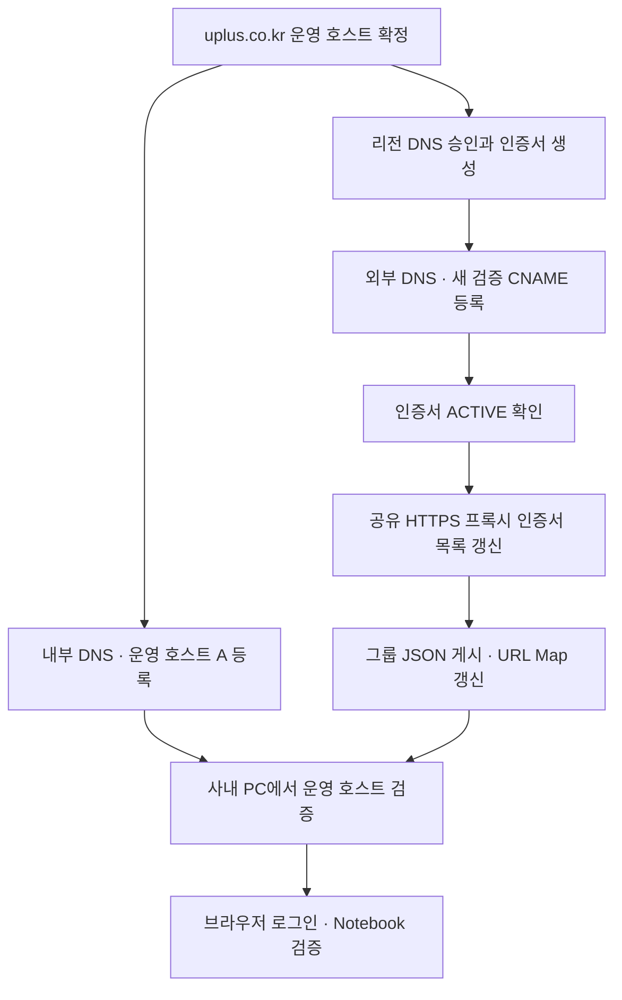

1. **운영 값 설정** · 3-32-1절의 공통 변수를 선언한 뒤, 아래 `DOMAIN`을 승인된 운영 FQDN으로 바꿉니다. 예시는 `jupyter-group01.uplus.co.kr`입니다. 조직 표준에 중간 도메인이 있으면 전체 이름을 입력합니다.

   ```bash
   # 실행 위치: infra-son01 | 대상: 로컬 (변수 선언) | 실행 계정: 불필요
   export DOMAIN="jupyter-group01.uplus.co.kr"
   export DNS_AUTH="dns-auth-jupyter-group01-uplus"
   export MANAGED_CERT="cert-jupyter-group01-uplus"
   ```

2. **DNS와 인증서 준비** · 3-32-2절에서 새 DNS 승인 생성·조회 명령을 실행합니다. 외부 요청서에는 새 CNAME 이름·대상을, 내부 요청서에는 새 FQDN과 확인된 ALB VIP를 입력합니다. 3-32-3절에서 새 인증서를 만들고 `ACTIVE`를 확인합니다.
3. **프록시와 그룹 라우팅 반영** · 3-33-2절에서 새 인증서를 적용합니다. 공유 프록시가 함께 서비스하는 모든 호스트의 인증서를 `CERT_REFS`에 포함합니다. 승인된 `group.json`의 `domain`만 새 FQDN으로 바꾸고, 기존 `tasks`를 포함한 전체 그룹 JSON으로 [2차 배포 문서 7-2절](../03.sandbox_deploy/README.md#7-2-그룹-json-게시와-실행)을 다시 실행합니다. URL Map의 새 호스트 규칙과 그룹 백엔드 상태를 확인합니다.
4. **접속 재검증** · 사내 PC에서 운영 호스트의 DNS 응답과 HTTPS 인증서를 확인하고 로그인과 Notebook 실행을 검증합니다. 호스트를 바꿨다면 로그인 서버에 새 콜백 주소도 등록합니다.

전환 때문에 Shared VPC, GKE, 과제 프로젝트 또는 그룹을 새로 구축할 필요는 없습니다. 새 호스트의 **공개 CNAME 승인, 내부 A 레코드, 인증서, URL Map, 로그인**을 확인합니다. PoC용 인증서와 DNS 승인은 참조하는 프록시와 사용자 경로가 사라진 것을 확인한 뒤 정리합니다.

<a name="-33-regional-https-proxy"></a>

<a name="33-regional-https-proxy"></a>

### 3-33. Regional HTTPS Proxy

**실행 위치** `infra-son01` · **로그인 계정** `user01@sonmap.net` · **가장 계정** `tf-manager`

공유 프록시와 URL Map을 조회해 호스트와 인증서 연결 상태를 확인합니다.

```bash
# 실행 위치: infra-son01 | 대상: gcp-sbx-gke01 | 실행 계정: user01@sonmap.net | 가장: tf-manager
export SBX_GKE_PROJECT="gcp-sbx-gke01"
export REGION="asia-northeast3"
export ADMIN_ACCOUNT="user01@sonmap.net"
export TF_MANAGER="tf-manager@gcp-sbx-gke01.iam.gserviceaccount.com"
gcloud compute target-https-proxies describe https-proxy-alb-sbxtest01-shared \
  --project="${SBX_GKE_PROJECT}" --region="${REGION}" \
  --account="${ADMIN_ACCOUNT}" --impersonate-service-account="${TF_MANAGER}" \
  --format='yaml(name,urlMap,sslCertificates)'

gcloud compute url-maps describe urlmap-alb-sbxtest01-shared \
  --project="${SBX_GKE_PROJECT}" --region="${REGION}" \
  --account="${ADMIN_ACCOUNT}" --impersonate-service-account="${TF_MANAGER}" \
  --format='yaml(hostRules)'
```

**조회 결과 읽는 법**

| 명령 | 결과 | 뜻 · 다음 |
|---|---|---|
| 프록시 `describe` | `was not found` | 아직 없음 → **3-33-1 신규 생성** |
| 프록시 `describe` | 이름 · URL Map · 인증서 출력 | 이미 있음 → 인증서가 다르면 3-33-2 갱신, 같으면 3-34 로 |
| URL Map `describe` | `null` | URL Map 은 있고(3-29), 호스트 규칙이 아직 없음. **정상**입니다. 과제 경로 규칙(`/general/task01/*` 등)은 2차 과제 배포가 추가합니다 |
| URL Map `describe` | `was not found` | 3-29 를 먼저 실행 |

아래 `CERT_REFS` 는 `sbx.sonmap.net` 인증서 하나를 연결합니다. **인증서 이름만 넣습니다**(`cert-sbx-managed`). `projects/…/certificates/…` 전체 경로를 넣으면 gcloud 가 앞에 경로를 한 번 더 붙여 `Invalid value for field 'resource.sslCertificates[0]'` 오류가 납니다. 공유 프록시가 다른 도메인도 서비스한다면 모든 도메인의 리전 Google 관리형 인증서를 `ACTIVE` 로 준비하고, 이름을 쉼표로 이어 붙입니다. 프록시 변경 시 전달한 목록 전체가 적용됩니다. [Google Cloud 인증서 연결 규칙](https://docs.cloud.google.com/load-balancing/docs/ssl-certificates#configuration_method_rules)

```bash
# 실행 위치: infra-son01 (저장소 루트) | 대상: 로컬 파일 · 변수 | 실행 계정: 불필요
cd ~/GCP_SBX_Test03   # 저장소 루트에서 실행 (상대 경로 사용)
export SBX_GKE_PROJECT="gcp-sbx-gke01"
export REGION="asia-northeast3"
export MANAGED_CERT="cert-sbx-managed"
export CERT_REFS="${MANAGED_CERT}"   # 이름만. 전체 경로를 넣으면 gcloud 가 경로를 한 번 더 붙여 Invalid value 오류
```

#### 3-33-1. 신규 프록시 생성

프록시 조회에서 `NOT_FOUND`가 확인되면 실행합니다. `Created [...]` 와 함께 `SSL_CERTIFICATES` 에 `cert-sbx-managed` 가 보이면 성공이며, **3-33-2 는 건너뛰고 3-34 로 갑니다.**

```bash
# 실행 위치: infra-son01 | 대상: gcp-sbx-gke01 | 실행 계정: user01@sonmap.net | 가장: tf-manager
export SBX_GKE_PROJECT="gcp-sbx-gke01"
export REGION="asia-northeast3"
export ADMIN_ACCOUNT="user01@sonmap.net"
export TF_MANAGER="tf-manager@gcp-sbx-gke01.iam.gserviceaccount.com"
export CERT_REFS="cert-sbx-managed"   # 이름만. gcloud 가 --project · --region 으로 전체 경로를 만듭니다
gcloud compute target-https-proxies create https-proxy-alb-sbxtest01-shared \
  --project="${SBX_GKE_PROJECT}" --region="${REGION}" \
  --url-map="projects/${SBX_GKE_PROJECT}/regions/${REGION}/urlMaps/urlmap-alb-sbxtest01-shared" \
  --certificate-manager-certificates="${CERT_REFS}" \
  --account="${ADMIN_ACCOUNT}" --impersonate-service-account="${TF_MANAGER}"
```

#### 3-33-2. 기존 프록시 갱신 (해당할 때만)

> **3-33-1 로 방금 만들었다면 실행하지 않습니다.** 아래 경우에만 실행합니다.
> - 3-33-1 이 `already exists` 로 실패했고, 기존 프록시의 인증서가 `cert-sbx-managed` 와 다를 때
> - 나중에 새 도메인 인증서를 추가해 프록시의 인증서 목록을 바꿀 때 (3-32-4 운영 도메인 전환)

프록시가 이미 있으면 준비된 인증서 전체 목록으로 갱신합니다.

```bash
# 실행 위치: infra-son01 | 대상: gcp-sbx-gke01 | 실행 계정: user01@sonmap.net | 가장: tf-manager
export SBX_GKE_PROJECT="gcp-sbx-gke01"
export REGION="asia-northeast3"
export ADMIN_ACCOUNT="user01@sonmap.net"
export TF_MANAGER="tf-manager@gcp-sbx-gke01.iam.gserviceaccount.com"
export CERT_REFS="cert-sbx-managed"   # 이름만. gcloud 가 --project · --region 으로 전체 경로를 만듭니다
gcloud compute target-https-proxies update https-proxy-alb-sbxtest01-shared \
  --project="${SBX_GKE_PROJECT}" --region="${REGION}" \
  --certificate-manager-certificates="${CERT_REFS}" \
  --account="${ADMIN_ACCOUNT}" --impersonate-service-account="${TF_MANAGER}"
```

프록시 조회를 다시 실행해 인증서 연결을 확인합니다. 3-34절에서 HTTPS Forwarding Rule을 확인한 뒤 사내 PC에서 그룹 URL에 접속합니다.

<a name="-34-내부-https-forwarding-rule"></a>

<a name="34-내부-https-forwarding-rule"></a>

### 3-34. 내부 HTTPS Forwarding Rule

```bash
# 실행 위치: infra-son01 | 대상: gcp-sbx-gke01 | 실행 계정: user01@sonmap.net | 가장: tf-manager
export SBX_GKE_PROJECT="gcp-sbx-gke01"
export REGION="asia-northeast3"
export VPC_HOST_PROJECT="gcp-prod-edp-hub-vpchost"
export NETWORK="vpc-prod-edp-hub"
export ADMIN_ACCOUNT="user01@sonmap.net"
export TF_MANAGER="tf-manager@gcp-sbx-gke01.iam.gserviceaccount.com"
export ILB_VIP_SUBNET="subnet-prod-edp-alb-frontend-an3"
gcloud compute forwarding-rules describe fr-alb-sbxtest01-shared-https --project="${SBX_GKE_PROJECT}" \
  --region="${REGION}" --format=json --account="${ADMIN_ACCOUNT}" \
  --impersonate-service-account="${TF_MANAGER}"
# 명시적 Not Found일 때만 생성합니다.
# 실행 위치: infra-son01 | 대상: gcp-sbx-gke01 | 실행 계정: user01@sonmap.net | 가장: tf-manager | Shared VPC gcp-prod-edp-hub-vpchost
gcloud compute forwarding-rules create fr-alb-sbxtest01-shared-https --project="${SBX_GKE_PROJECT}" \
  --region="${REGION}" --load-balancing-scheme=INTERNAL_MANAGED \
  --network="projects/${VPC_HOST_PROJECT}/global/networks/${NETWORK}" \
  --subnet="projects/${VPC_HOST_PROJECT}/regions/${REGION}/subnetworks/${ILB_VIP_SUBNET}" \
  --address=ip-alb-sbxtest01-shared --ports=443 --target-https-proxy=https-proxy-alb-sbxtest01-shared \
  --target-https-proxy-region="${REGION}" --allow-global-access --account="${ADMIN_ACCOUNT}" \
  --impersonate-service-account="${TF_MANAGER}"

```

<a name="-35-선택--builds-triggers-create-github"></a>

<a name="35-선택--builds-triggers-create-github"></a>

### 3-35. 선택 · builds triggers create github

> **테스트에서는 건너뜁니다.** 3-19 에서 이미지를 수동으로 빌드·푸시했다면 필요 없습니다.
> 이 트리거는 `main` 에 커밋할 때마다 Runner·Provisioner 이미지를 자동으로 다시 빌드하는 운영 편의 기능입니다. 쓰려면 먼저 Cloud Build 에 GitHub 저장소 연결(콘솔 → Cloud Build → 저장소)이 필요합니다.

| 상황 | 3-35 |
|---|---|
| 테스트 · 이미지 수동 빌드 (3-19) | 건너뜀 → 4절 |
| 커밋마다 이미지 자동 빌드가 필요할 때 | 주석 해제 후 실행 |

```bash
# 선택 작업: 필요한 경우에만 아래 명령의 주석을 해제합니다.
# 기존 자원 확인
# 실행 위치: infra-son01 | 대상: gcp-sbx-gke01 | 실행 계정: user01@sonmap.net | 가장: tf-manager
cd ~/GCP_SBX_Test03   # 저장소 루트에서 실행 (상대 경로 사용)
# gcloud builds triggers describe trigger-sbxtest01-platform-release --project="${SBX_GKE_PROJECT}" \
#   --region="${REGION}" --format=json --account="${ADMIN_ACCOUNT}" \
#   --impersonate-service-account="${TF_MANAGER}"
# 조회 결과가 명시적 Not Found일 때만 아래 생성 명령을 실행합니다.
# 실행 위치: infra-son01 | 대상: gcp-sbx-gke01 | 실행 계정: user01@sonmap.net | 가장: tf-manager | 워크로드 실행: tf-manager
# gcloud builds triggers create github --name=trigger-sbxtest01-platform-release \
#   --project="${SBX_GKE_PROJECT}" --region="${REGION}" --repo-owner=sonmap --repo-name=GCP_SBX_Test03 \
#   --branch-pattern="^main$" \
#   --build-config=03.sandbox_deploy/03.3.gke/cloudbuild/platform-release.yaml \
#   --service-account="projects/${SBX_GKE_PROJECT}/serviceAccounts/${TF_MANAGER}" \
#   '--substitutions=_RELEASE_ID=git-$SHORT_SHA,_COMMIT_SHA=$COMMIT_SHA' --account="${ADMIN_ACCOUNT}" \
#   --impersonate-service-account="${TF_MANAGER}"

# 다음: 4절 과제 Pod 실행 준비 → 2차 배포
# Build 설정은 03.sandbox_deploy/03.3.gke/cloudbuild에, Cloud Run과 Workflows 설정은 03.sandbox_deploy/03.1.request에 있습니다.
```

</details>

## 4. 과제 Pod 실행 준비

<details>
<summary>내용 펼치기 / 접기</summary>

과제 자동화([2차 문서](../03.sandbox_deploy/README.md))가 쓰는 공통 자원을 **한 번** 만듭니다. Helm 차트와 Hub·Proxy 이미지는 쓰지 않습니다. 과제 Pod 는 기존 과제 이미지를 그대로 실행합니다.

| 절 | 만드는 것 | 쓰는 곳 |
|---|---|---|
| 4-1 | Infrastructure Manager 실행 조건 | 5단계 모두, 특히 `50-workload` |
| 4-2 | StorageClass `sbx-static-pd` | 기존 디스크를 붙이는 정적 PV |
| 4-3 | 공용 TCP 헬스 체크 | 과제별 백엔드 서비스 |
| 4-4 | 방화벽 포트 확인 | ALB → Pod `8080-8089` |
| 4-5 | OAuth 값 등록 | Hub 로그인 (3-13 ~ 3-16 의 Secret) |
| 4-6 | 기존 과제 프로젝트 권한 | 이전 과제의 Workload Identity · 이미지 · 스냅샷 |

### 4-1. Infrastructure Manager 실행 조건

과제의 Terraform 5단계가 모두 Infrastructure Manager 배포로 실행됩니다. **State 는 배포마다 Infrastructure Manager 가 보관**하므로 State 버킷은 만들지 않습니다.

| 배포 이름 | 단계 |
|---|---|
| `sbxtest01-<과제>-<해시>-group` | 05-group |
| `sbxtest01-<과제>-<해시>-project` | 10-project |
| `sbxtest01-<과제>-<해시>-project-iam` | 30-project-iam |
| `sbxtest01-<과제>-<해시>-data` | 40-data |
| `sbxtest01-<과제>-<해시>-workload` | 50-workload (모든 과제) |

`50-workload` 가 GKE 안의 자원을 만들기 때문에 아래 세 가지가 필요합니다.

| 조건 | 이유 | 확인 |
|---|---|---|
| Private Pool → `registry.terraform.io` · `releases.hashicorp.com` HTTPS | Kubernetes provider 는 Google 관리 provider 가 아니라 실행할 때 내려받습니다 | 아래 점검 빌드 |
| Private Pool → GKE DNS 엔드포인트 | Terraform 이 kubeconfig 없이 접근 토큰으로 클러스터에 접속합니다 | [Private Pool GKE 접속 점검](reference/cloudbuild-private-gke-vpn-design.md) |
| `tf-manager` 의 `roles/container.admin` | Namespace · Pod · PV 생성 | 1-7절 |
| Private Pool → `cloudidentity.googleapis.com` (신규 과제만) | `05-group` 이 그룹을 만듭니다. 이 API 는 Restricted VIP 에서 지원되지 않으므로, Pool 이 Google API 를 Restricted VIP 로만 내보내면 실패합니다 | 첫 신규 과제 배포에서 확인. 실패하면 그룹은 수동 생성하고 `manage_group: false` 로 요청 |

#### 4-1-1. Pool 인터넷 송신 확인 · 열기 (레지스트리 점검 전에 먼저)

레지스트리 점검(4-1-2)은 Pool 이 인터넷으로 나갈 수 있어야 성공합니다. 먼저 Pool 의 송신 설정을 확인합니다.

```bash
# 실행 위치: Cloud Shell 또는 infra-son01 | 대상: gcp-sbx-gke01 (Pool) | 실행 계정: admin@sonmap.net
export SBX_GKE_PROJECT="gcp-sbx-gke01"
export REGION="asia-northeast3"
export POOL_ADMIN_ACCOUNT="admin@sonmap.net"
gcloud builds worker-pools describe pool-sbxtest01 \
  --project="${SBX_GKE_PROJECT}" --region="${REGION}" --account="${POOL_ADMIN_ACCOUNT}" \
  --format='value(state,privatePoolV1Config.networkConfig.egressOption,privatePoolV1Config.networkConfig.peeredNetworkIpRange)'
```

| 확인 결과 (두 번째 값) | 의미 | 조치 |
|---|---|---|
| `PUBLIC_EGRESS` 또는 비어 있음 | 송신 허용 | ① · ② 건너뛰고 **4-1-2** |
| `NO_PUBLIC_EGRESS` | 송신 막힘 (`--no-public-egress` 로 생성) | **①** 실행 |
| ① 이 `cannot be updated` · `INVALID_ARGUMENT` | 이 설정을 바꿀 수 없는 Pool | **②** 삭제 후 재생성 |

**① 기존 Pool 송신 허용**

```bash
# 실행 위치: Cloud Shell 또는 infra-son01 | 대상: gcp-sbx-gke01 (Pool) | 실행 계정: admin@sonmap.net
export SBX_GKE_PROJECT="gcp-sbx-gke01"
export REGION="asia-northeast3"
export POOL_ADMIN_ACCOUNT="admin@sonmap.net"
gcloud builds worker-pools update pool-sbxtest01 \
  --project="${SBX_GKE_PROJECT}" --region="${REGION}" \
  --public-egress \
  --account="${POOL_ADMIN_ACCOUNT}"

# 확인 → egressOption 이 PUBLIC_EGRESS 또는 비어 있으면 송신 허용
gcloud builds worker-pools describe pool-sbxtest01 \
  --project="${SBX_GKE_PROJECT}" --region="${REGION}" --account="${POOL_ADMIN_ACCOUNT}" \
  --format='value(state,privatePoolV1Config.networkConfig.egressOption,privatePoolV1Config.networkConfig.peeredNetworkIpRange)'
```

**② ① 이 실패할 때만 · 삭제 후 재생성** (실행 중인 빌드가 없을 때)

```bash
# 실행 위치: Cloud Shell 또는 infra-son01 | 대상: gcp-sbx-gke01 (Pool) · gcp-prod-edp-hub-vpchost (피어링 VPC) | 실행 계정: admin@sonmap.net
export SBX_GKE_PROJECT="gcp-sbx-gke01"
export REGION="asia-northeast3"
export POOL_ADMIN_ACCOUNT="admin@sonmap.net"
gcloud builds worker-pools delete pool-sbxtest01 \
  --project="${SBX_GKE_PROJECT}" --region="${REGION}" --account="${POOL_ADMIN_ACCOUNT}" --quiet
gcloud builds worker-pools create pool-sbxtest01 \
  --project="${SBX_GKE_PROJECT}" --region="${REGION}" \
  --worker-machine-type=e2-standard-4 \
  --worker-disk-size=100GB \
  --peered-network=projects/gcp-prod-edp-hub-vpchost/global/networks/vpc-prod-edp-hub \
  --peered-network-ip-range=10.250.0.0/29 \
  --account="${POOL_ADMIN_ACCOUNT}"
```

#### 4-1-2. Private Pool → Terraform 레지스트리 점검

4-1-1 에서 송신이 허용된 것을 확인한 뒤 실행합니다.

```bash
# 실행 위치: infra-son01 | 대상: gcp-sbx-gke01 | 실행 계정: user01@sonmap.net
export SBX_GKE_PROJECT="gcp-sbx-gke01"
export REGION="asia-northeast3"
export ADMIN_ACCOUNT="user01@sonmap.net"
export TF_MANAGER="tf-manager@gcp-sbx-gke01.iam.gserviceaccount.com"
# Private Pool 에서 Terraform 레지스트리에 닿는지 확인합니다.
cat > /tmp/check-registry.yaml <<YAML
steps:
- name: gcr.io/google.com/cloudsdktool/cloud-sdk:slim
  entrypoint: bash
  args: ["-c", "curl -sSf -o /dev/null -w '%{http_code}\\n' https://registry.terraform.io/v1/providers/hashicorp/kubernetes/versions"]
options:
  pool: {name: projects/${SBX_GKE_PROJECT}/locations/${REGION}/workerPools/pool-sbxtest01}
  logging: CLOUD_LOGGING_ONLY
YAML
gcloud builds submit --no-source --config=/tmp/check-registry.yaml \
  --project="${SBX_GKE_PROJECT}" --region="${REGION}" --account="${ADMIN_ACCOUNT}" \
  --service-account="projects/${SBX_GKE_PROJECT}/serviceAccounts/${TF_MANAGER}"
```

| 결과 | 조치 |
|---|---|
| `200` | 정상 → 다음 State 확인 |
| `curl: (28) Connection timed out` · `000` | Pool 송신이 막혀 있음 → 4-1-1 다시 확인 |
| 4-1-1 이 `PUBLIC_EGRESS` 인데도 시간 초과 | 네트워크 담당자에게 `registry.terraform.io` · `releases.hashicorp.com` HTTPS 송신 허용 요청 |


**State 확인**

```bash
# 실행 위치: infra-son01 | 대상: gcp-sbx-gke01 | 실행 계정: user01@sonmap.net
export SBX_GKE_PROJECT="gcp-sbx-gke01"
export REGION="asia-northeast3"
export ADMIN_ACCOUNT="user01@sonmap.net"
gcloud infra-manager deployments list --project="${SBX_GKE_PROJECT}" --location="${REGION}" \
  --filter="labels.task=<과제>" --format="table(name.basename(),state,latestRevision.basename())" \
  --account="${ADMIN_ACCOUNT}"
gcloud infra-manager deployments export-statefile \
  "projects/${SBX_GKE_PROJECT}/locations/${REGION}/deployments/<배포 이름>" --account="${ADMIN_ACCOUNT}"
```

### 4-2. 정적 PV 용 StorageClass

기존 VM 의 data 디스크를 붙일 때 PV 와 PVC 가 같이 쓰는 클래스입니다. 새 디스크를 만들지 않도록 PV 를 이름으로 지정해 붙이며, 이 클래스는 **확장 허용과 보존 정책**을 위해 둡니다.

```bash
# 실행 위치: infra-son01 | 대상: 클러스터 gke-sbx-main-an3 (gcp-sbx-gke01) | 실행 계정: user01@sonmap.net (3-18 에서 받은 kubeconfig)
kubectl apply -f - <<'YAML'
apiVersion: storage.k8s.io/v1
kind: StorageClass
metadata:
  name: sbx-static-pd
provisioner: pd.csi.storage.gke.io
reclaimPolicy: Retain
allowVolumeExpansion: true
volumeBindingMode: WaitForFirstConsumer
YAML
kubectl get storageclass sbx-static-pd standard-rwo
```

### 4-3. 공용 TCP 헬스 체크

과제마다 Hub 포트가 다를 수 있어 `--use-serving-port` 로 하나를 같이 씁니다.

```bash
# 실행 위치: infra-son01 | 대상: gcp-sbx-gke01 | 실행 계정: user01@sonmap.net | 가장: tf-manager
export SBX_GKE_PROJECT="gcp-sbx-gke01"
export REGION="asia-northeast3"
export ADMIN_ACCOUNT="user01@sonmap.net"
export TF_MANAGER="tf-manager@gcp-sbx-gke01.iam.gserviceaccount.com"
gcloud compute health-checks create tcp hc-sbxtest01-jupyter-tcp \
  --project="${SBX_GKE_PROJECT}" --region="${REGION}" --use-serving-port \
  --check-interval=10s --timeout=5s \
  --account="${ADMIN_ACCOUNT}" --impersonate-service-account="${TF_MANAGER}"
```

### 4-4. 방화벽 포트 확인

2-3-7 의 두 규칙(`fw-sbxtest01-alb-hc`, `fw-sbxtest01-ilb-proxy`)이 Pod 대역으로 `tcp:8080-8089` 를 허용해야 합니다. 이미 `tcp:8000` 으로 만들었다면 갱신합니다.

```bash
# 실행 위치: infra-son01 | 대상: gcp-prod-edp-hub-vpchost | 실행 계정: admin@sonmap.net
export VPC_HOST_PROJECT="gcp-prod-edp-hub-vpchost"
export VPC_ADMIN_ACCOUNT="admin@sonmap.net"
gcloud compute firewall-rules update fw-sbxtest01-alb-hc --project="${VPC_HOST_PROJECT}" \
  --allow=tcp:8080-8089 --account="${VPC_ADMIN_ACCOUNT}"
gcloud compute firewall-rules update fw-sbxtest01-ilb-proxy --project="${VPC_HOST_PROJECT}" \
  --allow=tcp:8080-8089 --account="${VPC_ADMIN_ACCOUNT}"
```

Pod 에서 나가는 방향은 환경에 맞게 따로 엽니다 — 로그인 서버(443), 포털 구성원 조회 API, 패키지 다운로드 경로.

### 4-5. OAuth 값 등록

> **테스트 중에는 건너뜁니다.** `provisioner-env.yaml` 의 `HUB_AUTH_MODE: dummy` 이면 로그인 서버 연동이 꺼져 있고 Secret Manager 를 읽지 않습니다. 실제 연동으로 바꿀 때(`oauth`) 이 절을 수행합니다.
>
> `oauth` 에서는 `50-workload` 가 Secret Manager 값을 읽어 과제 Namespace 에 Secret 을 만듭니다. **값이 Infrastructure Manager State 에 남으므로** State 를 볼 수 있는 사람을 `tf-manager` 와 관리자로 한정합니다. `tf-manager` 에 두 Secret 의 `roles/secretmanager.secretAccessor` 가 필요합니다.

3-13 ~ 3-16 에서 만든 `jupyter-oauth-client-id` · `jupyter-oauth-client-secret` 을 그대로 씁니다. Runner 가 이 값을 과제 Namespace 의 Secret `hub-oauth` 로 복사하고, Hub 설정은 파일로 읽습니다. **값을 저장소 · 요청 JSON · Terraform 변수에 적지 않습니다.**

```bash
# 실행 위치: infra-son01 | 대상: gcp-sbx-gke01 | 실행 계정: user01@sonmap.net
export SBX_GKE_PROJECT="gcp-sbx-gke01"
export ADMIN_ACCOUNT="user01@sonmap.net"
# 값은 화면에 남지 않게 입력합니다.
read -rs OAUTH_VALUE && printf '%s' "$OAUTH_VALUE" | gcloud secrets versions add jupyter-oauth-client-secret \
  --project="${SBX_GKE_PROJECT}" --data-file=- --account="${ADMIN_ACCOUNT}"; unset OAUTH_VALUE
```

로그인 서버에 등록할 콜백 주소는 과제의 `https://<host><base_path>hub/oauth_callback` 입니다. 로그인 서버 주소는 `provisioner-env.yaml` 의 `HUB_OAUTH_BASE_URL` 에 넣습니다.

### 4-6. 기존 과제 프로젝트 권한

신규 과제는 `10-project` 단계가 자동화 계정 권한을 넣습니다. **이전 과제는 프로젝트가 이미 있으므로 아래 세 가지를 과제 프로젝트마다 한 번 부여합니다.**

| 받는 주체 | 과제 프로젝트에서 필요한 권한 | 이유 |
|---|---|---|
| Terraform 실행 계정 (`tf-manager` 또는 `WI_IMPERSONATE_SA`) | 과제 서비스 계정에 `roles/iam.serviceAccountAdmin` | Workload Identity 바인딩 추가 |
| GKE 노드 서비스 계정 | 과제 이미지 저장소에 `roles/artifactregistry.reader` | Pod 이미지 받기 |
| 디스크를 만드는 계정 | `roles/compute.storageAdmin` (스냅샷 생성 · 읽기) | 스냅샷 → GKE 프로젝트 디스크 |

```bash
# 실행 위치: infra-son01 | 대상: 과제 프로젝트 | 실행 계정: 과제 프로젝트 IAM 관리자
export TF_MANAGER="tf-manager@gcp-sbx-gke01.iam.gserviceaccount.com"
export TASK_PROJECT="<과제 프로젝트>"
export TASK_GSA="<과제 서비스 계정 이메일>"
gcloud iam service-accounts add-iam-policy-binding "${TASK_GSA}" --project="${TASK_PROJECT}" \
  --member="serviceAccount:${TF_MANAGER}" --role=roles/iam.serviceAccountAdmin
```

</details>
