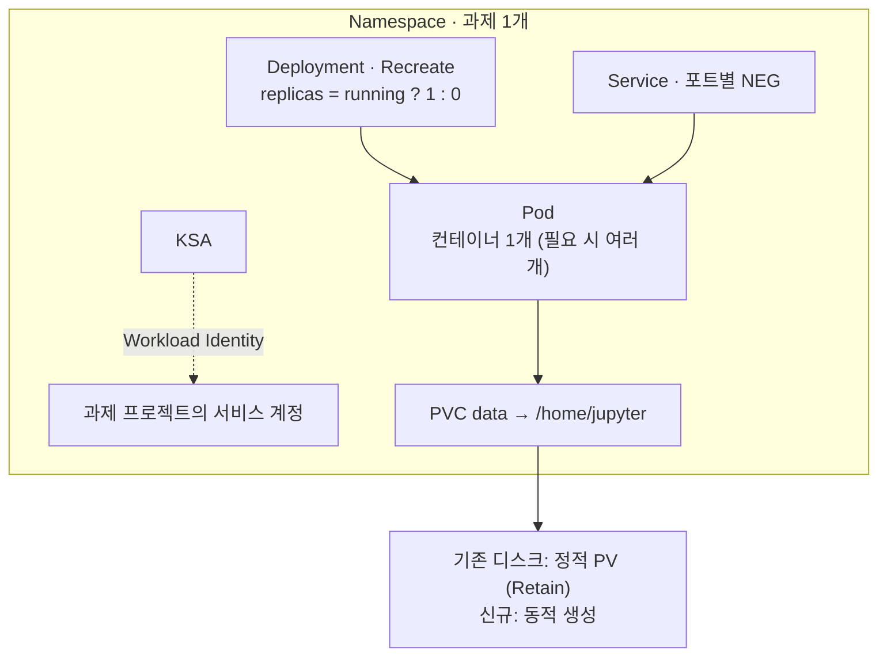

# 과제별 Terraform

코드는 한 벌이고, **모든 단계가 Infrastructure Manager 배포**로 실행됩니다. 배포는 과제 × 단계마다 하나이고 **State 는 그 배포 안에** 있습니다. VM 이나 Runner 에서 `terraform apply` 하지 않습니다.

| 단계 | 만드는 것 | 배포 이름 | 실행 조건 |
|---|---|---|---|
| `05-group` | Cloud Identity 그룹 · 구성원 | `sbxtest01-<과제>-<해시>-group` | `identity.manage_group` |
| `10-project` | 프로젝트 · API · 자동화 IAM | `…-project` | `project.manage` |
| `30-project-iam` | 그룹의 프로젝트 권한 | `…-project-iam` | `project.manage` |
| `40-data` | BigQuery · GCS · 서비스 계정 · 데이터 권한 | `…-data` | `data.manage` |
| `50-workload` | Namespace · KSA · Workload Identity · PV/PVC · Pod · Service | `…-workload` | 항상 |

`<해시>` 는 과제 프로젝트 ID 의 SHA-256 앞 8자리입니다. 기존 VM 과제(`origin: MIGRATED`)는 `-workload` 배포 하나만 생깁니다.

**State 확인**

```bash
gcloud infra-manager deployments list --project=gcp-sbx-gke01 --location=asia-northeast3 \
  --filter="labels.task=<과제>" --format="table(name.basename(),state,latestRevision.basename())"
gcloud infra-manager deployments export-statefile \
  projects/gcp-sbx-gke01/locations/asia-northeast3/deployments/<배포 이름>
```

**Infrastructure Manager 에 맞춘 점**

| 항목 | 방법 |
|---|---|
| Terraform 버전 | 1.5.7 (`TF_VERSION_CONSTRAINT`). 모든 단계 `required_version >= 1.5.7` |
| backend | 넣지 않음. State 는 Infrastructure Manager 가 보관 |
| GKE 접속 (`50-workload`) | kubeconfig 없이 배포 계정의 접근 토큰 + DNS 엔드포인트 (`gke_endpoint_mode = internal` 이면 사설 IP + 클러스터 CA) |
| Kubernetes provider | 실행 시 Terraform 레지스트리에서 받음 → Private Pool 의 송신 허용 필요 |
| 삭제 방지 | 코드의 `prevent_destroy`. 지우거나 교체하는 계획이면 그 배포가 실패하고 아무것도 바뀌지 않음 |
| OAuth Secret | `oauth` 모드에서만 Terraform 이 Secret Manager 값을 읽어 생성. 값이 State 에 남음 |

**삭제 방지 대상**

| 단계 | 자원 |
|---|---|
| 05 · 10 | 그룹 · 프로젝트 |
| 50 | Namespace · KSA · Workload Identity 바인딩 · PV · PVC · Service |

## 50-workload



| 요청 값 | Terraform 에서 바뀌는 것 |
|---|---|
| `running` | `replicas` 1 ↔ 0. 디스크 · 경로는 유지 |
| `cpu` · `memory_gib` | Pod 자원. Pod 재시작 |
| `storage.size_gb` (증가만) | PVC 크기 |
| `containers[].image` | 이미지 교체. Pod 재시작 |
| `containers[]` 추가 | 같은 Pod 에 컨테이너 · 포트 추가 |

**지워지지 않게 한 것** · 위 자원은 `prevent_destroy`, PV 는 `Retain` 입니다. 디스크는 PV 가 지워져도 남습니다.

**Hub 설정** · `hub_config: MANAGED` 면 [`templates/jupyterhub_config.py.tftpl`](deployments/50-workload/templates/jupyterhub_config.py.tftpl) 을 이미지의 설정 파일 위에 덮어 마운트합니다. VM 의 설정과 다른 점은 세 가지입니다 — 접속 주소가 ALB 주소, OAuth 값은 파일에서 읽음, 내부 포트가 컨테이너마다 다름. **이 템플릿은 참고본이므로 실제 이미지 안의 파일과 비교한 뒤 사용합니다.** `IMAGE` 면 이미지 안의 설정을 그대로 씁니다.
