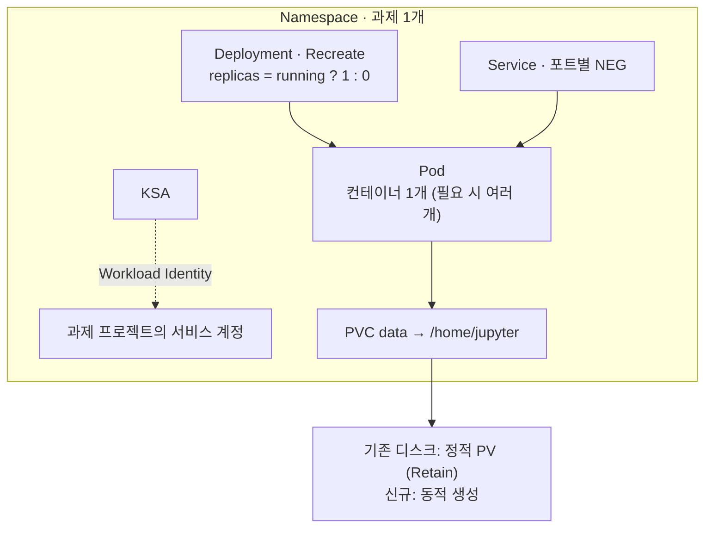

# 과제별 Terraform

코드는 한 벌이고 State 는 **과제 × 단계**마다 따로 있습니다. VM 에서 직접 `terraform apply` 하지 않습니다.

| 단계 | 만드는 것 | 실행 | State | 실행 조건 |
|---|---|---|---|---|
| `05-group` | Cloud Identity 그룹 · 구성원 | Infrastructure Manager | Deployment `<prefix>-<과제>-<hash>-group` | `identity.manage_group` |
| `10-project` | 프로젝트 · API · 자동화 IAM | 〃 | `…-project` | `project.manage` |
| `30-project-iam` | 그룹의 프로젝트 권한 | 〃 | `…-project-iam` | `project.manage` |
| `40-data` | BigQuery · GCS · 서비스 계정 · 데이터 권한 | 〃 | `…-data` | `data.manage` |
| `50-workload` | Namespace · KSA · Workload Identity · PV/PVC · Pod · Service | Runner (Terraform CLI) | `gs://<TF_STATE_BUCKET>/tasks/<과제>/50-workload` | 항상 |

기존 VM 과제(`origin: MIGRATED`)는 그룹 · 프로젝트 · 데이터가 이미 있으므로 **`50-workload` 만** 실행합니다.

## 50-workload

| 요청 값 | Terraform 에서 바뀌는 것 |
|---|---|
| `running` | `replicas` 1 ↔ 0. 디스크 · 경로는 유지 |
| `cpu` · `memory_gib` | Pod 자원. Pod 재시작 |
| `storage.size_gb` (증가만) | PVC 크기 |
| `containers[].image` | 이미지 교체. Pod 재시작 |
| `containers[]` 추가 | 같은 Pod 에 컨테이너 · 포트 추가 |

**지워지지 않게 한 것** · PV 와 PVC 는 `prevent_destroy`, PV 는 `Retain` 입니다. Runner 도 적용 전에 삭제 계획을 막습니다.

**Hub 설정** · `hub_config: MANAGED` 면 [`templates/jupyterhub_config.py.tftpl`](deployments/50-workload/templates/jupyterhub_config.py.tftpl) 을 이미지의 설정 파일 위에 덮어 마운트합니다. VM 의 설정과 다른 점은 세 가지입니다 — 접속 주소가 ALB 주소, OAuth 값은 파일에서 읽음, 내부 포트가 컨테이너마다 다름. **이 템플릿은 참고본이므로 실제 이미지 안의 파일과 비교한 뒤 사용합니다.** `IMAGE` 면 이미지 안의 설정을 그대로 씁니다.
