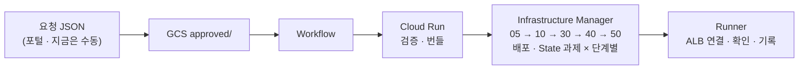

# 03 · 2차 과제 자동화

[1차 인프라 구축](../02.infra-setup/infra-setup-commend.md)을 마친 뒤 진행합니다. 과제 하나의 생성 · 변경 · 중지 · 이전이 모두 **요청 JSON 한 개**로 실행됩니다.



| 폴더 | 내용 |
|---|---|
| [03.1.request](03.1.request/README.md) | 요청 형식, 접수 API |
| [03.2.terraform](03.2.terraform/README.md) | 과제별 Terraform 5단계 · State 위치 |
| [03.3.gke](03.3.gke/README.md) | Runner (ALB 연결) |

**수행 위치** · 관리 VM 의 Test03 저장소 루트

---

## 로그인 방식 (테스트 / 실연동)

`03.1.request/provisioner-env.yaml` 의 `HUB_AUTH_MODE` 한 줄로 바꿉니다. 바꾼 뒤에는 릴리스를 다시 게시합니다(1번).

| 값 | 로그인 | Secret Manager | 로그인 서버 콜백 등록 |
|---|---|---|---|
| `dummy` (현재) | 이름만 입력하면 접속. **테스트 전용** | 불필요 | 불필요 |
| `oauth` | 로그인 서버(Okta 등) 연동 | `jupyter-oauth-client-id` · `-secret` 필요 | 과제별 주소 등록 |

`dummy` 는 내부 ALB 에 닿는 누구나 아무 이름으로 들어올 수 있습니다. 실제 과제 데이터를 붙인 상태에서는 쓰지 않습니다.

## 0. 시작 전 확인

| 확인 | 어디서 | 상태 |
|---|---|---|
| 1차 인프라 3-34 · 4-1 ~ 4-4 완료 | [1차 명령서](../02.infra-setup/infra-setup-commend.md) | 4-1-2 레지스트리 `200` · 4-2-0 `kubectl get ns` 성공 |
| 테스트용 Jupyter 이미지가 edge AR 에 있음 | `gcp-prod-edp-edge-509423/ar-sbxtest01-platform` | 2-1 에서 digest 확인 |
| 결제 계정 | 1차 1-9 | `019BE7-53DD39-AF5098` (예시 파일에 이미 입력) |

### 0-1. 저장소 준비 (git 저장소인지 확인)

1번은 `git` 으로 커밋 번호를 읽으므로 `~/GCP_SBX_Test03` 이 **git 으로 받은 저장소**여야 합니다. `fatal: not a git repository` 가 나오면 이 블록을 실행합니다.

```bash
# 실행 위치: infra-son01 | 대상: 로컬 저장소 ~/GCP_SBX_Test03 | 실행 계정: VM 로그인 사용자
cd ~
if git -C ~/GCP_SBX_Test03 rev-parse --is-inside-work-tree >/dev/null 2>&1; then
  git -C ~/GCP_SBX_Test03 pull -q origin main && echo "git 저장소 OK · 최신으로 갱신"
else
  [ -d ~/GCP_SBX_Test03 ] && mv ~/GCP_SBX_Test03 ~/GCP_SBX_Test03.bak-$(date +%Y%m%d%H%M) && echo "기존 폴더는 .bak 으로 보관"
  git clone -q https://github.com/sonmap/GCP_SBX_Test03.git ~/GCP_SBX_Test03 && echo "새로 clone 완료"
fi
cd ~/GCP_SBX_Test03 && git log --oneline -1 && ls 03.sandbox_deploy/03.3.gke/cloudbuild/platform-release.yaml
```

마지막 줄에 커밋 한 줄과 `platform-release.yaml` 경로가 나오면 준비 완료입니다. 이후 블록은 모두 `cd ~/GCP_SBX_Test03` 으로 시작합니다.

아래 블록은 모두 **infra-son01 의 `~/GCP_SBX_Test03`** 에서 순서대로 실행합니다. 블록마다 필요한 변수를 다시 선언하므로 앞 블록을 다시 실행할 필요가 없습니다.

## 1. 릴리스 게시 (처음 한 번 · 코드가 바뀔 때마다)

Runner 이미지, Provisioner 이미지, Terraform ZIP 을 같은 `RELEASE_ID` 로 게시하고 Cloud Run Provisioner 를 새 이미지로 바꿉니다. **커밋되지 않은 변경은 반영되지 않으므로** 먼저 `git pull` 로 `main` 과 맞춥니다.

```bash
# 실행 위치: infra-son01 · ~/GCP_SBX_Test03 | 대상: gcp-sbx-gke01 | 실행 계정: user01@sonmap.net | 가장: tf-manager
cd ~/GCP_SBX_Test03
git pull -q origin main
export SBX_GKE_PROJECT="gcp-sbx-gke01"
export REGION="asia-northeast3"
export ADMIN_ACCOUNT="user01@sonmap.net"
export TF_MANAGER="tf-manager@gcp-sbx-gke01.iam.gserviceaccount.com"
export BUILD_STAGING_BUCKET="gcp-sbx-gke01-sbxtest01-build-source"
export COMMIT_SHA="$(git rev-parse HEAD)"
export RELEASE_ID="git-$(git rev-parse --short=12 HEAD)"
git status --porcelain   # 아무것도 안 나와야 함
echo "RELEASE_ID=${RELEASE_ID}"
gcloud builds submit . --project="${SBX_GKE_PROJECT}" --region="${REGION}" \
  --account="${ADMIN_ACCOUNT}" --impersonate-service-account="${TF_MANAGER}" \
  --service-account="projects/${SBX_GKE_PROJECT}/serviceAccounts/${TF_MANAGER}" \
  --gcs-source-staging-dir="gs://${BUILD_STAGING_BUCKET}/source" \
  --config=03.sandbox_deploy/03.3.gke/cloudbuild/platform-release.yaml \
  --substitutions="_RELEASE_ID=${RELEASE_ID},_COMMIT_SHA=${COMMIT_SHA}"
```

빌드 마지막에 `PLATFORM RELEASE READY` 가 나오면 성공입니다. 결과 파일을 확인합니다.

```bash
# 실행 위치: infra-son01 · ~/GCP_SBX_Test03 | 대상: gcp-sbx-gke01 | 실행 계정: user01@sonmap.net
cd ~/GCP_SBX_Test03
export ADMIN_ACCOUNT="user01@sonmap.net"
export BUNDLE_BUCKET="gcp-sbx-gke01-sbxtest01-bundles"
export RELEASE_ID="git-$(git rev-parse --short=12 HEAD)"
gcloud storage cat "gs://${BUNDLE_BUCKET}/platform-releases/${RELEASE_ID}/release.json" --account="${ADMIN_ACCOUNT}"
```

출력의 `release_id` · `archive_uri` · `generation` · `sha256` 을 2-2 에서 요청 JSON 의 `source` 에 넣습니다.

## 2. 요청 JSON 작성

### 테스트 과제 3개

한 주소(`sbx.sonmap.net`) 아래에 영역별로 과제 하나씩 배치합니다. **task01 하나로 먼저 끝까지 확인**한 뒤 나머지를 합니다.

| 영역 | 과제 | 접속 주소 | Namespace | 요청 파일 |
|---|---|---|---|---|
| general | task01 | `https://sbx.sonmap.net/general/task01/` | `sbx-general-task01` | `test-task01-general.json` |
| sa | task11 | `https://sbx.sonmap.net/sa/task11/` | `sbx-sa-task11` | `test-task11-sa.json` |
| com | task21 | `https://sbx.sonmap.net/com/task21/` | `sbx-com-task21` | `test-task21-com.json` |

과제 이름은 Namespace · 서비스 계정 · 버킷 이름에 들어가므로 **영문 소문자 · 숫자 · `-`** 만 씁니다.

### 2-0. 테스트 Jupyter 이미지 만들기 (기존 과제 이미지가 없을 때)

edge AR 에는 자동화 도구 이미지(`sbxtest01-automation-runner` · `run-sbxtest01-provisioner`)만 있고 **과제 Pod 용 Jupyter 이미지가 없습니다.** 테스트용 이미지 `sbxtest01-jupyter-test` 를 만듭니다. 내용은 [03.4.test-image/Dockerfile](03.4.test-image/Dockerfile) 과 같습니다 (JupyterHub 5 · JupyterLab · sudospawner · sudo · `jupyterhub` 그룹).

빌드는 **Cloud Build 기본 풀**(인터넷 가능)에서 하므로 infra-son01 이 인터넷에 닿지 않아도, 저장소가 최신이 아니어도 됩니다.

```bash
# 실행 위치: infra-son01 | 대상: gcp-sbx-gke01 (Cloud Build) · gcp-prod-edp-edge-509423 (AR) | 실행 계정: user01@sonmap.net | 가장: tf-manager
export SBX_GKE_PROJECT="gcp-sbx-gke01"
export REGION="asia-northeast3"
export ADMIN_ACCOUNT="user01@sonmap.net"
export TF_MANAGER="tf-manager@gcp-sbx-gke01.iam.gserviceaccount.com"
export AR_REPO="asia-northeast3-docker.pkg.dev/gcp-prod-edp-edge-509423/ar-sbxtest01-platform"
cat > /tmp/build-jupyter-test.yaml <<YAML
steps:
- name: gcr.io/cloud-builders/docker
  entrypoint: bash
  args:
  - -ceu
  - |
    cat > Dockerfile <<'DOCKERFILE'
    FROM quay.io/jupyterhub/jupyterhub:5.2.1
    RUN apt-get update && apt-get install -y --no-install-recommends sudo && rm -rf /var/lib/apt/lists/* && PIP_BREAK_SYSTEM_PACKAGES=1 python3 -m pip install --no-cache-dir jupyterlab==4.2.5 sudospawner==0.5.2 && groupadd --force jupyterhub && mkdir -p /etc/jupyterhub /home/jupyter
    CMD ["jupyterhub", "-f", "/etc/jupyterhub/jupyterhub_config.py"]
    DOCKERFILE
    docker build -t ${AR_REPO}/sbxtest01-jupyter-test:v1 .
    docker push ${AR_REPO}/sbxtest01-jupyter-test:v1
options:
  logging: CLOUD_LOGGING_ONLY
YAML
gcloud builds submit --no-source --config=/tmp/build-jupyter-test.yaml \
  --project="${SBX_GKE_PROJECT}" --region="${REGION}" \
  --account="${ADMIN_ACCOUNT}" --impersonate-service-account="${TF_MANAGER}" \
  --service-account="projects/${SBX_GKE_PROJECT}/serviceAccounts/${TF_MANAGER}"
```

`STATUS SUCCESS` 이면 2-1 에서 `JUPYTER_IMAGE="sbxtest01-jupyter-test:v1"` 로 digest 를 확인합니다.

### 2-1. Jupyter 이미지 digest 확인

요청에는 태그가 아니라 digest 를 적습니다. `JUPYTER_IMAGE` 를 edge AR 에 올린 이미지 이름:태그로 바꿉니다.

```bash
# 실행 위치: infra-son01 · ~/GCP_SBX_Test03 | 대상: gcp-sbx-gke01 | 실행 계정: user01@sonmap.net | 가장: tf-manager
export ADMIN_ACCOUNT="user01@sonmap.net"
export TF_MANAGER="tf-manager@gcp-sbx-gke01.iam.gserviceaccount.com"
export AR_REPO="asia-northeast3-docker.pkg.dev/gcp-prod-edp-edge-509423/ar-sbxtest01-platform"
export JUPYTER_IMAGE="sbxtest01-jupyter-test:v1"   # 2-0 에서 만든 테스트 이미지 (기존 과제 이미지면 그 이름:태그)
gcloud artifacts docker images list "${AR_REPO}" --include-tags \
  --account="${ADMIN_ACCOUNT}" --impersonate-service-account="${TF_MANAGER}" \
  --format="table(package.basename(),tags,version)"
gcloud artifacts docker images describe "${AR_REPO}/${JUPYTER_IMAGE}" \
  --account="${ADMIN_ACCOUNT}" --impersonate-service-account="${TF_MANAGER}" \
  --format='value(image_summary.digest)'
```

### 2-2. 요청 파일 만들기 (task01)

예시를 `.local/` 로 복사하고 이미지 · `source` 를 채웁니다. `.local/` 은 git 에 올라가지 않습니다.

```bash
# 실행 위치: infra-son01 · ~/GCP_SBX_Test03 | 대상: gcp-sbx-gke01 | 실행 계정: user01@sonmap.net
cd ~/GCP_SBX_Test03
export BUNDLE_BUCKET="gcp-sbx-gke01-sbxtest01-bundles"
export ADMIN_ACCOUNT="user01@sonmap.net"
export RELEASE_ID="git-$(git rev-parse --short=12 HEAD)"
export REQUEST_ID="REQ-TEST-TASK01-002"   # 게시할 때마다 번호를 올림. 001 은 첫 시도(이미지 오류)에 사용됨
export EXAMPLE="test-task01-general.json"
export TF_MANAGER="tf-manager@gcp-sbx-gke01.iam.gserviceaccount.com"
export AR_REPO="asia-northeast3-docker.pkg.dev/gcp-prod-edp-edge-509423/ar-sbxtest01-platform"
export JUPYTER_IMAGE_NAME="sbxtest01-jupyter-test"   # 2-0 테스트 이미지 (기존 과제 이미지면 그 이름)
export JUPYTER_IMAGE_TAG="v1"
# digest 를 자동으로 조회합니다. 비어 있으면 2-0 빌드가 안 된 것이므로 중단합니다.
export JUPYTER_DIGEST="$(gcloud artifacts docker images describe "${AR_REPO}/${JUPYTER_IMAGE_NAME}:${JUPYTER_IMAGE_TAG}" \
  --account="${ADMIN_ACCOUNT}" --impersonate-service-account="${TF_MANAGER}" --format='value(image_summary.digest)')"
echo "JUPYTER_DIGEST=${JUPYTER_DIGEST}"
[[ "${JUPYTER_DIGEST}" =~ ^sha256:[0-9a-f]{64}$ ]] || { echo "digest 없음 → 2-0 을 먼저 실행"; return 1 2>/dev/null || exit 1; }
export JUPYTER_IMAGE_REF="${AR_REPO}/${JUPYTER_IMAGE_NAME}@${JUPYTER_DIGEST}"
mkdir -p .local
gcloud storage cat "gs://${BUNDLE_BUCKET}/platform-releases/${RELEASE_ID}/release.json" \
  --account="${ADMIN_ACCOUNT}" > .local/release.json
python3 - "03.sandbox_deploy/03.1.request/examples/${EXAMPLE}" .local/release.json \
  "${REQUEST_ID}" "${JUPYTER_IMAGE_REF}" ".local/${REQUEST_ID}.json" <<'PY'
import json, sys
src, rel, req_id, image, out = sys.argv[1:]
request = json.load(open(src))
release = json.load(open(rel))
request["request_id"] = req_id
request["workload"]["containers"][0]["image"] = image
request["source"] = {k: release[k] for k in ("release_id", "archive_uri", "generation", "sha256")}
json.dump(request, open(out, "w"), indent=2, ensure_ascii=False)
print("written", out)
PY
grep -n '"image"\|"release_id"\|"billing_account"\|"request_id"' ".local/${REQUEST_ID}.json"
```

`project.project_id` (`gcp-sbx-edp-task01` 등)는 전 세계에서 하나뿐이어야 합니다. 3번에서 `already exists` 로 실패하면 예시 파일의 프로젝트 ID 를 바꿉니다.

## 3. 게시와 실행

```bash
# 실행 위치: infra-son01 · ~/GCP_SBX_Test03 | 대상: gcp-sbx-gke01 | 실행 계정: user01@sonmap.net
cd ~/GCP_SBX_Test03
export SBX_GKE_PROJECT="gcp-sbx-gke01"
export REGION="asia-northeast3"
export ADMIN_ACCOUNT="user01@sonmap.net"
export TF_MANAGER="tf-manager@gcp-sbx-gke01.iam.gserviceaccount.com"
export REQUEST_BUCKET="gcp-sbx-gke01-sbxtest01-requests"
export REQUEST_ID="REQ-TEST-TASK01-002"   # 2-2 와 같은 값
export REQUEST_URI="gs://${REQUEST_BUCKET}/approved/${REQUEST_ID}/request.json"
gcloud storage cp --if-generation-match=0 ".local/${REQUEST_ID}.json" "${REQUEST_URI}" --account="${ADMIN_ACCOUNT}"
export GENERATION="$(gcloud storage objects describe "${REQUEST_URI}" --account="${ADMIN_ACCOUNT}" --format='value(generation)')"
export SHA256="$(sha256sum ".local/${REQUEST_ID}.json" | cut -d' ' -f1)"
gcloud workflows run workflow-sbxtest01-provision \
  --project="${SBX_GKE_PROJECT}" --location="${REGION}" --account="${ADMIN_ACCOUNT}" \
  --data="{\"request_id\":\"${REQUEST_ID}\",\"approved_json_uri\":\"${REQUEST_URI}\",\"generation\":${GENERATION},\"sha256\":\"${SHA256}\"}"
```

| 결과 | 의미 |
|---|---|
| `state: SUCCEEDED` | **접수** 완료. 실제 작업은 4번의 Cloud Build 에서 진행 |
| `412` · `Precondition` | 같은 `request_id` 가 이미 게시됨 → 2-2 에서 `REQUEST_ID` 번호를 올려 다시 |
| `FAILED` + `request schema validation failed` | 요청 값 오류 → 메시지의 항목을 고쳐 2-2 를 **번호를 올려** 다시 (예: `image` 에 `<…>` 가 남음 = digest 미입력) |

## 4. 결과 확인

```bash
# 실행 위치: infra-son01 · ~/GCP_SBX_Test03 | 대상: gcp-sbx-gke01 | 실행 계정: user01@sonmap.net
export SBX_GKE_PROJECT="gcp-sbx-gke01"
export REGION="asia-northeast3"
export ADMIN_ACCOUNT="user01@sonmap.net"
export TF_MANAGER="tf-manager@gcp-sbx-gke01.iam.gserviceaccount.com"
export TASK_NAME="task01"
# ① 빌드 목록 (최근 5개)
gcloud builds list --project="${SBX_GKE_PROJECT}" --region="${REGION}" \
  --account="${ADMIN_ACCOUNT}" --limit=5 --format='table(id,status,createTime)'
# ② 이 과제의 Infrastructure Manager 배포 (단계마다 1개)
gcloud infra-manager deployments list --project="${SBX_GKE_PROJECT}" --location="${REGION}" \
  --filter="labels.task=${TASK_NAME}" --format="table(name.basename(),state,labels.stage)" \
  --account="${ADMIN_ACCOUNT}"
```

```bash
# 실행 위치: infra-son01 · ~/GCP_SBX_Test03 | 대상: gcp-sbx-gke01 | 실행 계정: user01@sonmap.net
export SBX_GKE_PROJECT="gcp-sbx-gke01"
export REGION="asia-northeast3"
export ADMIN_ACCOUNT="user01@sonmap.net"
export TF_MANAGER="tf-manager@gcp-sbx-gke01.iam.gserviceaccount.com"
export BUILD_ID="<① 의 가장 최근 ID>"
gcloud builds log "${BUILD_ID}" --project="${SBX_GKE_PROJECT}" --region="${REGION}" \
  --account="${ADMIN_ACCOUNT}" 2>&1 | tail -50
```

마지막 줄이 `[OK] Sandbox task01 reconcile complete` 이면 끝입니다. 접속 주소는 `https://sbx.sonmap.net/general/task01/` 입니다. 실패하면 로그 마지막 50줄을 그대로 보내 주세요.

---

## 운영 — 중지 · 기동 · 증설 · 이미지 교체

직전 요청을 복사해 `action` 을 `UPDATE` 로, `request_id` 를 새 값으로 바꾸고 원하는 값만 고쳐 2~4번을 반복합니다.

| 작업 | 수정 | 결과 |
|---|---|---|
| 중지 | `running: false` | Pod 종료. 디스크 · 주소 유지 |
| 기동 | `running: true` | 같은 디스크로 Pod 시작 |
| CPU · 메모리 | `cpu`, `memory_gib` | Pod 재시작 |
| 디스크 | `storage.size_gb` (증가만) | PVC 확장 |
| 이미지 | `containers[].image` | Pod 재시작 |

막히는 변경: 프로젝트 · Namespace · 영역 · 디스크 이름 변경, 디스크 축소, 보호 자원 삭제.

## 미검증 항목

코드는 로컬 테스트만 통과했습니다. `terraform validate` 와 실제 배포는 하지 않았습니다. 과제 1개로 먼저 확인합니다.

| # | 확인할 것 | 틀리면 |
|---|---|---|
| 1 | 기존 과제 이미지가 Autopilot 에서 기동하는지 (privileged 불가) | 이미지 수정 필요 |
| 2 | 이미지 안 Hub 설정 파일 경로가 `/etc/jupyterhub/jupyterhub_config.py` 인지 | `hub_config_mount_path` 변경 |
| 3 | Hub 설정 템플릿이 실제 설정과 같은 동작을 하는지 | 템플릿 수정 또는 `hub_config: IMAGE` |
| 4 | Pod 재시작 뒤 계정 UID 가 홈 디렉터리 소유자와 맞는지 | 템플릿의 `useradd -u` 부분 확인 |
| 5 | 정적 PV 가 `sbx-static-pd` StorageClass 로 확장되는지 | 디스크 증설 절차를 수동으로 |
| 6 | `url-maps export → import` 가 fingerprint 충돌을 정확히 알려 주는지 | 재시도 조건 수정 |
| 7 | `cpu:memory = 1:8` 이 지정한 컴퓨트 클래스에서 그대로 배정되는지 | 클래스 또는 비율 변경 |
| 8 | Infrastructure Manager(Private Pool)가 GKE DNS 엔드포인트와 Terraform 레지스트리에 닿는지 | 네트워크 송신 허용 요청 |
| 10 | `gcloud infra-manager deployments apply` 의 `--tf-version-constraint` · `--labels` 가 현재 gcloud 에서 받아들여지는지 | 플래그 조정 |
| 9 | Pod 가 0 일 때도 NEG 가 생성되는지 | 중지 상태 이전(`--stopped`) 시 순서 조정 |
