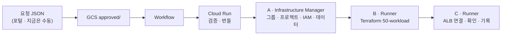

# 03 · 2차 과제 자동화

[1차 인프라 구축](../02.infra-setup/infra-setup-commend.md)을 마친 뒤 진행합니다. 과제 하나의 생성 · 변경 · 중지 · 이전이 모두 **요청 JSON 한 개**로 실행됩니다.



| 폴더 | 내용 |
|---|---|
| [03.1.request](03.1.request/README.md) | 요청 형식, 접수 API |
| [03.2.terraform](03.2.terraform/README.md) | 과제별 Terraform 5단계 |
| [03.3.gke](03.3.gke/README.md) | Runner (Terraform 실행, ALB 연결) |

**수행 위치** · 관리 VM 의 Test03 저장소 루트

---

## 로그인 방식 (테스트 / 실연동)

`03.1.request/provisioner-env.yaml` 의 `HUB_AUTH_MODE` 한 줄로 바꿉니다. 바꾼 뒤에는 릴리스를 다시 게시합니다(1번).

| 값 | 로그인 | Secret Manager | 로그인 서버 콜백 등록 |
|---|---|---|---|
| `dummy` (현재) | 이름만 입력하면 접속. **테스트 전용** | 불필요 | 불필요 |
| `oauth` | 로그인 서버(Okta 등) 연동 | `jupyter-oauth-client-id` · `-secret` 필요 | 과제별 주소 등록 |

`dummy` 는 내부 ALB 에 닿는 누구나 아무 이름으로 들어올 수 있습니다. 실제 과제 데이터를 붙인 상태에서는 쓰지 않습니다.

## 0. 변수

```bash
export SBX_GKE_PROJECT="gcp-sbx-gke01"
export ADMIN_ACCOUNT="son@sonmap.net"
export REGION="asia-northeast3"
export TF_MANAGER="tf-manager@${SBX_GKE_PROJECT}.iam.gserviceaccount.com"
export TF_MANAGER_RESOURCE="projects/${SBX_GKE_PROJECT}/serviceAccounts/${TF_MANAGER}"
export REQUEST_BUCKET="${SBX_GKE_PROJECT}-sbxtest01-requests"
export BUNDLE_BUCKET="${SBX_GKE_PROJECT}-sbxtest01-bundles"
export BUILD_STAGING_BUCKET="${SBX_GKE_PROJECT}-sbxtest01-build-source"
```

## 1. 릴리스 게시 (코드가 바뀔 때만)

Runner 이미지(Terraform `50-workload` 포함), Provisioner 이미지, Terraform ZIP 을 같은 `RELEASE_ID` 로 게시합니다. 커밋하지 않은 변경은 반영되지 않습니다.

```bash
export COMMIT_SHA="$(git rev-parse HEAD)"
export RELEASE_ID="git-$(git rev-parse --short=12 HEAD)"
git status --porcelain

gcloud builds submit . --project="$SBX_GKE_PROJECT" --region="$REGION" \
  --account="$ADMIN_ACCOUNT" --impersonate-service-account="$TF_MANAGER" \
  --service-account="$TF_MANAGER_RESOURCE" \
  --gcs-source-staging-dir="gs://${BUILD_STAGING_BUCKET}/source" \
  --config=03.sandbox_deploy/03.3.gke/cloudbuild/platform-release.yaml \
  --substitutions="_RELEASE_ID=${RELEASE_ID},_COMMIT_SHA=${COMMIT_SHA}"

gcloud storage cat "gs://${BUNDLE_BUCKET}/platform-releases/${RELEASE_ID}/release.json" \
  --account="$ADMIN_ACCOUNT"
```

출력의 `release_id` · `archive_uri` · `generation` · `sha256` 을 요청 JSON 의 `source` 에 넣습니다.

## 2. 요청 JSON 작성

[examples](03.1.request/examples/) 에서 복사해 값을 채웁니다. 형식은 [요청 형식](03.1.request/README.md)을 봅니다.

```bash
export REQUEST_ID="REQ-RSCH-20261126-01"
mkdir -p .local
cp 03.sandbox_deploy/03.1.request/examples/migrated-task.json ".local/${REQUEST_ID}.json"
# request_id, approval, 과제 값, source 를 수정
```

이미지는 태그가 아니라 digest 로 적습니다.

```bash
gcloud artifacts docker images describe "<저장소>/<이미지>:<태그>" \
  --account="$ADMIN_ACCOUNT" --format='value(image_summary.digest)'
```

## 3. 게시와 실행

```bash
REQUEST_URI="gs://${REQUEST_BUCKET}/approved/${REQUEST_ID}/request.json"
gcloud storage cp --if-generation-match=0 ".local/${REQUEST_ID}.json" "$REQUEST_URI" --account="$ADMIN_ACCOUNT"

GENERATION="$(gcloud storage objects describe "$REQUEST_URI" --account="$ADMIN_ACCOUNT" --format='value(generation)')"
SHA256="$(sha256sum ".local/${REQUEST_ID}.json" | cut -d' ' -f1)"

gcloud workflows run workflow-sbxtest01-provision \
  --project="$SBX_GKE_PROJECT" --location="$REGION" --account="$ADMIN_ACCOUNT" \
  --data="{\"request_id\":\"${REQUEST_ID}\",\"approved_json_uri\":\"${REQUEST_URI}\",\"generation\":${GENERATION},\"sha256\":\"${SHA256}\"}"
```

`412` 는 같은 `request_id` 가 이미 게시됐다는 뜻입니다. 내용을 바꿨다면 번호를 올립니다.

## 4. 결과 확인

Workflow 의 `SUCCEEDED` 는 **접수**입니다. 실제 작업은 Cloud Build 에서 진행됩니다.

```bash
gcloud builds list --project="$SBX_GKE_PROJECT" --region="$REGION" \
  --account="$ADMIN_ACCOUNT" --limit=5 --format='table(id,status,createTime)'
```

상위 빌드 로그에 적힌 **하위 빌드 ID** 로 조회해야 Terraform 과 ALB 로그가 보입니다.

```bash
gcloud builds log "<하위 빌드 ID>" --project="$SBX_GKE_PROJECT" --region="$REGION" \
  --account="$ADMIN_ACCOUNT" 2>&1 | tail -50
```

마지막 줄이 `[OK] Sandbox <과제> reconcile complete` 이면 끝입니다. 접속 주소는 `https://<host><base_path>` 입니다.

---

## 운영 — 중지 · 기동 · 증설 · 이미지 교체

직전 요청을 복사해 `action` 을 `UPDATE` 로, `request_id` 를 새 값으로 바꾸고 원하는 값만 고쳐 2~4번을 반복합니다.

| 작업 | 수정 | 결과 |
|---|---|---|
| 중지 | `running: false` | Pod 종료. 디스크 · 주소 유지 |
| 기동 | `running: true` | 같은 디스크로 Pod 시작 |
| CPU · 메모리 | `cpu`, `memory_gib` | Pod 재시작 |
| 디스크 | `storage.size_gb` (증가만) | PVC 확장 |
| 이미지 | `containers[].image` | Pod 재시작 |

막히는 변경: 프로젝트 · Namespace · 영역 · 디스크 이름 변경, 디스크 축소, 보호 자원 삭제.

## 미검증 항목

코드는 로컬 테스트만 통과했습니다. `terraform validate` 와 실제 배포는 하지 않았습니다. 과제 1개로 먼저 확인합니다.

| # | 확인할 것 | 틀리면 |
|---|---|---|
| 1 | 기존 과제 이미지가 Autopilot 에서 기동하는지 (privileged 불가) | 이미지 수정 필요 |
| 2 | 이미지 안 Hub 설정 파일 경로가 `/etc/jupyterhub/jupyterhub_config.py` 인지 | `hub_config_mount_path` 변경 |
| 3 | Hub 설정 템플릿이 실제 설정과 같은 동작을 하는지 | 템플릿 수정 또는 `hub_config: IMAGE` |
| 4 | Pod 재시작 뒤 계정 UID 가 홈 디렉터리 소유자와 맞는지 | 템플릿의 `useradd -u` 부분 확인 |
| 5 | 정적 PV 가 `sbx-static-pd` StorageClass 로 확장되는지 | 디스크 증설 절차를 수동으로 |
| 6 | `url-maps export → import` 가 fingerprint 충돌을 정확히 알려 주는지 | 재시도 조건 수정 |
| 7 | `cpu:memory = 1:8` 이 지정한 컴퓨트 클래스에서 그대로 배정되는지 | 클래스 또는 비율 변경 |
| 8 | Private Pool 에서 Runner 가 GKE 컨트롤 플레인과 State 버킷에 닿는지 | 네트워크 · IAM 보완 |
| 9 | Pod 가 0 일 때도 NEG 가 생성되는지 | 중지 상태 이전(`--stopped`) 시 순서 조정 |
