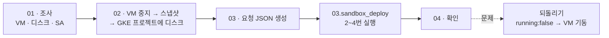

# 05 · 기존 VM 과제 이전

VM 의 **data 디스크를 통째로** GKE 프로젝트로 옮기고, 같은 이미지 · 같은 서비스 계정으로 Pod 를 띄웁니다. 이전도 요청 JSON(`origin: MIGRATED`)으로 실행하므로, 이전 뒤의 중지 · 증설은 신규 과제와 같은 경로를 탑니다.



| 스크립트 | 하는 일 | 변경 |
|---|---|---|
| `01_inventory.sh` | 과제 프로젝트들의 VM · data 디스크 · 서비스 계정을 CSV 로 | 없음 (조회) |
| `02_snapshot_to_disk.sh` | VM 중지 → 스냅샷 → GKE 프로젝트에 디스크 생성 | VM 중지, 스냅샷 · 디스크 생성 |
| `03_make_request.py` | 과제 요청 JSON 생성 | 없음 |
| `04_verify.sh` | PVC · Pod · Workload Identity · 홈 디렉터리 · 로그인 화면 | 없음 (조회) |

## 과제 1개 이전

```bash
./05.migration/01_inventory.sh projects.txt > inventory.csv

./05.migration/02_snapshot_to_disk.sh rsch gcp-sbx-edp-rsch vm-sbx-rsch-notebook-4 \
  asia-northeast3-a <data 디스크 이름> gcp-sbx-edp-gke01

./05.migration/03_make_request.py --defaults 05.migration/defaults.example.json \
  --task rsch --project gcp-sbx-edp-rsch --area general \
  --gsa sa-sbx-rsch-notebook-1-user@gcp-sbx-edp-rsch.iam.gserviceaccount.com \
  --disk disk-sbx-rsch-data --zone asia-northeast3-a --size-gb 100 \
  --image "<저장소>/<이미지>@sha256:<digest>" > .local/REQ-MIG-RSCH.json
```

이후 [03.sandbox_deploy 2~4번](../03.sandbox_deploy/README.md#3-게시와-실행)을 실행하고 확인합니다.

```bash
./05.migration/04_verify.sh sbx-general-rsch rsch \
  sa-sbx-rsch-notebook-1-user@gcp-sbx-edp-rsch.iam.gserviceaccount.com \
  https://sbx.sonmap.net/general/rsch/
```

## 지켜야 할 것

- **VM 과 원본 디스크는 지우지 않습니다.** 되돌릴 때는 Pod 를 중지(`running: false`)하고 VM 을 켭니다. 그 사이 Pod 에서 쓴 데이터는 VM 에 없습니다.
- **VM 과 Pod 를 동시에 켜지 않습니다.** 디스크가 서로 다른 복사본이라 내용이 갈라집니다.
- 디스크는 **클러스터 프로젝트 · 같은 영역(zone)** 에 있어야 붙습니다.
- VM 이 여러 대이거나 data 디스크가 여러 개인 과제는 `inventory.csv` 에서 먼저 골라내 따로 판단합니다.
- 1개 → 10개 → 묶음 순서로 늘립니다.
