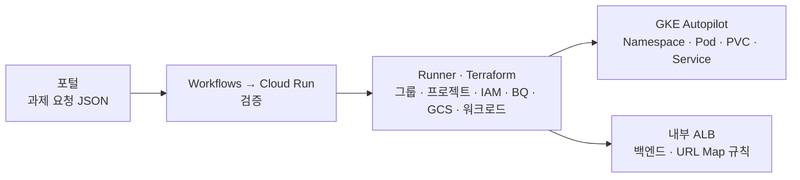

# GCP Sandbox Test03

실작업 전 개인 검증 공간입니다. [Test02](https://github.com/sonmap/https-github.com-sonmap-GCP_SBX_Test02)를 그대로 복사한 뒤(`main` 첫 커밋) **과제당 Pod 1개** 구조로 정리했습니다.

| 순서 | 폴더 | 내용 | 방식 |
|---|---|---|---|
| 1 | [02.infra-setup](02.infra-setup/infra-setup-commend.md) | VPC · GKE · 내부 ALB · AR · 버킷 · 계정 | **수작업** (명령서) |
| 2 | [03.sandbox_deploy](03.sandbox_deploy/README.md) | 과제 생성 · 변경 · 중지 · 증설 | **Terraform 자동화** |
| 3 | [05.migration](05.migration/README.md) | 기존 VM 과제를 Pod 로 이전 | 스크립트 + 같은 Terraform |
| - | [04.tests](04.tests/README.md) | 로컬 검증 | `unittest` |

## 구조

- **과제 1개 = Namespace 1 · Pod 1 · 디스크 1 · 서비스 계정 1.** Pod 안에서 기존 과제 이미지(JupyterHub 포함)를 그대로 실행합니다.
- **요청 JSON 은 과제의 전체 상태입니다.** 신규 · 중지 · 기동 · 증설 · 이미지 교체 · 이전이 모두 같은 형식, 같은 경로입니다.
- **코드는 한 벌, State 는 과제 × 단계별**이고 전부 `gs://gcp-sbx-gke01-sbxtest01-tfstate/tasks/` 아래에 있습니다. 과제가 늘어도 Terraform 코드는 늘지 않습니다.

## Test02 에서 달라진 점

| 구분 | Test02 | Test03 |
|---|---|---|
| 워크로드 | z2jh Helm · 그룹 공유 Hub | 기존 과제 이미지를 그대로 실행하는 Pod |
| Terraform 실행 | Infrastructure Manager + Python 스크립트 | Runner 의 Terraform CLI 한 곳 |
| State | Infrastructure Manager 배포별 · K8s 자원은 없음 | GCS 한 버킷 `tasks/<과제>/<단계>` |
| 요청 | `CREATE` 1회 | 전체 상태 `CREATE` / `UPDATE` |
| 기존 과제 | 대상 아님 | `origin: MIGRATED` — 기존 디스크 · 기존 서비스 계정 사용 |
| 과제별 서브넷 | `20-network` | 삭제 |
| 환경 값 | 스키마 · 코드에 고정 | `provisioner-env.yaml` |

**실환경에서 아직 검증하지 않았습니다.** 검증이 필요한 항목은 [03.sandbox_deploy/README.md](03.sandbox_deploy/README.md#미검증-항목)에 있습니다.
